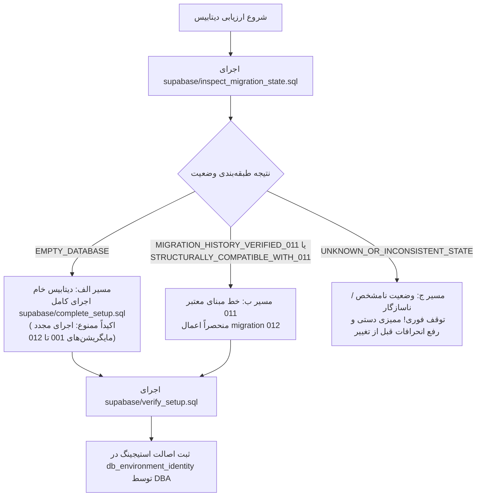

# راهنمای جامع مدیریت و استقرار پایگاه داده سامانه گالری طلایی (DBA Runbook - P2.1)

این راهنما فرآیند تصمیم‌گیری ۳مسیره، استقرار امن پایگاه داده، ممیزی اصالت، و آزمون‌های اعتبارسنجی را برای مدیران ارشد دیتابیس (DBA) تشریح می‌کند.

---

## ۱. درخت تصمیم‌گیری استقرار پایگاه داده (Authoritative Deployment Decision Tree)

پیش از هرگونه اقدام در محیط استیجینگ یا توسعه، DBA باید وضعیت فعلی دیتابیس را ارزیابی کرده و دقیقاً یکی از ۳ مسیر زیر را انتخاب نماید:



### مسیر الف: راه‌اندازی دیتابیس خام (Fresh Database Setup)
- **شرط ورود:** پایگاه داده کاملاً خالی است (`EMPTY_DATABASE`).
- **اقدام مجاز:** اجرای مستقیم و یکپارچه اسکریپت کانونیکال `supabase/complete_setup.sql`.
- **ممنوعیت‌های بحرانی:**
  - **هرگز** پس از اجرای `complete_setup.sql`، اسکریپت‌های مهاجرت `001` تا `012` را اجرا نکنید (زیرا ساختار کانونیکال پیشاپیش مستقر شده و تلاش مجدد باعث خطا یا رفتارهای ناخواسته می‌شود).
  - **هرگز** تاریخچه مهاجرت ساختگی یا رکوردهای دستی در جدول `supabase_migrations` جعل نکنید. دفترکل دیتابیس خام باید اصیل بماند یا از ابزار رسمی کلاینت Supabase CLI برای ثبت وضعیت استفاده شود.
- **تاییدیه نهایی:** اجرای `supabase/verify_setup.sql`.

### مسیر ب: ارتقای دیتابیس دارای خط مبنای ۰۱۱ (Upgrade from 011 Baseline)
- **شرط ورود:** دیتابیس از طریق `inspect_migration_state.sql` به عنوان `MIGRATION_HISTORY_VERIFIED_011` یا `STRUCTURALLY_COMPATIBLE_WITH_011` طبقه‌بندی شده است.
- **اقدام مجاز:** **منحصراً** اجرای اسکریپت مهاجرت فاز P2.1:
  `supabase/migrations/012_p2_1_plan_security_and_confirmation.sql`
- **ممنوعیت بحرانی:** از اجرای `complete_setup.sql` روی دیتابیس دارای داده‌های پیشین خودداری کنید، مگر آنکه فرآیند بازنشانی کامل و بک‌آپ قبلاً اخذ شده باشد.
- **تاییدیه نهایی:** اجرای `supabase/verify_setup.sql` و کسب تاییدیه سازگاری کامل P2.1.

### مسیر ج: وضعیت نامشخص یا ناسازگار (Inconsistent State)
- **شرط ورود:** دیتابیس در وضعیت `UNKNOWN_OR_INCONSISTENT_STATE` قرار دارد.
- **اقدام مجاز:** **توقف فوری (STOP)**. هیچ اسکریپت مهاجرت یا نصبی نباید اجرا شود تا گزارش دقیق خطاهای خروجی `inspect_migration_state.sql` توسط تیم مهندسی بررسی گردد.

---

## ۲. ایجاد اولین حساب مدیر QC (Bootstrap QC Manager)

جهت راه‌اندازی اولیه سامانه، مدیر ارشد دیتابیس به صورت کاملاً ایمن (بدون بازنویسی خاموش رکوردهای موجود) کاربر مدیر QC را ثبت می‌نماید:

```sql
DO $$
DECLARE
  v_admin_uid uuid := 'شناسه_UID_کاربر_در_auth_users'::uuid;
  v_phone text := '0912xxxxxxx';
  v_name text := 'نام و نام خانوادگی مدیر QC';
BEGIN
  -- گارد تصادم و حفاظت از داده‌های پیشین
  IF EXISTS (SELECT 1 FROM public.profiles WHERE id = v_admin_uid) THEN
    RAISE NOTICE 'پروفایل کاربر مدیر QC از قبل موجود است و تغییری در آن اعمال نگردید.';
  ELSE
    IF EXISTS (SELECT 1 FROM public.profiles WHERE phone = v_phone) THEN
      RAISE EXCEPTION 'شماره تلفن اعلام‌شده (%) متعلق به پروفایل دیگری است. اجرا متوقف شد.', v_phone;
    END IF;

    INSERT INTO public.profiles (id, name, phone, role, avatar, active)
    VALUES (v_admin_uid, v_name, v_phone, 'QC_MANAGER', '👔', true);
    RAISE NOTICE 'پروفایل مدیر QC اولیه با موفقیت ثبت شد.';
  END IF;
END;
$$;
```

---

## ۳. ثبت شناسه اصالت محیط استیجینگ توسط DBA (Fail-Closed Provisioning)

آزمون‌های امنیتی و همزمانی فاز P2.1 بدون ثبت صریح هویت استیجینگ در جدول کانونیکال `public.db_environment_identity` اجرا نخواهند شد:

```sql
DO $$
DECLARE
  v_rec record;
  v_expected_cluster text := 'talaie-isolated-staging-cluster-v1';
  v_expected_provisioner text := 'DBA_AUTHORIZATION';
BEGIN
  -- ۱. اعتبارسنجی ساختار جدول و RLS فعال
  IF NOT EXISTS (
    SELECT 1 FROM pg_tables
    WHERE schemaname = 'public' AND tablename = 'db_environment_identity' AND rowsecurity = true
  ) THEN
    RAISE EXCEPTION 'جدول کانونیکال db_environment_identity یا فعال‌سازی RLS آن یافت نشد. ابتدا مسیر الف یا ب را اجرا فرمایید.';
  END IF;

  -- ۲. بررسی سلب امتیاز نوشتن از کلاینت‌های غیرمجاز
  IF EXISTS (
    SELECT 1 FROM information_schema.role_table_grants
    WHERE table_schema = 'public' AND table_name = 'db_environment_identity'
      AND grantee IN ('anon', 'authenticated', 'public')
      AND privilege_type IN ('INSERT', 'UPDATE', 'DELETE')
  ) THEN
    RAISE EXCEPTION 'امنیت نقض شد: نقش‌های کلاینت دارای دسترسی تغییر در db_environment_identity هستند!';
  END IF;

  -- ۳. ممانعت از اجرای تصادفی بر روی اسامی مشکوک به پروداکشن
  IF current_database() ~* '(prod|production|live|primary|talaie_main)' THEN
    RAISE EXCEPTION 'نام پایگاه داده متصل (%) حاوی الگوهای پروداکشن است! انتساب استیجینگ مسدود شد.', current_database();
  END IF;

  -- ۴. ثبت یا تایید هویت استیجینگ (Fail-Closed)
  SELECT environment, cluster_identity, provisioned_by, safety_lock
  INTO v_rec
  FROM public.db_environment_identity
  WHERE environment = 'staging';

  IF FOUND THEN
    IF v_rec.cluster_identity IS DISTINCT FROM v_expected_cluster OR
       v_rec.provisioned_by IS DISTINCT FROM v_expected_provisioner OR
       v_rec.safety_lock IS NOT TRUE THEN
      RAISE EXCEPTION 'هویت استیجینگ موجود با مشخصات DBA مطابقت ندارد. بازنویسی خاموش مسدود شد.';
    ELSE
      RAISE NOTICE 'هویت استیجینگ با موفقیت تایید شد: %', v_rec.cluster_identity;
    END IF;
  ELSE
    INSERT INTO public.db_environment_identity (environment, cluster_identity, provisioned_by, safety_lock)
    VALUES ('staging', v_expected_cluster, v_expected_provisioner, true);
    RAISE NOTICE 'هویت استیجینگ با موفقیت ثبت شد: %', v_expected_cluster;
  END IF;
END;
$$;
```

---

## ۴. یافته معماری تقویم و اعتبارسنجی روزهای کاری (Architectural Limitation Finding)

> [!WARNING]
> **محدودیت معماری اعتبارسنجی تقویم و روزهای کاری در لایه پایگاه داده:**
> - تابع پایگاه داده `public.validate_schedule_capacity` موارد زیر را تضمین می‌کند:
>   1. قفل ردیف انحصاری اکیپ (`FOR UPDATE`).
>   2. اعتبارسنجی سقف ظرفیت روزانه (مجموع ساعات پروژه‌های اکیپ در تاریخ مدنظر $\le$ سقف ظرفیت اکیپ).
>   3. عدم تداخل بازه‌های زمانی ساعت شروع/پایان در یک روز.
> - **موارد خارج از کنترل پایگاه داده:**
>   1. اعتبارسنجی روزهای کاری و تعطیلات (مثلاً جمعه‌ها یا تعطیلات رسمی): این منطق صرفاً در لایه فرانت‌اند و تایپ‌اسکریپت (`src/utils/capacity.ts` با فیلتر `allowedDays`) پیاده‌سازی شده است.
>   2. اعتبارسنجی تاریخ‌های گذشته: کنترل عدم ثبت پروژه در گذشته منحصراً در UI (`OperationsControlCenter.tsx`) انجام می‌پذیرد.
> - **پیامد عملیاتی برای DBA و اسکریپت‌های تست:** اگر یک درخواست مستقیم SQL یا کلاینت متفرقه فراخوانی `patch_project` را با تاریخی در گذشته یا در روز جمعه ارسال کند، تابع دیتابیس صرفاً سقف ساعت و عدم تداخل را می‌سنجد و درخواست را به دلیل تعطیلی یا گذشته بودن ریجکت نمی‌کند. در نقشه راه آینده (فاز P2.2 یا P3)، جدول کانونیکال تقویم کاری شرکتی به پایگاه داده افزوده خواهد شد.

---

## ۵. چک‌لیست آزمون‌های امنیتی و عملکردی پایگاه داده

| # | عنوان آزمون | فایل اجرایی / سناریو | نتیجه مورد انتظار |
|---|---|---|---|
| ۱ | **مجموعه آزمون‌های نفوذ امنیتی (۱۶ آزمون)** | `supabase/tests/p2_1_adversarial_database_tests.sql` | موفقیت ۱۰۰٪ تمام ۱۶ آزمون، صفر خطا، پاکسازی ایمن فیکسچرها |
| ۲ | **آزمون همزمانی دو نشست اصلاحیه طرح** | `supabase/tests/p2_1_concurrency_two_session_test.sql` | توقف نشست دوم در صف قفل، تعهد نشست اول و رد شدن نشست دوم با خطای همزمانی |
| ۳ | **آزمون همزمانی دو نشست سقف ظرفیت P1** | `supabase/tests/p1_capacity_concurrency_two_session_test.sql` | توقف نشست دوم در صف قفل اکیپ، تعهد نشست اول و رد شدن نشست دوم با خطای سقف ظرفیت |
| ۴ | **اعتبارسنجی کامل اشیاء و دسترسی‌ها** | `supabase/verify_setup.sql` | مقدار `ok = true` برای تمامی اشیاء و جداول |

---

## ۶. رویه پاکسازی ایمن و اختصاصی فیکسچرها در صورت وقوع اجراهای متوقف‌شده (Interrupted-Run Cleanup)

> [!CAUTION]
> **ممنوعیت استفاده از شروط کلی و بدون احراز مالکیت یکتا:**
> استفاده از الگوهای جستجوی کلی نظیر `LIKE '%تست امنیتی%'` یا `LIKE 'TEAM_%'` یا اکتفا به برچسب‌های عمومی مثل `_testRunMarker = '...'` به تنهایی اکیداً ممنوع است؛ چرا که مالکیت یک اجرای خاص را اثبات نکرده و ریسک حذف رکوردهای متفرقه را در بر دارد. هرگونه عملیات پاکسازی توسط DBA باید صرفاً با **توکن یکتای پایدار (`_testRunToken`)** مربوط به همان اجرا انجام پذیرد.

### ۱. محل‌های ذخیره‌سازی پایدار توکن اجرای یکتا (Durable Run-Token Storage)

در هر ۳ اسکریپت آزمون، یک توکن تصادفی پایدار تولید و در بدنه دیتابیس ثبت می‌شود. علاوه بر توکن، کلیه فراداده‌های شناسه‌ای و هویتی رکوردهای وابسته نیز در فیلد `data` پروژه ذخیره می‌گردند تا در صورت قطع ارتباط نشست، مالکیت بدون تکیه بر متغیرهای گذرا قابل بازیابی باشد:
- **آزمون‌های نفوذ امنیتی (`p2_1_adversarial_database_tests.sql`):**
  - جدول `public.projects`: فیلد `data->>'_testRunToken'` (پیشوند `ADV_`)، پسوند شناسه پروژه (`PRJ-TEST-P2-1-<TOKEN>`) و فراداده‌های هویتی `_testTeamAId`، `_testTeamBId`، `_testTeamACode`، `_testTeamBCode`، `_testQcUserId`، `_testCoordUserId`، `_testLeadUserId`، `_testOtherLeadUserId`، `_testTechUserId`.
  - جدول `auth.users`: رشته ایمیل ۵ کاربر بر اساس برابری دقیق با فرمت `<role>-<TOKEN>@talaie.test`.
- **آزمون همزمانی اصلاحیه طرح (`p2_1_concurrency_two_session_test.sql`):**
  - جدول `public.projects`: فیلد `data->>'_testRunToken'` (پیشوند `CNC_`) و فراداده‌های هویتی `_testQcUserId`، `_testQcEmail`، `_testQcPhone` در رکورد `PRJ-CONCURRENCY-TEST`.
  - جدول `auth.users`: رشته ایمیل کاربر به صورت دقیق `qc-concurrency-<TOKEN>@talaie.test`.
- **آزمون همزمانی سقف ظرفیت (`p1_capacity_concurrency_two_session_test.sql`):**
  - جدول `public.projects`: فیلد `data->>'_testRunToken'` (پیشوند `CAP_`) و فراداده‌های `_testTeamId`، `_testCoordinatorId`، `_testLeadId`، `_testCoordinatorEmail`، `_testLeadEmail` در هر دو پروژه `PRJ-CAP-CONCUR-A` و `PRJ-CAP-CONCUR-B`.

---

### ۲. رفتار تراکنشی و معناشناسی امنیت (Transaction Safety Semantics)

> [!NOTE]
> **اتمیک بودن در سطح دستور (Statement-Level Atomicity):**
> هر بلاک `DO $$ ... $$` در PostgreSQL به صورت یک دستور مجزا اجرا می‌شود. در صورتی که هرگونه خطای مدیریت‌نشده (`RAISE EXCEPTION`) درون بلاک رخ دهد، کل عملیات انجام‌شده در آن بلاک به طور خودکار بازگردانی (**Rollback**) شده و هیچ تغییر ناقصی در دیتابیس ثبت نمی‌گردد.

> [!WARNING]
> **عدم بازگشت خودکار تراکنش‌های قبلاً تعهد شده (Committed Transactions Across Multi-Statement Scripts):**
> در آزمون‌های چندنشستی یا اسکریپت‌های چندمرحله‌ای، هرگاه یک گام مستقل با دستور `COMMIT` تایید شده باشد، خطای رخ‌داده در نشست دیگر یا قطع ناگهانی ارتباط کلاینت نمی‌تواند سوابق قبلاً تعهد شده را بازگرداند. رویه پاکسازی اختصاصی زیر، منحصراً جهت شناسایی و حذف اتمیک این رکوردهای تعهدشده بدون آسیب رساندن به سایر داده‌ها تدوین شده است.

---

### ۳. فرآیند ۳ مرحله‌ای پاکسازی ایمن توسط DBA

#### مرحله اول: استعلام پیش‌نمایش و بازیابی توکن اجرای متوقف‌شده (SELECT Preview)

پیش از هرگونه حذف، DBA کوئری زیر را جهت یافتن توکن اجرای متوقف‌شده و فراداده‌های ثبت‌شده اجرا می‌نماید:

```sql
SELECT
  p.id AS project_id,
  p.data->>'title' AS project_title,
  p.data->>'_testRunMarker' AS marker,
  p.data->>'_testRunToken' AS run_token,
  p.data->>'status' AS status,
  p.created_at
FROM public.projects p
WHERE p.data ? '_testRunToken'
  AND p.data->>'_testRunMarker' IN (
    'P2_1_ADVERSARIAL_TEST_OWNED',
    'P2_1_CONCURRENCY_TEST_OWNED',
    'P1_CONCURRENCY_TEST_OWNED'
  );
```

#### مرحله دوم: پیش‌نمایش رکوردهای وابسته بر اساس توکن بازیابی‌شده (<TARGET_RUN_TOKEN>)

DBA با جایگزینی مقدار دقیق `run_token` مشاهده‌شده، رکوردهای وابسته را بر اساس آزمون مربوطه پیش‌نمایش و مقادیر را اعتبارسنجی می‌کند:

```sql
-- الف) بررسی رکوردهای آزمون امنیتی (پیشوند ADV_) بر مبنای برابری دقیق ۵ ایمیل:
SELECT u.id, u.email, p.phone, p.name, p.role
FROM auth.users u
JOIN public.profiles p ON p.id = u.id
WHERE u.email IN (
  'qc-' || '<TARGET_RUN_TOKEN>' || '@talaie.test',
  'coord-' || '<TARGET_RUN_TOKEN>' || '@talaie.test',
  'lead-' || '<TARGET_RUN_TOKEN>' || '@talaie.test',
  'otherlead-' || '<TARGET_RUN_TOKEN>' || '@talaie.test',
  'tech-' || '<TARGET_RUN_TOKEN>' || '@talaie.test'
);

-- ب) بررسی رکوردهای آزمون همزمانی اصلاحیه (پیشوند CNC_) بر مبنای شناسه‌های استخراج‌شده از پروژه:
SELECT p.id, p.name, p.phone, p.role
FROM public.profiles p
WHERE p.id = (
  SELECT (data->>'_testQcUserId')::uuid
  FROM public.projects
  WHERE id = 'PRJ-CONCURRENCY-TEST' AND data->>'_testRunToken' = '<TARGET_RUN_TOKEN>'
);

SELECT u.id, u.email
FROM auth.users u
WHERE u.id = (
  SELECT (data->>'_testQcUserId')::uuid
  FROM public.projects
  WHERE id = 'PRJ-CONCURRENCY-TEST' AND data->>'_testRunToken' = '<TARGET_RUN_TOKEN>'
);

-- ج) بررسی رکوردهای آزمون ظرفیت (پیشوند CAP_) بر مبنای شناسه‌های استخراج‌شده از پروژه الف:
SELECT t.id, t.name, t.code, t.supervisor_id, t.daily_capacity_hours
FROM public.installation_teams t
WHERE t.id = (
  SELECT (data->>'_testTeamId')::uuid
  FROM public.projects
  WHERE id = 'PRJ-CAP-CONCUR-A' AND data->>'_testRunToken' = '<TARGET_RUN_TOKEN>'
);

SELECT p.id, p.name, p.phone, p.role
FROM public.profiles p
WHERE p.id IN (
  SELECT (data->>'_testCoordinatorId')::uuid FROM public.projects WHERE id = 'PRJ-CAP-CONCUR-A' AND data->>'_testRunToken' = '<TARGET_RUN_TOKEN>'
  UNION
  SELECT (data->>'_testLeadId')::uuid FROM public.projects WHERE id = 'PRJ-CAP-CONCUR-A' AND data->>'_testRunToken' = '<TARGET_RUN_TOKEN>'
);
```

#### مرحله سوم: تراکنش پاکسازی با اعتبارسنجی صفات و تعداد سطرهای متاثر (Transactional Cleanup)

در صورت تطابق کامل پیش‌نمایش با مقادیر مورد انتظار، DBA بلاک تراکنشی زیر را با جایگزینی مقدار دقیق `<TARGET_RUN_TOKEN>` اجرا می‌نماید:

```sql
DO $$
DECLARE
  v_target_token text := '<TARGET_RUN_TOKEN>'; -- جایگزینی توکن دقیق توسط DBA
  v_del_projects int := 0;
  v_del_members int := 0;
  v_del_teams int := 0;
  v_del_profiles int := 0;
  v_del_users int := 0;
BEGIN
  -- ۱. اعتبارسنجی اولیه وجود حداقل یک پروژه معتبر دارای این توکن
  IF NOT EXISTS (
    SELECT 1 FROM public.projects WHERE data->>'_testRunToken' = v_target_token
  ) THEN
    RAISE EXCEPTION 'CLEANUP ABORTED: هیچ پروژه‌ای با توکن اعلام‌شده (%) یافت نشد.', v_target_token;
  END IF;

  -- ۲. انشعاب بر اساس پیشوند دقیق توکن (Exact Prefix Checks)
  IF left(v_target_token, 4) = 'ADV_' THEN
    DECLARE
      v_proj_count int := 0;
      v_team_a_id uuid;
      v_team_b_id uuid;
      v_team_a_code text;
      v_team_b_code text;
      v_target_uids uuid[];
      v_target_emails text[];
    BEGIN
      SELECT count(*) INTO v_proj_count
      FROM public.projects
      WHERE data->>'_testRunToken' = v_target_token AND data->>'_testRunMarker' = 'P2_1_ADVERSARIAL_TEST_OWNED';

      IF v_proj_count NOT IN (1, 2) THEN
        RAISE EXCEPTION 'CLEANUP ABORTED: تعداد پروژه‌های ADV با توکن % برابر با % است (انتظار: ۱ یا ۲). توقف جهت بررسی دستی.', v_target_token, v_proj_count;
      END IF;

      SELECT
        (data->>'_testTeamAId')::uuid,
        (data->>'_testTeamBId')::uuid,
        data->>'_testTeamACode',
        data->>'_testTeamBCode'
      INTO v_team_a_id, v_team_b_id, v_team_a_code, v_team_b_code
      FROM public.projects
      WHERE data->>'_testRunToken' = v_target_token AND data->>'_testRunMarker' = 'P2_1_ADVERSARIAL_TEST_OWNED'
      LIMIT 1;

      IF v_team_a_id IS NULL OR v_team_b_id IS NULL OR v_team_a_code IS NULL OR v_team_b_code IS NULL THEN
        RAISE EXCEPTION 'CLEANUP ABORTED: فراداده‌های هویتی اکیپ‌ها در پروژه یافت نشد. بازرسی دستی الزامی است.';
      END IF;

      v_target_emails := ARRAY[
        'qc-' || v_target_token || '@talaie.test',
        'coord-' || v_target_token || '@talaie.test',
        'lead-' || v_target_token || '@talaie.test',
        'otherlead-' || v_target_token || '@talaie.test',
        'tech-' || v_target_token || '@talaie.test'
      ];

      IF EXISTS (SELECT 1 FROM information_schema.tables WHERE table_schema = 'auth' AND table_name = 'users') THEN
        SELECT coalesce(array_agg(id), '{}') INTO v_target_uids
        FROM auth.users WHERE email = ANY(v_target_emails);

        IF coalesce(cardinality(v_target_uids), 0) != 5 THEN
          RAISE EXCEPTION 'CLEANUP ABORTED: تعداد کاربران منطبق با ایمیل‌های دقیق این توکن برابر با % است (انتظار: ۵).', coalesce(cardinality(v_target_uids), 0);
        END IF;
      ELSE
        SELECT coalesce(array_agg(id), '{}') INTO v_target_uids
        FROM public.profiles WHERE id IN (
          SELECT (data->>'_testQcUserId')::uuid FROM public.projects WHERE data->>'_testRunToken' = v_target_token
          UNION SELECT (data->>'_testCoordUserId')::uuid FROM public.projects WHERE data->>'_testRunToken' = v_target_token
          UNION SELECT (data->>'_testLeadUserId')::uuid FROM public.projects WHERE data->>'_testRunToken' = v_target_token
          UNION SELECT (data->>'_testOtherLeadUserId')::uuid FROM public.projects WHERE data->>'_testRunToken' = v_target_token
          UNION SELECT (data->>'_testTechUserId')::uuid FROM public.projects WHERE data->>'_testRunToken' = v_target_token
        );
      END IF;

      IF (SELECT count(*) FROM public.team_members WHERE team_id IN (v_team_a_id, v_team_b_id) AND user_id = ANY(v_target_uids)) != 3 THEN
        RAISE EXCEPTION 'CLEANUP ABORTED: تعداد اعضای اکیپ وابسته با مقدار مورد انتظار (۳) مطابقت ندارد.';
      END IF;

      IF (SELECT count(*) FROM public.installation_teams WHERE id IN (v_team_a_id, v_team_b_id) AND code IN (v_team_a_code, v_team_b_code)) != 2 THEN
        RAISE EXCEPTION 'CLEANUP ABORTED: تعداد اکیپ‌های وابسته با مقدار مورد انتظار (۲) مطابقت ندارد.';
      END IF;

      IF (SELECT count(*) FROM public.profiles WHERE id = ANY(v_target_uids)) != 5 THEN
        RAISE EXCEPTION 'CLEANUP ABORTED: تعداد پروفایل‌های وابسته با مقدار مورد انتظار (۵) مطابقت ندارد.';
      END IF;

      DELETE FROM public.projects WHERE data->>'_testRunToken' = v_target_token AND data->>'_testRunMarker' = 'P2_1_ADVERSARIAL_TEST_OWNED';
      GET DIAGNOSTICS v_del_projects = ROW_COUNT;

      DELETE FROM public.team_members WHERE team_id IN (v_team_a_id, v_team_b_id) AND user_id = ANY(v_target_uids);
      GET DIAGNOSTICS v_del_members = ROW_COUNT;

      DELETE FROM public.installation_teams WHERE id IN (v_team_a_id, v_team_b_id) AND code IN (v_team_a_code, v_team_b_code);
      GET DIAGNOSTICS v_del_teams = ROW_COUNT;

      DELETE FROM public.profiles WHERE id = ANY(v_target_uids);
      GET DIAGNOSTICS v_del_profiles = ROW_COUNT;

      IF EXISTS (SELECT 1 FROM information_schema.tables WHERE table_schema = 'auth' AND table_name = 'users') THEN
        DELETE FROM auth.users WHERE email = ANY(v_target_emails);
        GET DIAGNOSTICS v_del_users = ROW_COUNT;
      END IF;

      IF v_del_projects NOT IN (1, 2) OR v_del_teams != 2 OR v_del_members != 3 OR v_del_profiles != 5 THEN
        RAISE EXCEPTION 'CLEANUP INCONSISTENCY: تعداد سطرهای حذف‌شده با مقادیر مورد انتظار مطابقت ندارد. تراکنش لغو شد.';
      END IF;

      IF EXISTS (SELECT 1 FROM information_schema.tables WHERE table_schema = 'auth' AND table_name = 'users') THEN
        IF v_del_users != 5 THEN
          RAISE EXCEPTION 'CLEANUP INCONSISTENCY: تعداد کاربران حذف‌شده در auth.users (%) با مقدار ۵ مطابقت ندارد.', v_del_users;
        END IF;
      END IF;
    END;

  ELSIF left(v_target_token, 4) = 'CNC_' THEN
    DECLARE
      v_extracted_qc_id uuid;
      v_extracted_qc_email text;
      v_extracted_qc_phone text;
    BEGIN
      SELECT
        (data->>'_testQcUserId')::uuid,
        data->>'_testQcEmail',
        data->>'_testQcPhone'
      INTO v_extracted_qc_id, v_extracted_qc_email, v_extracted_qc_phone
      FROM public.projects
      WHERE id = 'PRJ-CONCURRENCY-TEST'
        AND data->>'_testRunToken' = v_target_token
        AND data->>'_testRunMarker' = 'P2_1_CONCURRENCY_TEST_OWNED';

      IF v_extracted_qc_id IS NULL OR v_extracted_qc_email IS NULL OR v_extracted_qc_phone IS NULL THEN
        RAISE EXCEPTION 'CLEANUP ABORTED: فراداده‌های هویتی در پروژه CNC یافت نشد. بازرسی دستی DBA الزامی است.';
      END IF;

      IF v_extracted_qc_email != ('qc-concurrency-' || v_target_token || '@talaie.test') THEN
        RAISE EXCEPTION 'CLEANUP ABORTED: ایمیل استخراج‌شده (%) با توکن تطابق ندارد.', v_extracted_qc_email;
      END IF;

      IF NOT EXISTS (
        SELECT 1 FROM public.profiles
        WHERE id = v_extracted_qc_id AND phone = v_extracted_qc_phone AND role = 'QC_MANAGER' AND name = 'مدیر کیفی آزمون همزمانی P2.1'
      ) THEN
        RAISE EXCEPTION 'CLEANUP ABORTED: صفات پروفایل مدیر کیفی با فیکسچر همزمانی تطابق ندارد.';
      END IF;

      DELETE FROM public.projects
      WHERE id = 'PRJ-CONCURRENCY-TEST'
        AND data->>'_testRunToken' = v_target_token
        AND data->>'_testRunMarker' = 'P2_1_CONCURRENCY_TEST_OWNED';
      GET DIAGNOSTICS v_del_projects = ROW_COUNT;

      DELETE FROM public.profiles
      WHERE id = v_extracted_qc_id AND phone = v_extracted_qc_phone AND role = 'QC_MANAGER' AND name = 'مدیر کیفی آزمون همزمانی P2.1';
      GET DIAGNOSTICS v_del_profiles = ROW_COUNT;

      IF EXISTS (SELECT 1 FROM information_schema.tables WHERE table_schema = 'auth' and table_name = 'users') THEN
        DELETE FROM auth.users WHERE id = v_extracted_qc_id AND email = v_extracted_qc_email;
        GET DIAGNOSTICS v_del_users = ROW_COUNT;
      END IF;

      IF v_del_projects != 1 OR v_del_profiles != 1 THEN
        RAISE EXCEPTION 'CLEANUP INCONSISTENCY: تعداد سطرهای حذف‌شده CNC با انتظار مطابقت ندارد. تراکنش لغو شد.';
      END IF;

      IF EXISTS (SELECT 1 FROM information_schema.tables WHERE table_schema = 'auth' and table_name = 'users') THEN
        IF v_del_users != 1 THEN
          RAISE EXCEPTION 'CLEANUP INCONSISTENCY: تعداد کاربران حذف‌شده در auth.users (%) با مقدار ۱ مطابقت ندارد. تراکنش لغو شد.', v_del_users;
        END IF;
      END IF;
    END;

  ELSIF left(v_target_token, 4) = 'CAP_' THEN
    DECLARE
      v_rec_a record;
      v_rec_b record;
      v_extracted_team_id uuid;
      v_extracted_coord_id uuid;
      v_extracted_lead_id uuid;
      v_extracted_coord_email text;
      v_extracted_lead_email text;
      v_team_rec record;
      v_member_rec record;
      v_coord_prof record;
      v_lead_prof record;
    BEGIN
      SELECT id, data INTO v_rec_a FROM public.projects
      WHERE id = 'PRJ-CAP-CONCUR-A' AND data->>'_testRunToken' = v_target_token AND data->>'_testRunMarker' = 'P1_CONCURRENCY_TEST_OWNED';

      SELECT id, data INTO v_rec_b FROM public.projects
      WHERE id = 'PRJ-CAP-CONCUR-B' AND data->>'_testRunToken' = v_target_token AND data->>'_testRunMarker' = 'P1_CONCURRENCY_TEST_OWNED';

      IF v_rec_a.id IS NULL OR v_rec_b.id IS NULL THEN
        RAISE EXCEPTION 'CLEANUP ABORTED: هر دو پروژه الف و ب با توکن % یافت نشدند.', v_target_token;
      END IF;

      IF (v_rec_a.data->>'_testTeamId') IS DISTINCT FROM (v_rec_b.data->>'_testTeamId') OR
         (v_rec_a.data->>'_testCoordinatorId') IS DISTINCT FROM (v_rec_b.data->>'_testCoordinatorId') OR
         (v_rec_a.data->>'_testLeadId') IS DISTINCT FROM (v_rec_b.data->>'_testLeadId') OR
         (v_rec_a.data->>'_testCoordinatorEmail') IS DISTINCT FROM (v_rec_b.data->>'_testCoordinatorEmail') OR
         (v_rec_a.data->>'_testLeadEmail') IS DISTINCT FROM (v_rec_b.data->>'_testLeadEmail') THEN
        RAISE EXCEPTION 'CLEANUP ABORTED: فراداده‌های فیکسچر بین پروژه‌های الف و ب متناقض است.';
      END IF;

      v_extracted_team_id := (v_rec_a.data->>'_testTeamId')::uuid;
      v_extracted_coord_id := (v_rec_a.data->>'_testCoordinatorId')::uuid;
      v_extracted_lead_id := (v_rec_a.data->>'_testLeadId')::uuid;
      v_extracted_coord_email := v_rec_a.data->>'_testCoordinatorEmail';
      v_extracted_lead_email := v_rec_a.data->>'_testLeadEmail';

      SELECT * INTO v_team_rec FROM public.installation_teams WHERE id = v_extracted_team_id;
      IF v_team_rec.id IS NULL OR v_team_rec.code != 'CAP_CONCUR_TEAM' OR v_team_rec.supervisor_id != v_extracted_lead_id OR v_team_rec.daily_capacity_hours != 8.0 THEN
        RAISE EXCEPTION 'CLEANUP ABORTED: صفات اکیپ با شناسه % با فیکسچر همزمانی مطابقت ندارد.', v_extracted_team_id;
      END IF;

      SELECT * INTO v_member_rec FROM public.team_members WHERE team_id = v_extracted_team_id AND user_id = v_extracted_lead_id;
      IF v_member_rec.id IS NULL OR v_member_rec.role_in_team != 'LEAD' THEN
        RAISE EXCEPTION 'CLEANUP ABORTED: عضویت سرپرست در اکیپ مطابقت ندارد.';
      END IF;

      SELECT * INTO v_coord_prof FROM public.profiles WHERE id = v_extracted_coord_id;
      IF v_coord_prof.id IS NULL OR v_coord_prof.role != 'SCHEDULING_COORDINATOR' OR v_coord_prof.phone != '09129990022' THEN
        RAISE EXCEPTION 'CLEANUP ABORTED: صفات هماهنگ‌کننده مطابقت ندارد.';
      END IF;

      SELECT * INTO v_lead_prof FROM public.profiles WHERE id = v_extracted_lead_id;
      IF v_lead_prof.id IS NULL OR v_lead_prof.role != 'LEAD_TECHNICIAN' OR v_lead_prof.phone != '09129990033' THEN
        RAISE EXCEPTION 'CLEANUP ABORTED: صفات سرپرست مطابقت ندارد.';
      END IF;

      DELETE FROM public.projects
      WHERE id IN ('PRJ-CAP-CONCUR-A', 'PRJ-CAP-CONCUR-B')
        AND data->>'_testRunToken' = v_target_token
        AND data->>'_testRunMarker' = 'P1_CONCURRENCY_TEST_OWNED';
      GET DIAGNOSTICS v_del_projects = ROW_COUNT;

      DELETE FROM public.team_members WHERE team_id = v_extracted_team_id AND user_id = v_extracted_lead_id AND role_in_team = 'LEAD';
      GET DIAGNOSTICS v_del_members = ROW_COUNT;

      DELETE FROM public.installation_teams WHERE id = v_extracted_team_id AND code = 'CAP_CONCUR_TEAM';
      GET DIAGNOSTICS v_del_teams = ROW_COUNT;

      DELETE FROM public.profiles WHERE id = v_extracted_coord_id AND phone = '09129990022' AND role = 'SCHEDULING_COORDINATOR';
      GET DIAGNOSTICS v_del_profiles = ROW_COUNT;

      DELETE FROM public.profiles WHERE id = v_extracted_lead_id AND phone = '09129990033' AND role = 'LEAD_TECHNICIAN';
      v_del_profiles := v_del_profiles + ROW_COUNT;

      IF EXISTS (SELECT 1 FROM information_schema.tables WHERE table_schema = 'auth' AND table_name = 'users') THEN
        DELETE FROM auth.users WHERE id = v_extracted_coord_id AND email = v_extracted_coord_email;
        GET DIAGNOSTICS v_del_users = ROW_COUNT;

        DELETE FROM auth.users WHERE id = v_extracted_lead_id AND email = v_extracted_lead_email;
        v_del_users := v_del_users + ROW_COUNT;
      END IF;

      IF v_del_projects != 2 OR v_del_teams != 1 OR v_del_members != 1 OR v_del_profiles != 2 THEN
        RAISE EXCEPTION 'CLEANUP INCONSISTENCY: تعداد سطرهای حذف‌شده CAP با مقادیر مورد انتظار مطابقت ندارد. تراکنش لغو شد.';
      END IF;

      IF EXISTS (SELECT 1 FROM information_schema.tables WHERE table_schema = 'auth' AND table_name = 'users') THEN
        IF v_del_users != 2 THEN
          RAISE EXCEPTION 'CLEANUP INCONSISTENCY: تعداد کاربران حذف‌شده در auth.users (%) با مقدار ۲ مطابقت ندارد. تراکنش لغو شد.', v_del_users;
        END IF;
      END IF;
    END;
  ELSE
    RAISE EXCEPTION 'قالب پیشوند توکن ناشناخته است (%). پیشوند باید یکی از ADV_ یا CNC_ یا CAP_ باشد.', v_target_token;
  END IF;

  RAISE NOTICE 'پاکسازی با موفقیت تعهد شد: پروژه‌ها: % | اعضا: % | اکیپ‌ها: % | پروفایل‌ها: % | کاربران: %',
    v_del_projects, v_del_members, v_del_teams, v_del_profiles, v_del_users;
END;
$$;
```

> [!IMPORTANT]
> **قانون عدم احراز مالکیت (Strict Ownership Rule):**
> اگر رکوردی در دیتابیس یافت شود که فاقد توکن معتبر باشد، یا ارتباط آن با پروژه دارای توکن احراز نگردد، یا صفات وابسته آن با فیکسچر تطابق نداشته باشد، این فرآیند **بلافاصله تراکنش را با شکست مواجه کرده و Rollback می‌نماید**. DBA **هرگز نباید چنین رکوردهایی را به صورت دستی یا کورکورانه حذف کند**. کلیه این موارد نیازمند بررسی دستی ریشه‌ای و تعیین منشا است.
