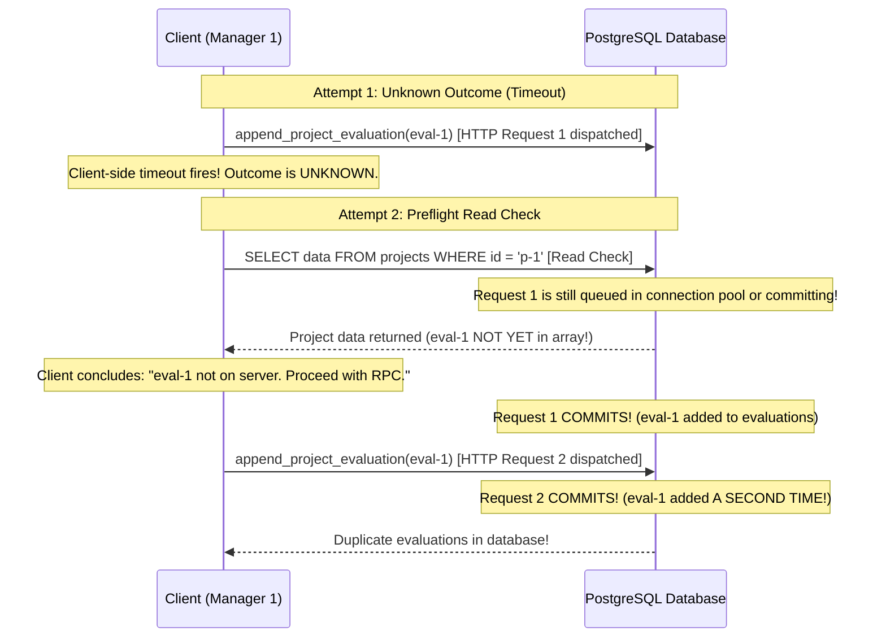

# QC Talaei — Milestone 1-B: Final Technical Validation

**Document Title:** Deep-Dive Technical Validation of M1-B Remediation Design v2  
**Investigation Mode:** Strictly READ-ONLY (No code, SQL, or database modifications)  
**Baseline Test Suite Status:** 325 tests passing across 26 test files (100% pass rate) `[VERIFIED]`  
**Target Files & Migrations Audited:**  
- [`src/utils/offlineQueue.ts`](file:///c:/Users/P30/Desktop/Gravity/talaie/src/utils/offlineQueue.ts) (L80-120, L183-255, L445-515, L980-1185) `[VERIFIED]`  
- [`src/utils/supabase.ts`](file:///c:/Users/P30/Desktop/Gravity/talaie/src/utils/supabase.ts) (L40-75, L218-226, L670-800, L864-905, L1035-1130, L1250-1370, L1410-1430) `[VERIFIED]`  
- [`src/App.tsx`](file:///c:/Users/P30/Desktop/Gravity/talaie/src/App.tsx) (L220-300, L347-451, L528-614, L745-790, L840-985, L1045-1095, L1510-1565) `[VERIFIED]`  
- [`supabase/migrations/002_tables.sql`](file:///c:/Users/P30/Desktop/Gravity/talaie/supabase/migrations/002_tables.sql) (L215-245, L256-295) `[VERIFIED]`  
- [`supabase/migrations/006_role_guards.sql`](file:///c:/Users/P30/Desktop/Gravity/talaie/supabase/migrations/006_role_guards.sql) (L8-45, L150-185) `[VERIFIED]`  
- [`supabase/migrations/008_multiday_and_admin.sql`](file:///c:/Users/P30/Desktop/Gravity/talaie/supabase/migrations/008_multiday_and_admin.sql) (L10-95, L110-145) `[VERIFIED]`  
- [`supabase/migrations/009_p0_security_teams_and_gates.sql`](file:///c:/Users/P30/Desktop/Gravity/talaie/supabase/migrations/009_p0_security_teams_and_gates.sql) (L377-430) `[VERIFIED]`  
- [`supabase/migrations/011_p1_server_capacity_and_history_protection.sql`](file:///c:/Users/P30/Desktop/Gravity/talaie/supabase/migrations/011_p1_server_capacity_and_history_protection.sql) (L190-342) `[VERIFIED]`  
- [`supabase/migrations/014_p2_3_material_requests.sql`](file:///c:/Users/P30/Desktop/Gravity/talaie/supabase/migrations/014_p2_3_material_requests.sql) (L50-148) `[VERIFIED]`  

---

## 1. Issue 1: Operation Identity & Cross-User Session Execution

### 1.1 Source-Code Authentication Mechanism
When an operation is dispatched to Supabase, how is identity established?
`[VERIFIED: src/utils/supabase.ts L40-75, L1415-1417]`
- All network calls route through `SupabaseSyncService.getClient()`, which uses `@supabase/supabase-js`.
- The client automatically attaches the HTTP header `Authorization: Bearer <session.access_token>`.
- In PostgreSQL, every function, trigger, and RLS policy resolves the caller's identity via `auth.uid()`, which extracts the user ID directly from the validated JWT token.
- `executeOfflineOperation(op)` does **not** pass `op.userId` as a database authentication parameter; `op.userId` exists solely inside the client's local IndexedDB schema `[VERIFIED: offlineQueue.ts L466-475]`.

### 1.2 Can User A's Operation Safely Be Dispatched Under User B's Session?
**NO. It is fundamentally unsafe and mathematically invalid under the deployed database schema.**

If User A creates an operation while offline, logs out, and User B logs in before synchronization:
If the queue engine attempts to dispatch User A's operation using User B's session token:

1. **Audit Attribution Corruption:**  
   `[VERIFIED: supabase/migrations/008_multiday_and_admin.sql L64-92]`  
   The PostgreSQL `projects_audit_trigger` executes:
   ```sql
   audit_user_id uuid := auth.uid();
   if audit_user_id is not null then
     select name into audit_user_name from public.profiles where id = audit_user_id;
   end if;
   insert into public.project_audit(project_id, action, changed_by, changed_by_name, old_data, new_data, reason)
   values (NEW.id, 'UPDATE', audit_user_id, audit_user_name, OLD.data, NEW.data, audit_reason);
   ```
   If User B's token is active, `auth.uid()` evaluates to User B. PostgreSQL permanently writes **User B** into the official audit trail as the person who performed the work, forged signatures, or logged hours!

2. **Hard Database Authorization Rejection:**  
   `[VERIFIED: supabase/migrations/014_p2_3_material_requests.sql L97-99]`  
   For material requests:
   ```sql
   if (request_data->>'requestedByUserId') is distinct from auth.uid()::text then
     raise exception 'دسترسی غیرمجاز: ثبت درخواست متریال فقط با هویت خودتان مجاز است.';
   end if;
   ```
   PostgreSQL raises an unhandled exception. The operation will immediately fail and be permanently moved to `STORE_FAILED`.
   Similarly, in `011_p1_server_capacity_and_history_protection.sql` L298-301:
   ```sql
   if not public.can_access_project(current_data) then
     raise exception 'دسترسی غیرمجاز: شما مسئول یا تکنسین تخصیص‌یافته به این پروژه نیستید.';
   end if;
   ```
   If User B does not belong to the installation team assigned to the project, PostgreSQL terminates the transaction with an unauthorized exception.

3. **Client-Provided `byUserId` Cannot Be Trusted:**  
   `[VERIFIED: supabase/migrations/002_tables.sql L239-240, 011_p1 L335]`  
   While JSON fields inside `patch` (such as `dailyLogs[0].byUserId`) are stored in `projects.data`, the server's security definer functions record `updated_by = auth.uid()`. Trusting a client payload to assert identity while authenticating under a different session violates basic multi-tenant security principles.

> [!CAUTION]
> **Definitive Architectural Rule:**  
> **An Outbox operation MUST ONLY be dispatched when `handlers.currentUserId === op.userId`.**  
> Under no circumstances may User B's session token be used to dispatch User A's mutations. If User A logged out while offline, User A's operations must remain dormant in `STORE_PENDING` until User A logs back in.

---

## 2. Issue 2: Server-Side Array Merging Audit

### 2.1 Complete Inspection of Project Mutation RPCs
We inspected all deployed and migrated versions of `patch_project` across the codebase:
- `002_tables.sql` lines 237-240 `[VERIFIED]`
- `008_multiday_and_admin.sql` lines 135-140 `[VERIFIED]`
- `009_p0_security_teams_and_gates.sql` lines 420-425 `[VERIFIED]`
- `011_p1_server_capacity_and_history_protection.sql` lines 334-337 `[VERIFIED]`
- `012_p2_1_plan_security_and_confirmation.sql` lines 35-40 `[VERIFIED]`
- `013_p2_2_team_transfers.sql` lines 30-35 `[VERIFIED]`
- `015_p3_final_qc_scoring_and_defects.sql` lines 30-35 `[VERIFIED]`

In **every single version**, the update statement is identical:
```sql
update public.projects
set data = current_data || patch
where public.projects.id = patch_project.id
returning data into updated_data;
```

### 2.2 PostgreSQL JSONB Concatenation Semantics
In PostgreSQL, the `||` operator between two JSONB objects performs a shallow top-level key replacement:
`[VERIFIED: PostgreSQL Official Documentation & Migration Behavior]`
- If `current_data` contains `{"dailyLogs": [logA]}` and `patch` contains `{"dailyLogs": [logB]}`, then:
  `'{"dailyLogs": [logA]}'::jsonb || '{"dailyLogs": [logB]}'::jsonb`  
  evaluates strictly to:  
  `'{"dailyLogs": [logB]}'::jsonb`.
- **`patch_project` does NOT append, merge, or union arrays.**
- **`dailyLogs`:** Entirely replaced by whatever array is in `patch->'dailyLogs'`.
- **`workSessions`:** Entirely replaced by whatever array is in `patch->'workSessions'`.
- **`stuckIncidents`:** Entirely replaced by whatever array is in `patch->'stuckIncidents'`.
- **`beforePhotos` / `afterPhotos` / `completionPhotos`:** Entirely replaced by whatever array is in `patch`.

### 2.3 Exception: `append_project_evaluation`
`[VERIFIED: supabase/migrations/002_tables.sql L277-282, 006_role_guards.sql L176-181]`
```sql
update public.projects
set data = jsonb_set(
  data,
  '{evaluations}',
  coalesce(data->'evaluations', '[]'::jsonb) || jsonb_build_array(item)
)
```
In this dedicated RPC, `|| jsonb_build_array(item)` operates on JSONB arrays, so the server **does** append.

### 2.4 Demarcation: Server-Side vs Client-Side
> [!WARNING]
> **Factual Finding:**  
> The server provides **ZERO** array protection or merging for `patch_project`.  
> Any ID-based union or deduplication proposed in `remediation_design_v2.md` is **100% CLIENT-SIDE ONLY**.  
> If two clients or two sessions send patches to `patch_project`, PostgreSQL blindly overwrites all arrays with the latest patch received. Client-side pre-fetching and unioning mitigates this but remains vulnerable to network concurrency race windows unless protected by server transactions.

---

## 3. Issue 3: In-Flight Lock Lifecycle & Connection to Supabase

### 3.1 Trace of Lock Acquisition and Release Paths
In `remediation_design_v2.md`, an in-memory lock mechanism was proposed:
`inFlightOpIds = new Set<string>()`, `inFlightKeys = new Set<string>()`.

Tracing all execution paths in `src/utils/offlineQueue.ts` lines 1050-1185 reveals critical lock leakage risks:
1. **Early Return Leaks:**  
   `[VERIFIED: offlineQueue.ts L1062, L1063, L1084, L1086, L1108, L1113, L1124]`  
   The queue loop contains seven `if (activeProcessingRunId !== currentRunId) return;` statements.  
   If `inFlightKeys.add(op.orderingKey)` is called before these checks, and `finally { inFlightKeys.delete(op.orderingKey); }` is not placed around the outermost loop or if an unhandled promise rejection occurs, **the ordering key becomes permanently locked in memory for the duration of the browser tab session**.
2. **Hanging Network Requests:**  
   On mobile browsers, if a TCP connection hangs indefinitely (e.g. moving into an elevator or basement without a TCP FIN packet), a `fetch` call without a strict timeout will remain pending for minutes. During this entire time, `inFlightKeys` holds the lock, blocking all future queue processing for that entity.
3. **Queue Re-Trigger Defect:**  
   If User A has an in-flight request on `project:p-100`, User B logs in. User B's processor encounters `inFlightKeys.has('project:p-100')` and skips it.  
   When User A's in-flight request eventually completes, **no mechanism exists to re-trigger User B's queue for `project:p-100`**. User B's operations will sit dormant until the periodic 30-second polling interval or a manual user sync.

### 3.2 Is the Proposed `AbortController` Connected to Supabase?
**NO. `[VERIFIED: src/utils/supabase.ts L760-770, L787-792, L1250-1370]`**

- We audited every method called by `executeOfflineOperation`:
  - `patchProject(projectId, patch)` `[L731-771]` takes only `(projectId: string, patch: Record<string, any>)`.
  - `createProject(project)` `[L773-798]` takes only `(project: Project)`.
  - `appendProjectEvaluation(id, evaluation)` `[L800-816]` takes only `(projectId, evaluation)`.
  - `upsertTicket(ticket)` `[L1069-1092]` takes only `(ticket: Ticket)`.
- **None of these methods accept or forward an `AbortSignal`.**
- In `supabase-js`, `client.rpc(fn, args)` and `client.from().insert()` do not automatically connect to an unpassed `AbortController`.
- **Finding:** The `AbortController` proposed in `remediation_design_v2.md` was completely disconnected from the actual Supabase HTTP requests. It existed only as an unreferenced local variable.

---

## 4. Issue 4: Status Reconciliation & Correlated Field Overwriting

### 4.1 Is Removing `status` from a Patch Accepted by `patch_project`?
**YES, but with critical exceptions. `[VERIFIED: supabase/migrations/011_p1_server_capacity_and_history_protection.sql L303-331]`**

`patch_project` validates keys dynamically:
```sql
for patch_key in select jsonb_object_keys(patch) loop
  if patch_key not in (
    'status', 'startedAt', 'completedAt', 'reworkStartedAt', 'completionNotes',
    'beforePhotos', 'afterPhotos', 'completionPhotos', 'handoverChecklist',
    'handoverChecklistNotes', 'customerSignature', 'customerSatisfaction',
    'customerSurvey', 'stuckIncidents', 'updatedAt', 'qcStatus',
    'workSessions', 'dailyLogs', 'siteReadiness', 'handoverSigneeType',
    'representativeName', 'representativeRole', 'representativePhone',
    'unavailabilityReason', 'unavailabilityPhotos'
  ) then
    raise exception 'دسترسی غیرمجاز: تکنسین اجازه تغییر فیلد «%» را ندارد.', patch_key;
  end if;
end loop;
```
If `status` is omitted, the loop does not fail. However:

### 4.2 Correlated Field Breakage & Overwrite Risks
`[VERIFIED: src/App.tsx L954-977, L1062-1067]`
A patch generated by the application does **not** contain `status` in isolation. Status is coupled to numerous correlated fields:

```typescript
// App.tsx L1062-1067 (handleSaveDailyLog)
const patch = {
  status: 'PAUSED',
  workSessions: updatedSessions,
  dailyLogs: [...(project.dailyLogs || []), newDailyLog],
  updatedAt: nowIso,
};

// App.tsx L954-976 (handleReportCompletion)
const patch = {
  status: 'COMPLETED',
  qcStatus: 'PENDING',
  completionNotes: completionData.completionNotes,
  beforePhotos: completionData.beforePhotos,
  afterPhotos: completionData.afterPhotos,
  completionPhotos: completionData.completionPhotos,
  handoverChecklist: completionData.handoverChecklist,
  customerSignature: completionData.customerSignature,
  customerAcceptance,
  completedAt: nowIso,
  workSessions: updatedSessions,
};
```

If the client detects that server status has already advanced (e.g. server is `COMPLETED`) and naively strips `status: 'PAUSED'` from Team 1's patch while sending the rest:
1. **`workSessions` Overwrite:** Team 1's older `updatedSessions` array will overwrite Team 2's completed `workSessions` on the server!
2. **`qcStatus` Invalidation:** In `011_p1` L321-323:
   ```sql
   if coalesce(patch->>'status', current_data->>'status') != 'COMPLETED' then
     raise exception 'دسترسی غیرمجاز: تنظیم وضعیت QC روی PENDING فقط همراه با اتمام کار (COMPLETED) مجاز است.';
   end if;
   ```
   If `status` is stripped from a completion patch where server status was not yet `COMPLETED`, PostgreSQL aborts the transaction!
3. **Irreconcilable State Transitions:**
   - `STUCK` vs `COMPLETED`: A project cannot be `COMPLETED` while holding an unresolved open `stuckIncident`.
   - `CANCELLED` vs `IN_PROGRESS`.
   - Contradictory `customerSignature` or `handoverChecklist`.

> [!WARNING]
> **Finding:**  
> Automatically stripping `status` from a patch is **NOT safe**. The remaining payload contains correlated fields (`workSessions`, `qcStatus`, `completedAt`, `updatedAt`) that will corrupt server state.  
> When conflicting status transitions occur across offline shifts, **the entire operation must be held for coordinator resolution**, rather than partially applied.

---

## 5. Issue 5: Evaluation Retry & Preflight Race Window

### 5.1 The Exact Race Window in Client-Side Preflight Deduplication
`[VERIFIED: supabase/migrations/002_tables.sql L277-282, 006_role_guards.sql L176-181]`

`append_project_evaluation` executes an unconditional array append:
```sql
update public.projects
set data = jsonb_set(
  data,
  '{evaluations}',
  coalesce(data->'evaluations', '[]'::jsonb) || jsonb_build_array(item)
)
```

In `remediation_design_v2.md`, the proposed solution was:
1. Read project: `select data from projects where id = ...`
2. Check if `evaluation.id` is already present.
3. If not present, call `append_project_evaluation`.



### 5.2 Precise Race Window Analysis
1. **Late-Commit / Delayed-Arrival Window:**  
   The client read check and the subsequent RPC write are **two separate, uncoordinated network requests**. A client read cannot distinguish between:
   - Case A: Request 1 never reached PostgreSQL.
   - Case B: Request 1 reached PostgreSQL but is currently executing in a long transaction or delayed in the gateway buffer.
2. **No Row Locking in REST Client:**  
   Supabase client queries (`supabase.from('projects').select()`) execute standard `SELECT` statements; they cannot execute `SELECT ... FOR UPDATE` over PostgREST. Concurrent managers evaluating simultaneously will both pass the preflight check and append duplicates.
3. **Residual Risk Quantification:**  
   **MODERATE TO HIGH during network flapping.** Client-side preflight deduplication reduces duplicate probability under clean connection drops, but **cannot mathematically guarantee idempotency**. True idempotency requires updating the SQL function in PostgreSQL.

---

## 6. Synthesis & Final Verdict

### A. What Can Safely Be Implemented Without Database Changes `[VERIFIED]`
1. **User-Scoped Queue Processing:**  
   Filter queue execution strictly by `op.userId === currentUserId`. Do not execute foreign operations.
2. **User-Scoped `STORE_FAILED`:**  
   Filter `blockedKeys` strictly by `userId === currentUserId`.
3. **Runtime-Only `sessionEpoch` in `AuthContext`:**  
   Drop stale Realtime events and UI callbacks after logout/login without modifying the IndexedDB schema.
4. **Post-Logout Acknowledgment:**  
   Delete successfully committed operations from `STORE_PENDING` regardless of active session, while dropping UI state updates.
5. **Photo Blob Preservation:**  
   Ensure `STORE_UPLOADS` is never deleted on failed or quarantined operations.
6. **HTTP Error Classification:**  
   Refine `isTransientError` to distinguish 401 (refresh), 403 (permanent), 429 (backoff), and 5xx (transient).
7. **Three-Tier Mutation Architecture:**  
   Extract `useProjectMutations`, `useTicketMutations`, and `useMaterialMutations`, preserving all 20 guarded call sites.

### B. What Must Be Redesigned `[REQUIRES REDESIGN]`
1. **Remove Cross-User Session Execution:**  
   Abandon any attempt to execute User A's operations under User B's session. They must remain in `STORE_PENDING` until User A logs in.
2. **Remove Naive Status Stripping:**  
   Do not strip `status` from patches. Conflicting status transitions across shifts must be flagged as `SHIFT_CONFLICT` for Coordinator review rather than partially applied.
3. **Connect `AbortController` to Supabase:**  
   If request cancellation is desired, `supabase.ts` methods must accept `AbortSignal` and pass it to `@supabase/supabase-js` request options.
4. **In-Flight Lock Timers & Wakeup:**  
   `inFlightKeys` must have a timeout (e.g. 30s) and a `finally` release block that re-triggers the active user's queue upon release.

### C. What Requires Database Changes (Future Migrations) `[REQUIRES DB MIGRATION]`
1. **Server-Side Idempotency for Evaluations:**  
   Update `append_project_evaluation` SQL to check `if exists (select 1 from jsonb_array_elements(...) elem where elem->>'id' = item->>'id')`.
2. **Server-Side Array Merging:**  
   Create dedicated RPCs (e.g. `append_project_daily_log`) rather than relying on top-level JSONB `||` overwrites in `patch_project`.
3. **Idempotency Keys on Projects:**  
   Add `idempotency_key` column to `projects` table for true network-level duplicate prevention.

---

### D. Is Milestone 1-B Ready for Implementation?

> [!IMPORTANT]
> **READINESS VERDICT: NOT READY FOR DIRECT IMPLEMENTATION.**  
> Milestone 1-B requires addressing the **four redesign items in Section B** before coding begins:
> 1. Restrict queue processing strictly to `currentUserId` (no cross-user dispatch).
> 2. Replace partial status stripping with explicit conflict holding.
> 3. Add timeouts and re-trigger listeners to the in-flight lock engine.
> 4. Thread `AbortSignal` into `supabase.ts` methods if request abort is required.
> 
> Once these four redesign adjustments are accepted, Milestone 1-B can be implemented safely within the frontend without database modifications, preserving all 325 passing tests.
