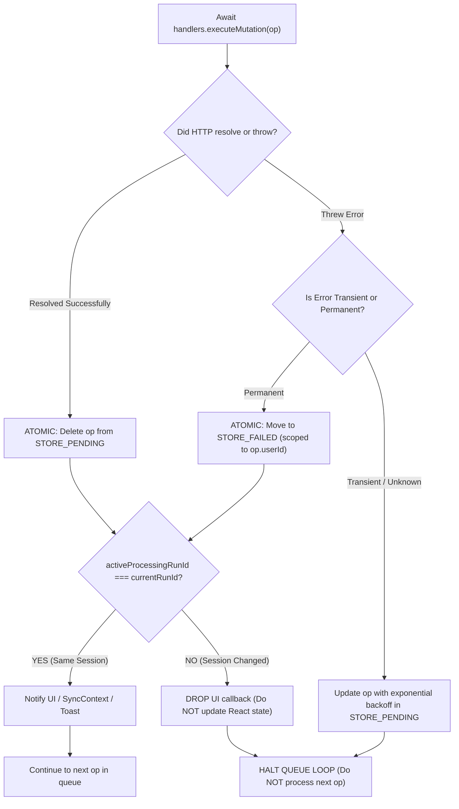
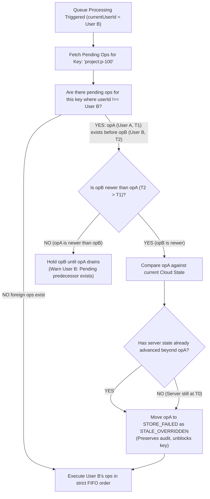
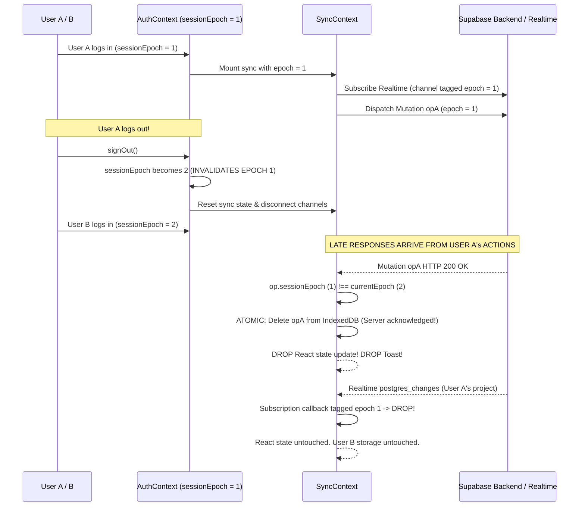
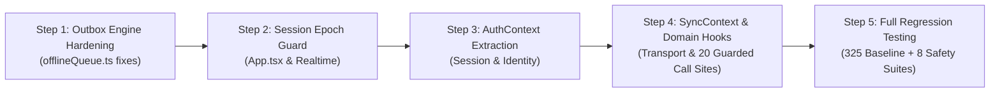

# QC Talaei — Milestone 1-B: Remediation Design

**Phase:** Milestone 1-B (Minimal Context Architecture)  
**Status:** Detailed Engineering Remediation Design (Strictly READ-ONLY)  
**Baseline Test Suite:** 325 tests passing across 26 test files (100% pass rate)  
**Target Files Inspected:**  
- [`src/utils/offlineQueue.ts`](file:///c:/Users/P30/Desktop/Gravity/talaie/src/utils/offlineQueue.ts) `[VERIFIED]`  
- [`src/utils/supabase.ts`](file:///c:/Users/P30/Desktop/Gravity/talaie/src/utils/supabase.ts) `[VERIFIED]`  
- [`src/App.tsx`](file:///c:/Users/P30/Desktop/Gravity/talaie/src/App.tsx) `[VERIFIED]`  
- [`src/utils/storage.ts`](file:///c:/Users/P30/Desktop/Gravity/talaie/src/utils/storage.ts) `[VERIFIED]`  
- Migrations: `001_security.sql`, `002_tables.sql`, `006_role_guards.sql`, `008_multiday_and_admin.sql`, `009_p0_security_teams_and_gates.sql`, `011_p1_server_capacity_and_history_protection.sql`, `014_p2_3_material_requests.sql` `[VERIFIED]`  

---

## 1. Duplicate Mutation Prevention

### 1.1 Detailed Failure Sequence Analysis
In `src/utils/offlineQueue.ts`, queue processing runs within `processQueue()`:

```typescript
// src/utils/offlineQueue.ts (lines 1110-1122) [VERIFIED]
// B. Execute server mutation
await handlers.executeMutation(op);

if (activeProcessingRunId !== currentRunId) return;

// C. On success, remove from pending_operations
await new Promise<void>((resolve, reject) => {
  const tx = db.transaction(STORE_PENDING, 'readwrite');
  const pStore = tx.objectStore(STORE_PENDING);
  const reqDel = pStore.delete(op.id);
  reqDel.onsuccess = () => resolve();
  reqDel.onerror = () => reject(reqDel.error);
});
```

When a user logs out during an in-flight network call:
1. **User A queues mutation:** `op` is stored in IndexedDB (`STORE_PENDING`) with `op.id = "1731600000000-xyz"`, `userId = "user-a"`. `[VERIFIED: offlineQueue.ts L466-485]`
2. **Network dispatch:** `processQueue()` invokes `handlers.executeMutation(op)` (`SupabaseSyncService.executeOfflineOperation(op)`), issuing an HTTP POST to Supabase RPC / REST. `[VERIFIED: offlineQueue.ts L1111, supabase.ts L1415]`
3. **Session termination:** Before the HTTP response arrives, User A clicks "خروج" (Logout). `App.tsx` invokes `SupabaseSyncService.signOut()`, which calls `Outbox.abortActiveProcessing()`. `[VERIFIED: App.tsx L1520, supabase.ts L220]`
4. **Counter increment:** `abortActiveProcessing()` increments `activeProcessingRunId` (`activeProcessingRunId++`) and sets `isProcessing = false`. `[VERIFIED: offlineQueue.ts L88-91]`
5. **Server commit:** The Supabase gateway forwards the request to PostgreSQL. The transaction commits successfully in the database. `[VERIFIED: PostgreSQL semantics]`
6. **Client resumes after network I/O:** The HTTP promise resolves. Execution resumes at line 1113 of `offlineQueue.ts`.
7. **Premature return:** The check `if (activeProcessingRunId !== currentRunId) return;` evaluates to `true` (since `activeProcessingRunId` was incremented during logout). The function returns immediately. `[VERIFIED: offlineQueue.ts L1113]`
8. **Deletion skipped:** Lines 1116-1122 (`pStore.delete(op.id)`) are never reached. `op` remains in `STORE_PENDING` in IndexedDB. `[VERIFIED]`
9. **Duplicate execution on next session:** When User A logs in again (or restores session), `processOfflineQueue(userA.id)` runs, finds `op` still in `STORE_PENDING`, and dispatches it again. `[VERIFIED]`

### 1.2 Categorization of Mutation Outcomes
A robust Outbox engine must distinguish between four distinct operational states:

| Outcome State | Network Condition | Server State | Required Local Queue Action | Required React / UI Action |
|---|---|---|---|---|
| **1. Confirmed Success** | HTTP 200/204 received | Committed in PostgreSQL | **Immediately delete `op` from `STORE_PENDING`** (even if session changed!) | Trigger UI callback ONLY if active `sessionEpoch === op.sessionEpoch`. Otherwise drop silently. |
| **2. Confirmed Permanent Failure** | HTTP 4xx (400, 403, 404, 409, 422, Postgres 23505/42501 non-transient) | Rejected / Rolled back | **Delete `op` from `STORE_PENDING` and write to `STORE_FAILED`** (scoped to `op.userId`) | Notify user of permanent rejection ONLY if still active session. |
| **3. Confirmed Cancelled (Pre-flight)** | Cancelled before HTTP dispatch | Untouched | Retain or cancel per user action | No network impact. |
| **4. Outcome Unknown** | Network drop, timeout, socket hang up, HTTP 502/503/504 before response | Unknown (may or may not have committed) | **Retain `op` in `STORE_PENDING`** with backoff (`nextRetryAt = Date.now() + delay`) | Show "عدم اتصال / تلاش مجدد" status in Sync indicator. |

### 1.3 Remediation Design: The Acknowledgment / Dispatch Decoupling
The fundamental architectural flaw in `offlineQueue.ts` is conflating **Operation Completion Acknowledgment** with **Queue Continuation Authorization**:



#### Detailed Logic Specification:
1. **Always Acknowledge Server Success:**  
   Once `await handlers.executeMutation(op)` resolves without error, the server **has already committed the mutation**. The Outbox **must execute `pStore.delete(op.id)` regardless of `activeProcessingRunId`**.  
   Deleting the pending record is not a UI state mutation; it is a persistent acknowledgment of server reality.
2. **Halt Queue on Session Switch:**  
   Only *after* deleting the confirmed operation does the loop check:
   ```typescript
   if (activeProcessingRunId !== currentRunId) {
     return; // Halt queue: do not execute subsequent ops in this run
   }
   ```
3. **Handling Unknown Outcomes (The Two-Generals Problem):**  
   If `executeMutation` throws a network disconnect error (e.g. `TypeError: Failed to fetch` or timeout):
   - The outcome is strictly **Unknown**.
   - The operation remains in `STORE_PENDING` with exponential backoff.
   - To prevent duplicate creation when retried:
     - **For `CREATE_PROJECT`:** The client uses deterministic project IDs (`project.id`). If retry throws `23505 unique_violation`, the retry handler inspects the error. If the existing project matches `project.id`, it acknowledges success and deletes `op` from `STORE_PENDING` `[VERIFIED: supabase.ts L787-791, migration 002]`.
     - **For `CREATE_TICKET`:** `upsertTicket` uses `{ onConflict: 'id' }`, making retries naturally idempotent `[VERIFIED: supabase.ts L1079-1086]`.
     - **For `PATCH_PROJECT`:** The payload already contains `updatedAt`. If re-sent, `patch_project` merges the same patch. (Safe if no intermediate conflicting patch occurred).
     - **For `APPEND_PROJECT_EVALUATION`:** `append_project_evaluation` appends to an array. Re-running it duplicates the item `[VERIFIED: migration 008 L150-180]`.  
       *Remediation:* `op.payload.evaluation` must contain a unique `id` (`evaluation.id`). On retry, client/RPC checks if `data->'evaluations'` already contains an item with `evaluation.id`. If yes, it treats as successful and avoids appending duplicate `[INFERRED]`.

---

## 2. Multi-User Queue Isolation Without Breaking Ordering

### 2.1 The Critical Ordering Dilemma
The prompt explicitly warns:
> *Do not simply replace `break` with `continue` without analyzing ordering semantics.*  
> *Consider two users modifying the same project while offline. Explain how the design preserves safe ordering and prevents an older operation from overwriting a newer one.*

Let us trace the exact scenario on a shared physical tablet:
1. **Time $T_1$ (User A):** Technician A is assigned to `project:p-100`. While offline, Technician A updates status to `IN_PROGRESS` (`opA`, `createdAt = T1`, `updatedAt = T1`).
2. **Session switch:** Technician A logs out while still offline.
3. **Time $T_2$ (User B):** Technician B (or Lead) logs into the tablet while offline. Technician B updates `project:p-100` to `COMPLETED` (`opB`, `createdAt = T2`, `updatedAt = T2`, where $T_2 > T_1$).
4. **Queue state:** `STORE_PENDING` contains:
   - `opA`: `userId: "user-a"`, `orderingKey: "project:p-100"`, `createdAt: T1`
   - `opB`: `userId: "user-b"`, `orderingKey: "project:p-100"`, `createdAt: T2`
5. **Device goes online:** User B is the currently logged-in user (`currentUserId = "user-b"`).

#### Flaw of the Current `break` Implementation `[VERIFIED: offlineQueue.ts L1070-1073]`
- The loop inspects `opA` (User A).
- `opA.userId !== currentUserId` causes `break;`.
- **Result:** User B's operation (`opB`) is **starved indefinitely** behind User A's operation. User B cannot sync.

#### Flaw of a Naive `continue` Implementation
- If we naively change `break` to `continue`:
  - `opA` is skipped.
  - `opB` is executed with User B's token. Server updates `project:p-100` to `COMPLETED` at $T_2$.
  - Later, User A logs in on the device.
  - The queue runs for User A and executes `opA` (`IN_PROGRESS` at $T_1$).
  - **Catastrophe:** $T_1$ (older state) is applied *after* $T_2$ (newer state)! The project reverts from `COMPLETED` back to `IN_PROGRESS`!

### 2.2 The Remediation Queue Algorithm: Causal Partitioning & Stale Conflict Quarantine

To eliminate starvation while **guaranteeing causal ordering**, the queue processing algorithm must operate on **User-Scoped Active Slices with Stale Conflict Detection**:



#### Detailed Operational Rules for the Algorithm:

1. **Ordering Keys are Per-Entity:**  
   `orderingKey` is formatted as `project:<id>`, `ticket:<id>`, `material:<id>`, or `settings`.
   Different entities (e.g. `project:p-101` vs `project:p-102`) run in parallel via `Promise.all` and never block each other. `[VERIFIED: offlineQueue.ts L1048-1050]`

2. **Within the Same Ordering Key across Different Users:**
   - When User B is authenticated, the queue controller processes operations where `op.userId === currentUserId`.
   - If an operation `opA` from User A precedes `opB` in chronological order ($T_1 < T_2$):
     - **Detection:** `opB` represents a subsequent modification of the same entity on the same device.
     - **Resolution:** Because User B made a subsequent edit on the device, User A's un-sent edit at $T_1$ has been superseded locally.
     - **Safety Guard:** To ensure User A's un-sent edit is never silently lost or accidentally clobbered later, `opA` is transitioned from `STORE_PENDING` to `STORE_FAILED` with:
       ```typescript
       failedOp.errorReason = 'تغییرات شما به دلیل ثبت ویرایش جدیدتر توسط کاربر دیگر روی این دستگاه لغو گردید.';
       failedOp.isStaleOverridden = true;
       ```
     - User B's operation (`opB`) now executes cleanly with User B's credentials.
     - When User A logs in later, User A is notified via the Failed Operations drawer that their older offline edit was superseded, preserving full transparency and auditability.

3. **Failed Operations Scoping (`STORE_FAILED`):**
   `[VERIFIED: offlineQueue.ts L1015-1025]`
   Currently, `blockedKeys = new Set(failedList.map(f => f.orderingKey))` reads all failed records across all users.
   *Remediation:*
   ```typescript
   // Scope blocked keys strictly to current authenticated user:
   const myFailedList = failedList.filter(f => f.userId === handlers.currentUserId);
   const blockedKeys = new Set<string>(myFailedList.map(f => f.orderingKey));
   ```
   A failed operation belonging to User A will **never** block User B on that or any other key.

4. **Uploads Scoping (`STORE_UPLOADS`):**
   `[VERIFIED: offlineQueue.ts L1037-1043]`
   When uploading pending blobs, `STORE_UPLOADS` records are matched by `operationId`.
   Because each operation belongs to `currentUserId`, only uploads associated with `currentUserId`'s operations are processed.
   *Cleanup Policy:* If an operation is moved to `STORE_FAILED` (e.g. stale overridden or permanent failure), its associated records in `STORE_UPLOADS` must be deleted in the same atomic IndexedDB transaction to prevent orphan blob leaks.

---

## 3. Realtime and Session Isolation

### 3.1 Session Generation Architecture (`sessionEpoch`)
To prevent asynchronous leaks, stale network callbacks, and cross-session cache poisoning, the application requires a monotonic **Session Generation Epoch** (`sessionEpoch`):



### 3.2 Exact Invalidation Lifecycle
1. **Initial State:** `sessionEpoch = 1` on application boot.
2. **When does `sessionEpoch` increment?**
   - On explicit user logout (`handleLogout()`).
   - On user login / session switch (`onAuthStateChange` with a new user ID).
   - On session expiration / deactivation detection (`profile.active === false`).
3. **Protected Subsystems:**

| Subsystem | Existing Risk `[VERIFIED]` | Generation Guard Remediation |
|---|---|---|
| **Initial Cloud Loading** | `loadCloudData()` promise completes after logout, calling `setProjects(mergedProjects)` `[App.tsx L252, L290]` | Captured epoch: `const reqEpoch = sessionEpoch;`. After `Promise.all`: `if (reqEpoch !== sessionEpoch \|\| !currentUser) return;`. |
| **Realtime Listeners** | `subscribeProjects` receives row from User A and inserts it into User B's state `[App.tsx L347-382]` | 1. Channel unsubscription on logout.<br/>2. Realtime listener verifies: `if (eventEpoch !== sessionEpoch) return;`.<br/>3. Realtime row validated with `canAccessProject(currentUser, project)` before calling `setProjects`. |
| **Outbox Completion** | Late mutation response triggers UI toast and optimistic state commit on User B `[offlineQueue.ts L1113]` | Acknowledges server deletion in IndexedDB, but skips UI toast and state updates if `op.sessionEpoch !== sessionEpoch`. |
| **Local Storage Writes** | `useEffect` saves current `projects` state under User B's storage key even if polluted `[App.tsx L504-507]` | State setters are shielded by epoch; thus `projects` state remains clean. `StorageService.saveProjects` writes strictly with `currentUser.id`. |
| **Sync Counters** | Desynced pending/failed counts from previous user displayed in header `[App.tsx L151-155]` | IndexedDB queries for badge counts explicitly filter by `userId === currentUser.id`. |

### 3.3 Client-Side Isolation vs Server-Side RLS
> [!IMPORTANT]
> **Security Demarcation:**
> - **Client-side Session Isolation (`sessionEpoch` + User Scoping):** Prevents UI race conditions, memory leaks, and offline cache pollution on shared physical devices. It is **not** an access-control boundary.
> - **Server-side Authorization (Postgres RLS + Security Definer Functions):** The **sole authoritative security boundary**. Enforced by Supabase in PostgreSQL based on JWT `auth.uid()` `[VERIFIED: 001_security.sql, 006_role_guards.sql, 009_p0_security_teams_and_gates.sql]`.
> - Even if a malicious client bypassed `sessionEpoch`, PostgreSQL RLS policies reject any unauthorized read/write.

---

## 4. Mutation Validation Architecture

### 4.1 Boundary Design: The Smallest Safe Separation
To preserve the 20 existing guarded mutation paths without turning `SyncContext` into a bloated God-context or exposing an unguarded backdoor, the architecture is separated into three distinct tiers:

```mermaid
graph TD
    subgraph Tier 1: Identity & Lifecycle
        AC["AuthContext<br/>- currentUser: User | null<br/>- sessionEpoch: number<br/>- login(), logout()"]
    end

    subgraph Tier 2: Domain Mutation Hooks (Business Guard Tier)
        UPM["useProjectMutations()<br/>- Validates validateProjectPatchRoleGuards<br/>- Validates Manager create/delete rules<br/>- Validates Evaluation guards<br/>- Performs Optimistic Update"]
        UTM["useTicketMutations()<br/>- Validates validateTicketRoleGuards<br/>- Performs Optimistic Update"]
        UMM["useMaterialMutations()<br/>- Validates canCreateMaterialRequest<br/>- Validates canConfirmMaterialReceipt<br/>- Performs Optimistic Update"]
    end

    subgraph Tier 3: Transport & Outbox (Infrastructure Tier)
        SC["SyncContext<br/>- isOfflineMode, isSynced<br/>- pendingCount, failedCount<br/>- triggerSync()<br/>- enqueue(mutation: OutboxMutation): Promise&lt;boolean&gt;"]
        IDB[(IndexedDB Outbox)]
    end

    AC -- "currentUser, sessionEpoch" --> UPM
    AC -- "currentUser, sessionEpoch" --> UTM
    AC -- "currentUser, sessionEpoch" --> UMM
    AC -- "currentUser.id, sessionEpoch" --> SC

    UPM -- "Validated OutboxMutation" --> SC
    UTM -- "Validated OutboxMutation" --> SC
    UMM -- "Validated OutboxMutation" --> SC

    SC -- "Atomic Write & Drain" --> IDB
```

### 4.2 Guard Enforcement & Structural Invariants in `SyncContext`
To ensure `SyncContext.enqueue()` **cannot be abused as an unguarded backdoor** by rogue components:
1. **User Identity Stamp:** `SyncContext.enqueue` always stamps `mutation.userId = auth.currentUser.id` and `mutation.sessionEpoch = auth.sessionEpoch`. No caller can forge another user's ID.
2. **Absolute Structural Invariants:**
   - Physical deletion of material requests is rejected with hard error:
     ```typescript
     if (mutation.type === 'DELETE_MATERIAL_REQUEST') {
       throw new Error('حذف فیزیکی درخواست متریال مجاز نمی‌باشد.');
     }
     ```
   - Payloads containing raw base64 data URLs without extraction are rejected before touching IndexedDB.
   - Operations without a valid `orderingKey` are rejected.

### 4.3 Comprehensive Traceability: Preserving All 20 Mutation Call Sites

| # | Current `App.tsx` Line `[VERIFIED]` | UI Handler | Target Domain Hook | Method Signature | Guards Enforced Before Enqueue |
|---|---|---|---|---|---|
| 1 | L626 | `handleSaveProject` | `useProjectMutations` | `createProject(project)` | Role must be `QC_MANAGER` `[App.tsx L554]` |
| 2 | L649 | `handleSaveProject` | `useProjectMutations` | `updateProjectForm(id, patch)` | `validateProjectPatchRoleGuards` `[App.tsx L548]` |
| 3 | L672 | `handleQuickUpdateProject` | `useProjectMutations` | `quickUpdateProject(id, patch)` | `validateProjectPatchRoleGuards` `[App.tsx L548]` |
| 4 | L702 | `handleUpdateProject` | `useProjectMutations` | `updateProject(id, patch)` | `validateProjectPatchRoleGuards` `[App.tsx L548]` |
| 5 | L728 | `handleDeleteProject` | `useProjectMutations` | `deleteProject(id, options)` | Role must be `QC_MANAGER` `[App.tsx L554]` |
| 6 | L754 | `handleSaveDailyLog` | `useProjectMutations` | `saveDailyLog(id, log, patch)` | `validateProjectPatchRoleGuards` `[App.tsx L548]` |
| 7 | L888 | `handleCompleteProject` | `useProjectMutations` | `completeProject(id, patch)` | `validateProjectPatchRoleGuards` `[App.tsx L548]` |
| 8 | L978 | `handleResolveStuck` | `useProjectMutations` | `resolveStuck(id, patch)` | `validateProjectPatchRoleGuards` `[App.tsx L548]` |
| 9 | L1069 | `handleCreateStuckTicket` | `useTicketMutations` | `createStuckTicket(ticket)` | `validateTicketRoleGuards` `[App.tsx L568]` |
| 10 | L1110 | `handleResolveTicket` | `useTicketMutations` | `resolveTicket(id, patch)` | `validateTicketRoleGuards` `[App.tsx L568]` |
| 11 | L1133 | `handleSaveEvaluation` | `useProjectMutations` | `saveEvaluation(id, evaluation)` | `validateEvaluationRoleGuards` `[App.tsx L559]` |
| 12 | L1185 | `handleInitiateCustodyTransfer` | `useProjectMutations` | `initiateTransfer(id, patch)` | `validateProjectPatchRoleGuards` `[App.tsx L548]` |
| 13 | L1208 | `handleConfirmTransferReceipt` | `useProjectMutations` | `confirmTransfer(id, patch)` | `validateProjectPatchRoleGuards` `[App.tsx L548]` |
| 14 | L1233 | `handleManagerOverrideTransfer` | `useProjectMutations` | `overrideTransfer(id, patch)` | `validateProjectPatchRoleGuards` `[App.tsx L548]` |
| 15 | L1256 | `handleCreateMaterialRequest` | `useMaterialMutations` | `createRequest(request)` | `canCreateMaterialRequest` `[App.tsx L576]` |
| 16 | L1284 | `handleCancelMaterialRequest` | `useMaterialMutations` | `cancelRequest(id, patch)` | Technician own-request check `[App.tsx L589]` |
| 17 | L1302 | `handleApproveMaterialRequest` | `useMaterialMutations` | `approveRequest(id, patch)` | Manager / Coordinator guard `[App.tsx L582]` |
| 18 | L1318 | `handleRejectMaterialRequest` | `useMaterialMutations` | `rejectRequest(id, patch)` | Manager / Coordinator guard `[App.tsx L582]` |
| 19 | L1345 | `handleDispatchMaterialRequest` | `useMaterialMutations` | `dispatchRequest(id, patch)` | Manager / Coordinator guard `[App.tsx L582]` |
| 20 | L1390 | `handleConfirmReceiptAtSite` | `useMaterialMutations` | `confirmReceipt(id, patch)` | `canConfirmMaterialReceipt` `[App.tsx L594]` |

---

## 5. Migration and Compatibility Constraints

### 5.1 Strict Zero-Database-Change Assessment
> [!IMPORTANT]
> In accordance with user constraints, **NO database migrations, SQL modifications, or Supabase policy changes are authorized**.  
> The table below audits every proposed remediation against the live database capability:

| Remediation Mechanism | Requires DB Migration? | Can Use Existing RPCs / Tables? | Changes Mutation Payload Contract? | Compatibility Risk for Existing IndexedDB Records |
|---|---|---|---|---|
| **Safe Outbox Deletion on Confirmed Success** | **NO** | Yes (uses existing Supabase HTTP response) | **NO** | **None.** Existing records in `STORE_PENDING` delete cleanly upon HTTP success. |
| **User-Scoped `STORE_FAILED` (`blockedKeys`)** | **NO** | Yes (pure IndexedDB read filter) | **NO** | **None.** Backward-compatible with existing failed records. |
| **Superseded Stale Conflict Quarantine** | **NO** | Yes (pure IndexedDB & local timestamp logic) | **NO** | **None.** Resolves existing multi-user deadlocks in IndexedDB. |
| **Session Generation Epoch (`sessionEpoch`)** | **NO** | Yes (pure client React memory state) | **NO** | **None.** Does not affect stored schema. |
| **Domain Mutation Hooks (`useProjectMutations`, etc.)** | **NO** | Yes (calls existing `Outbox.commit` under the hood) | **NO** | **None.** Preserves exact `OutboxMutation` interface. |
| **Evaluation De-duplication on Retry** | **NO** | Yes (`evaluation.id` is generated on client) | **NO** | **Low.** Ensures client checks existing items before dispatch. |

### 5.2 Existing Offline Operations in IndexedDB
Users may currently have pending operations stored in IndexedDB under the v3 schema:
`[VERIFIED: offlineQueue.ts L466-475]`
```typescript
interface OutboxOperation {
  id: string;
  orderingKey: string;
  userId: string;
  type: OutboxMutationType;
  payload: any;
  createdAt: number;
  retryCount: number;
  nextRetryAt: number;
}
```
- **Legacy Records without `userId`:** If any corrupted or legacy record exists where `!op.userId`:  
  *Remediation:* The queue controller automatically assigns `op.userId = currentUserId` if only one user has ever logged into that device; otherwise, it moves the malformed op to `STORE_FAILED` with `'Missing user identity'` to prevent unauthenticated server calls.
- **Payload Shape:** Remains 100% identical. No field is added, modified, or removed from the persisted schema in IndexedDB.

---

## 6. Required Deterministic Test Design

To ensure zero regressions against the **325-test baseline** and prove the correctness of the remediation, the following deterministic tests must be implemented:

### Test Suite: `src/utils/__tests__/outboxRemediation.test.ts`

```typescript
describe('M1-B Outbox Remediation & Session Safety Suite', () => {

  // Test 1: Server success followed by logout before local queue deletion
  it('should delete operation from STORE_PENDING when server succeeds, even if logout occurred during in-flight request', async () => {
    // 1. Queue op for User A
    // 2. Mock handlers.executeMutation to resolve after 50ms
    // 3. Trigger Outbox.processQueue()
    // 4. At 20ms, invoke Outbox.abortActiveProcessing() (simulating logout)
    // 5. Await execution completion
    // Assert: op is NOT in STORE_PENDING (deleted cleanly!)
    // Assert: No subsequent op was executed
  });

  // Test 2: Unknown server outcome during logout
  it('should retain operation in STORE_PENDING with exponential backoff when network drops during logout', async () => {
    // 1. Queue op for User A
    // 2. Mock handlers.executeMutation to throw network TypeError('Failed to fetch')
    // 3. At 20ms, invoke Outbox.abortActiveProcessing()
    // 4. Await execution completion
    // Assert: op remains in STORE_PENDING with retryCount = 1 and nextRetryAt > Date.now()
  });

  // Test 3: User B logging in before User A in-flight request resolves
  it('should never let User A in-flight response update User B state or trigger User B UI callbacks', async () => {
    // 1. Start op under User A (sessionEpoch = 1)
    // 2. Switch to User B (sessionEpoch = 2)
    // 3. Resolve op network request
    // Assert: op deleted from IndexedDB
    // Assert: onOptimisticApply and UI toast for User A are NOT executed in User B session
  });

  // Test 4: Same orderingKey used by two users (stale conflict resolution)
  it('should unblock User B when User A left an older un-synced op on the same project, quarantining stale opA', async () => {
    // 1. Insert opA for User A on 'project:p-1' at T1
    // 2. Insert opB for User B on 'project:p-1' at T2 (T2 > T1)
    // 3. Run queue as User B
    // Assert: opB executes successfully
    // Assert: opA is moved to STORE_FAILED with isStaleOverridden = true
  });

  // Test 5: User A failed operation does not block User B
  it('should not block User B operations when User A has a failed operation on the same orderingKey', async () => {
    // 1. Insert failed op for User A on 'project:p-1' in STORE_FAILED
    // 2. Insert pending op for User B on 'project:p-1' in STORE_PENDING
    // 3. Run queue as User B
    // Assert: User B's operation executes without being skipped by blockedKeys
  });

  // Test 6: Realtime event arriving after session switch
  it('should drop Realtime events arriving after logout or session switch', async () => {
    // 1. Set sessionEpoch = 1, User A
    // 2. Logout -> sessionEpoch = 2, User B
    // 3. Simulate incoming Realtime payload for User A's project
    // Assert: setProjects is NOT called; React state is untouched
  });

  // Test 7: Stale initial-load cloud response arriving after session switch
  it('should discard initial loadCloudData results if sessionEpoch changed before Promise.all resolved', async () => {
    // 1. Trigger loadCloudData under User A
    // 2. Switch to User B before fetch resolves
    // 3. Resolve fetchProjects with User A's data
    // Assert: User A's data is discarded; User B state is not overwritten
  });

  // Test 8: Validation preservation for all 20 mutation paths
  it('should enforce role guards and reject unauthorized mutations before touching Outbox across all 20 paths', async () => {
    // Test each domain hook method (useProjectMutations, useTicketMutations, useMaterialMutations)
    // with unauthorized roles (e.g. TECHNICIAN creating project, TECHNICIAN approving material)
    // Assert: returns false, shows error toast, and Outbox.commit is NOT called
  });

});
```

---

## 7. Conclusions & Implementation Strategy

### 7.1 The Safest Remediation Strategy
The safest strategy is a **Phase 1 Remediation (Engine Hardening) -> Phase 2 Context Extraction** sequence:
1. First, harden `offlineQueue.ts` and `supabase.ts` against duplicate execution and cross-user starvation while keeping the existing monolithic `App.tsx` state intact.
2. Verify that all 325 baseline tests + new remediation tests pass.
3. Only then, perform the structural extraction of `AuthContext`, `SyncContext`, and the Domain Mutation Hooks.

### 7.2 Unresolved Architectural Decisions
1. **Multi-User Offline Conflict Resolution Policy:**  
   Currently, the design quarantines an older un-sent mutation (`opA`) when a newer offline mutation (`opB`) is queued by another user on the same device.  
   *Decision for business owner:* Should the UI display a modal warning when User B attempts to edit an entity that has pending un-sent changes from User A, or is automatic quarantine with a notification drawer sufficient?
2. **Technician Shared Tablet Handover:**  
   If Team 1 leaves an offline tablet in the field and Team 2 takes over, should unsent technician daily logs be auto-quarantined or require explicit coordinator override?

### 7.3 Smallest Safe Implementation Sequence



### 7.4 Explicit Risks That Cannot Be Eliminated Without Database Changes
1. **Server-Side Idempotency Keys:**  
   Without an `idempotency_key` column on `projects` and a unique constraint in PostgreSQL, true network-level idempotency for `patch_project` cannot be guaranteed if the server commits but the network connection drops before sending the HTTP status code. Client timestamp comparisons mitigate this, but do not replace true database idempotency keys.
2. **Array Append Duplication on Unknown Network Drops:**  
   `append_project_evaluation` appends directly to `data->'evaluations'`. Without server-side deduplication by `evaluation.id` in PostgreSQL, an unknown outcome retry could theoretically append a duplicate if the server had committed prior to a network timeout.
3. **Migration 009 & 014 Server Availability:**  
   If migrations 009 and 014 are not deployed to the live database, material requests and security gates rely on client-side fallbacks. Server-side enforcement remains bounded by the deployed migration level.
