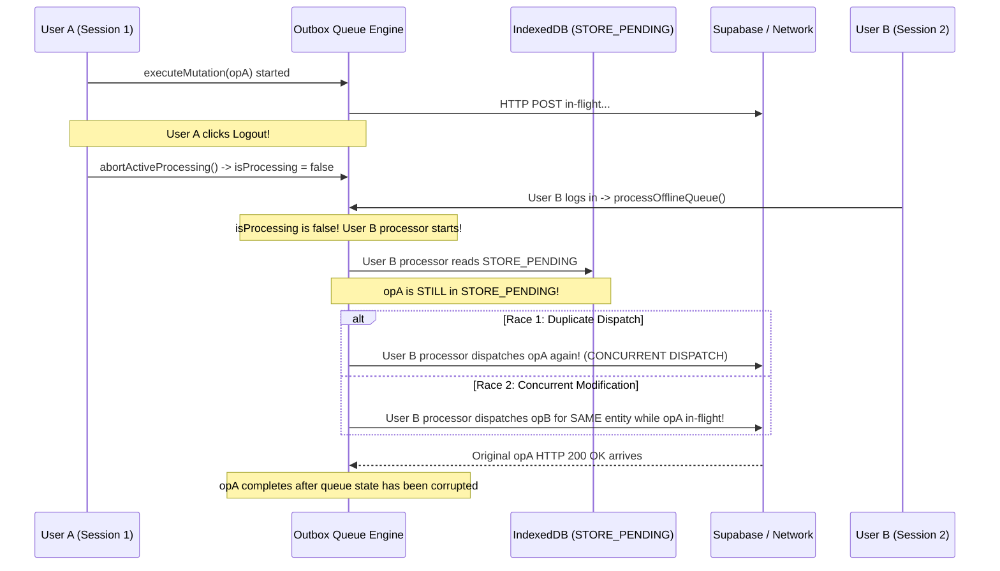
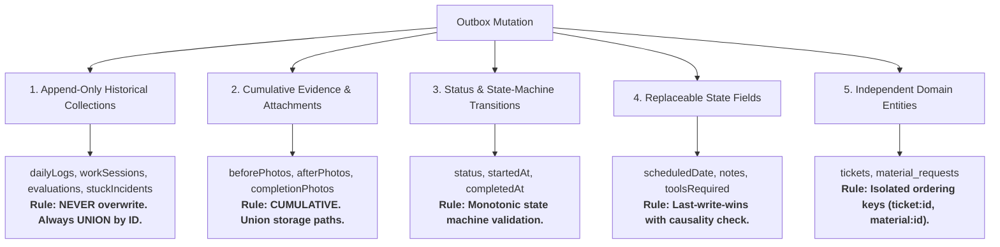
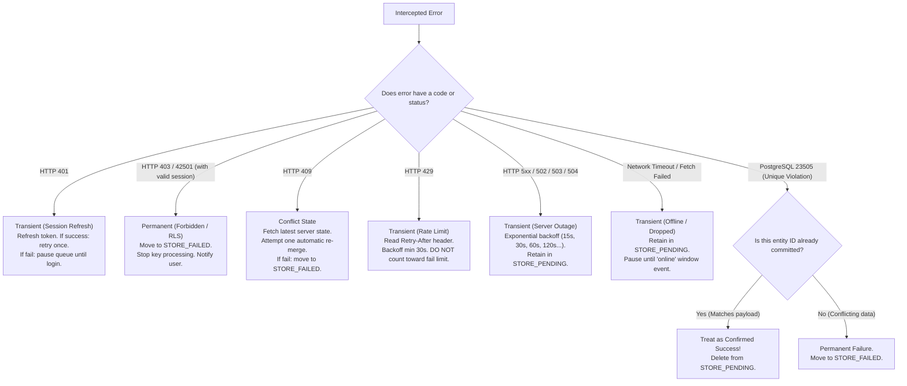

# QC Talaei — Milestone 1-B: Remediation Design v2
**Architectural Remediation Specification & Safety Guarantees**

**Phase:** Milestone 1-B (Minimal Context Architecture)  
**Document Version:** 2.0 (Revised Post-Architecture Review)  
**Baseline Test Suite:** 325 tests passing across 26 test files (100% pass rate) `[VERIFIED]`  
**Status:** Strictly READ-ONLY Investigation & Engineering Design  
**Target Files Inspected:**  
- [`src/utils/offlineQueue.ts`](file:///c:/Users/P30/Desktop/Gravity/talaie/src/utils/offlineQueue.ts) `[VERIFIED]`  
- [`src/utils/supabase.ts`](file:///c:/Users/P30/Desktop/Gravity/talaie/src/utils/supabase.ts) `[VERIFIED]`  
- [`src/App.tsx`](file:///c:/Users/P30/Desktop/Gravity/talaie/src/App.tsx) `[VERIFIED]`  
- [`src/utils/storage.ts`](file:///c:/Users/P30/Desktop/Gravity/talaie/src/utils/storage.ts) `[VERIFIED]`  
- Migrations: `001_security.sql`, `002_tables.sql`, `006_role_guards.sql`, `008_multiday_and_admin.sql`, `009_p0_security_teams_and_gates.sql`, `011_p1_server_capacity_and_history_protection.sql`, `013_p2_2_team_transfers.sql`, `014_p2_3_material_requests.sql` `[VERIFIED]`  

---

## 1. Outbox Concurrency, In-Flight Operations, and Logout Lifecycle

### 1.1 The Cross-Session Concurrency Race Condition
In the existing implementation, a dangerous race occurs when User A logs out while a network mutation is actively in flight:



#### Exact Mechanism of Failure `[VERIFIED: offlineQueue.ts L88-91, L1003, L1110-1122]`
1. User A begins `handlers.executeMutation(opA)` (`activeProcessingRunId = 1`).
2. User A logs out. `abortActiveProcessing()` executes: `activeProcessingRunId++` (now 2) and `isProcessing = false`.
3. User B logs in immediately. `App.tsx` calls `SupabaseSyncService.processOfflineQueue(userB.id)`.
4. Inside `processQueue()`: `if (isProcessing) return;` evaluates to `false` because logout reset it. User B's processor sets `isProcessing = true` and starts scanning `STORE_PENDING`.
5. **The in-flight operation `opA` is still in `STORE_PENDING`** because its network response has not returned yet.
6. If User A logs back in quickly, or if another trigger fires, `opA` could be read and dispatched a **second time concurrently**, sending two identical HTTP requests to Supabase with the same payload!
7. Even worse: If User B modifies the same entity (`project:p-100`), User B's mutation `opB` is dispatched **while User A's `opA` is still being executed on the wire**, leading to non-deterministic Postgres commit ordering!

### 1.2 Remediation: Per-Operation In-Flight Lease & Entity Key Locking
To guarantee zero duplicate dispatches and prevent cross-session entity races, we introduce an **In-Memory Mutual Exclusion Lease Engine**:

```typescript
// Memory-level concurrency guards (in src/utils/offlineQueue.ts) [INFERRED]
const inFlightOpIds = new Set<string>();
const inFlightKeys = new Set<string>();
const inFlightAbortControllers = new Map<string, AbortController>();
```

#### Concurrency Lifecycle Rules:
1. **Pre-Flight Claim:**  
   Before calling `handlers.executeMutation(op)`:
   - Check `if (inFlightOpIds.has(op.id) || inFlightKeys.has(op.orderingKey)) break;`
   - Atomically register: `inFlightOpIds.add(op.id)` and `inFlightKeys.add(op.orderingKey)`.
   - Create and register an `AbortController`: `inFlightAbortControllers.set(op.id, new AbortController())`.
2. **Logout Event (`abortActiveProcessing()`):**  
   - Increments `activeProcessingRunId++`.
   - Sets `isProcessing = false`.
   - **DOES NOT CLEAR `inFlightOpIds` or `inFlightKeys`!** Active in-flight requests remain leased until their physical network sockets resolve or timeout.
   - Any newly spawned queue processor (e.g. from User B) will see `inFlightOpIds.has(op.id)` and `inFlightKeys.has(op.orderingKey)` and **will strictly skip leased entities**.
3. **Post-Flight Acknowledgment (Independent of Active Session):**  
   When the physical network promise for `op` settles:
   ```typescript
   try {
     await handlers.executeMutation(op); // HTTP request
     // ALWAYS acknowledge server success in persistent storage
     await deleteOperationFromPendingStore(op.id);
   } catch (err) {
     // Handle failure or backoff
     await handleOperationFailure(op, err);
   } finally {
     // Release concurrency locks
     inFlightOpIds.delete(op.id);
     inFlightKeys.delete(op.orderingKey);
     inFlightAbortControllers.delete(op.id);
   }
   ```
4. **UI Notification Isolation:**  
   The UI notification and React state updates occur **only if** the active `sessionEpoch` matches the epoch captured when the operation was launched. If User A logged out, the completion acknowledges in IndexedDB but emits zero events to React.

---

## 2. Non-Destructive Multi-User Queue Semantics & Shift Handover

### 2.1 Elimination of Automatic Cross-User Quarantine
> [!CAUTION]
> **Mandatory Architecture Correction:**  
> Moving an older operation `opA` to `STORE_FAILED` merely because User B created a newer operation `opB` is **strictly prohibited**. A newer timestamp ($T_2 > T_1$) does **not** prove semantic supersession. In field operations, Team 1's work log and Team 2's work log are complementary historical records, not conflicting overrides.

### 2.2 Semantic Taxonomy of Mutations
Different fields and mutation types require completely different concurrency and merge semantics:



#### Detailed Taxonomy Specification:

| Category | Target Fields / Types | Server Database Behavior `[VERIFIED]` | Safe Client Reconciliation Rule |
|---|---|---|---|
| **1. Append-Only Collections** | `dailyLogs`, `workSessions`, `stuckIncidents`, `evaluations` | PostgreSQL `patch_project` does `data = current_data || patch` `[011_p1 L335]`. Sending raw array replaces the entire collection! | **Intelligent Union by ID:** When dispatching, fetch latest server project, concatenate server items with local items, deduplicate by item `id`, and send the unified array. |
| **2. Cumulative Evidence** | `beforePhotos`, `afterPhotos`, `completionPhotos`, `proposalImages` | Top-level JSONB `||` replaces array `[002_tables.sql L238]`. | **URL Union:** Concatenate existing server photo URLs with local photo URLs (`Array.from(new Set([...serverPhotos, ...localPhotos]))`). Never truncate evidence. |
| **3. State Transitions** | `status`, `startedAt`, `completedAt`, `qcStatus` | Server enforces `is_valid_status_transition(current, patch)` `[011_p1 L327]`. Invalid transition throws error. | **Monotonic Guard:** If server status is already `COMPLETED` ($T_2$), an older mutation at $T_1$ with `status: 'PAUSED'` must **strip the stale status field** from its patch while **preserving and dispatching its `dailyLogs` and `workSessions`**. |
| **4. Replaceable Fields** | `scheduledDate`, `notes`, `toolsRequired`, `customerSatisfaction` | Simple scalar overwrite in JSONB. | **Causal Last-Write-Wins:** Compare `patch.updatedAt` against `server.updatedAt`. If server is newer, prompt or merge non-conflicting fields. |
| **5. Domain Entities** | `CREATE_TICKET`, `PATCH_TICKET`, `CREATE_MATERIAL_REQUEST`, `PATCH_MATERIAL_REQUEST` | Each entity has its own primary key table (`tickets`, `material_requests`). | **Strict Entity Isolation:** Keyed by `ticket:<id>` and `material:<id>`. Completely independent from `project:<id>`. |

### 2.3 Shared Device and Shift Handover (Team 1 -> Team 2)
When Team 2 takes over a project from Team 1 on a shared offline tablet:

#### Handover Sequence Without Data Loss:
1. **Team 1 Offline Shift Completion:**  
   Team 1 logs 4 hours, attaches 2 photos, and marks shift paused:
   - `op1`: `userId = "team-1-user"`, `orderingKey = "project:p-100"`.
   - Payload: `{ dailyLogs: [log1], beforePhotos: [p1, p2], status: 'PAUSED', updatedAt: T1 }`.
   - Team 1 logs out while offline. `op1` is stored safely in `STORE_PENDING`.
2. **Team 2 Offline Shift Start:**  
   Team 2 logs in while offline.
   - `applyPendingToProjects` merges `op1` locally so Team 2 sees that Day 1 is logged and status is `PAUSED`.
   - Team 2 performs installation on Day 2:
   - `op2`: `userId = "team-2-user"`, `orderingKey = "project:p-100"`.
   - Payload: `{ dailyLogs: [log1, log2], completionPhotos: [p3, p4], status: 'COMPLETED', updatedAt: T2 }`.
   - Stored in `STORE_PENDING`.
3. **Device Reconnects Online (Team 2 Authenticated):**  
   - Queue processing runs.
   - For `project:p-100`, the queue contains `[op1 (Team 1), op2 (Team 2)]`.
   - **Can Team 2 dispatch `op1`?**  
     In PostgreSQL, `patch_project` verifies `auth.uid()` against project team assignment. If Team 2 is assigned or if custody was transferred via `013_p2_2_team_transfers.sql`, Team 2 has permission to patch the project.  
     However, to preserve strict audit integrity:
     - `op1` retains `dailyLogs[0].byUserId = "team-1-user"`.
     - When `op1` is dispatched, server receives Day 1 log.
     - When `op2` is dispatched, server receives Day 2 log and completion status.
   - **What if Team 1's op was NOT sent before Team 2's op?**  
     If `op2` dispatches first (setting status to `COMPLETED`), when `op1` dispatches later:
     - Client detects server status is `COMPLETED`.
     - Stale transition `status: 'PAUSED'` is stripped from `op1`.
     - Append-only items (`dailyLogs[0]`, `beforePhotos`) in `op1` are merged and sent.
     - **Result:** Both Day 1 and Day 2 logs exist in PostgreSQL. No data is lost. No coordinator intervention is required.
4. **When is Coordinator Intervention Genuinely Required?**  
   Coordinator intervention is invoked **only** if:
   - A true semantic contradiction occurs (e.g. Team 1 marked project `STUCK: Customer Refused Access`, while Team 2 marked project `COMPLETED`, and customer signatures conflict).
   - In that rare case, the conflict is surfaced to the QC Control Center as a `TRANSFER_CONFLICT` ticket without deleting either team's drafts.

---

## 3. Session Generation Epoch (`sessionEpoch`) & IndexedDB Compatibility

### 3.1 Resolving the Epoch Architecture
> [!IMPORTANT]
> **Definitive Architectural Clarification:**  
> `sessionEpoch` is **STRICTLY RUNTIME-ONLY** in memory (`AuthContext`). It is **NEVER persisted in IndexedDB**.  
> The IndexedDB v3 schema remains **100% UNCHANGED**.

### 3.2 Detailed Operational Specification
- **Storage Reality (IndexedDB v3 Schema `[VERIFIED: offlineQueue.ts L466-475]`):**
  ```typescript
  interface OutboxOperation {
    id: string;
    orderingKey: string;
    userId: string;
    type: OutboxMutationType;
    payload: any;
    createdAt: number;
    retryCount: number;
    nextRetryAt: number;
  }
  ```
  No `sessionEpoch` column or property is stored in IndexedDB.
- **Runtime Memory Reality (`AuthContext`):**
  - `sessionEpoch` is a module-scoped integer counter initialized to `1` on application load.
  - Every login, logout, account switch, or user deactivation increments `sessionEpoch++`.
- **Handling Legacy and Restored Operations in IndexedDB:**
  - Because `sessionEpoch` is not stored, existing or restored pending operations in IndexedDB are completely valid.
  - When the queue processor reads an operation from IndexedDB, it associates the dispatch with the **active runtime `sessionEpoch`** for that processing turn.
- **Callback Rejection vs Server Acknowledgment:**
  ```typescript
  // In src/utils/offlineQueue.ts (Revised processQueue loop) [INFERRED]
  const dispatchEpoch = handlers.getCurrentSessionEpoch(); // captured before HTTP call

  try {
    await handlers.executeMutation(op);

    // 1. ALWAYS acknowledge in IndexedDB (Database reality)
    await deleteOpFromPending(op.id);

    // 2. Reject UI callback if session changed (UI reality)
    if (handlers.getCurrentSessionEpoch() === dispatchEpoch) {
      handlers.notifySuccess(op); // Triggers React state, toast, sync badge
    } else {
      console.info(`[Outbox] Op ${op.id} succeeded on server; UI callback dropped (epoch mismatch).`);
    }
  } catch (err) {
    ...
  }
  ```

---

## 4. Retry Semantics, Unknown Outcomes, and Residual Risks

### 4.1 Comprehensive Mutation-by-Mutation Audit (Unknown Outcomes)
When a network connection drops while an HTTP request is in-flight (timeout or client disconnect), the client cannot determine if PostgreSQL committed the transaction.

| Mutation Type | RPC / SQL Path `[VERIFIED]` | Duplicate Execution Outcome | Safe Client Reconciliation Capability | Residual Risk Without DB Changes |
|---|---|---|---|---|
| `CREATE_PROJECT` | `client.from('projects').insert(...)` `[supabase.ts L787]` | Throws Postgres `23505 unique_violation` on `id` `[002_tables L15]`. | Catch `23505`. Read project by `id`. If payload matches, acknowledge success and delete from queue. | **None.** Fully deterministic. |
| `PATCH_PROJECT` | `client.rpc('patch_project', { id, patch })` `[supabase.ts L761]` | Merges `current_data || patch`. Re-applying replaces scalars with same values; appends could duplicate if unhandled. | Pre-flight: Re-read project data. Union arrays by item ID. Send idempotent patch. | **Low.** If concurrent user modifies scalar field between timeout and retry. |
| `APPEND_PROJECT_EVALUATION` | `client.rpc('append_project_evaluation', { id, item })` `[002 L256, 006 L151]` | **SQL DUPLICATION:** `coalesce(data->'evaluations', '[]') || jsonb_build_array(item)` **always appends!** `[002 L281]` | **Read-Check Pre-Flight:** Before retrying, client reads `projects.data->'evaluations'`. Checks if `evaluation.id` exists. If yes, skips RPC and marks success. | **MODERATE (Residual):** If another manager evaluates simultaneously, or if read query fails during network flapping. True idempotency requires SQL check. |
| `DELETE_PROJECT` | `client.rpc('admin_delete_project', ...)` `[supabase.ts L874]` | Project already deleted. RPC returns clean or 404. | If project not found, treat as deleted (success). | **None.** Idempotent. |
| `CREATE_TICKET` | `client.from('tickets').upsert(..., { onConflict: 'id' })` `[supabase.ts L1079]` | Upsert with primary key `id`. Overwrites with identical row. | Naturally idempotent. | **None.** Idempotent. |
| `PATCH_TICKET` | `client.from('tickets').update(...)` `[supabase.ts L1118]` | Updates row data by `id`. | Naturally idempotent for identical patch. | **None.** Idempotent. |
| `DELETE_TICKET` | `client.from('tickets').delete().eq('id', ticketId)` `[supabase.ts L1125]` | Deletes row by `id`. | Naturally idempotent. | **None.** Idempotent. |
| `CREATE_MATERIAL_REQUEST` | `client.rpc('create_material_request', ...)` `[014 L51]` | In Migration 014: `exception when unique_violation then return v_existing.data` `[014 L126]`. | Server-side idempotent IF migration 014 is deployed. | **HIGH if 014 not deployed; LOW if deployed.** |
| `PATCH_MATERIAL_REQUEST` | `client.rpc('patch_material_request', ...)` `[014 L154]` | Re-applies patch. | Same as `PATCH_PROJECT`. | **Low.** |

### 4.2 Safe Reconciliation for `APPEND_PROJECT_EVALUATION`
`[VERIFIED: 002_tables.sql L277-282, 006_role_guards.sql L176]`
Because `append_project_evaluation` in PostgreSQL does unconditional array appending:
1. Every evaluation object created on the client must carry an immutable unique `id` (`evaluation.id = uuid()`).
2. Before retrying an operation of type `APPEND_PROJECT_EVALUATION` whose previous outcome was unknown:
   - The queue processor performs a read-only query:
     ```typescript
     const { data: proj } = await client.from('projects').select('data').eq('id', op.payload.id).single();
     const existingEvaluations = proj?.data?.evaluations || [];
     const alreadyAppended = existingEvaluations.some((e: any) => e.id === op.payload.evaluation.id);
     ```
   - If `alreadyAppended === true`: The server already received and committed the evaluation during the previous attempt. The client **must not call `append_project_evaluation` again**. It deletes `op` from `STORE_PENDING` and treats the mutation as confirmed success.
   - If `alreadyAppended === false`: The server did not commit it. Safe to dispatch RPC.

---

## 5. Precise HTTP & Database Error Classification

To prevent infinite retry loops on unrecoverable errors while ensuring reliable recovery on transient drops, errors must be categorized with precision:



### Detailed Error Handling Matrix:

| Error Type / Status | Classification | Retry Action | Queue State Action | User / UI Presentation |
|---|---|---|---|---|
| **HTTP 401 (Unauthorized)** | Transient (Auth) | Call `client.auth.refreshSession()`. If refreshed, retry immediately. | If refresh fails, halt queue without marking failed. | Header badge: "نشست منقضی شده. لطفاً مجدداً وارد شوید." |
| **HTTP 403 / 42501 (RLS Violation)** | Permanent | **No retry.** | Delete from `STORE_PENDING`, write to `STORE_FAILED` (scoped to `op.userId`). | Toast: "عدم دسترسی مجاز برای این عملیات." |
| **HTTP 409 (Conflict)** | Reconcilable | Re-fetch entity, attempt client merge. If still conflicting, mark permanent. | If merge succeeds: re-dispatch. If fails: move to `STORE_FAILED`. | Drawer: "تعارض در داده‌های پروژه با سرور." |
| **HTTP 429 (Rate Limit)** | Transient | Exponential backoff (minimum 30s or `Retry-After`). | Retain in `STORE_PENDING`. Does not increment failure counter. | Sync badge: "محدودیت درخواست سرور. شکیبا باشید." |
| **HTTP 500 / 502 / 503 / 504** | Transient | Exponential backoff with jitter (15s, 30s, 1m, 2m, 4m, max 15m). | Retain in `STORE_PENDING`. | Sync badge: "خطای موقت سرور. تلاش مجدد..." |
| **Network Timeout / Status 0 / 'Load Failed'** | Transient | Backoff paused while offline. Resume on `online` event. | Retain in `STORE_PENDING`. | Sync badge: "آفلاین (در صف ارسال)" |
| **PostgreSQL 23505 (Unique Violation)** | Conditional | If ID already exists with matching payload: treat as success. Else permanent. | Success: delete from pending. Conflicting: move to failed. | If success: none. If conflicting: "شناسه تکراری است." |

---

## 6. Upload Ownership & Blob Preservation

### 6.1 Strict Blob Preservation Mandate
> [!IMPORTANT]
> **Field Evidence Protection Rule:**  
> Photo blobs in `STORE_UPLOADS` represent physical evidence captured by technicians on roofs, job sites, and client premises.  
> **Under NO circumstances should automatic queue errors, operation failure, shift handover, or quarantine DELETE photo blobs from `STORE_UPLOADS`!**

### 6.2 Upload Ownership Model
Each record in `STORE_UPLOADS` must carry explicit ownership:
```typescript
interface PendingUpload {
  id: string;              // Upload record ID
  operationId: string;     // Foreign key to OutboxOperation.id
  userId: string;          // Author of the upload
  orderingKey: string;     // Entity key (e.g. project:p-100)
  targetPath: string;      // Dot-path in payload (e.g. 'dailyLogs.0.photos.1')
  blob: Blob | File;       // The binary photo data
  createdAt: number;
}
```

### 6.3 Exact Cleanup Conditions
Blobs in `STORE_UPLOADS` may be deleted **ONLY** under two specific conditions:
1. **Confirmed Server Upload:**  
   `storagePath = await handlers.uploadBlob(u)` resolves successfully, and the resulting storage URL is atomically written into `op.payload` in `STORE_PENDING`. The blob is then safely deleted from `STORE_UPLOADS` `[VERIFIED: offlineQueue.ts L1085-1105]`.
2. **Explicit User Discard:**  
   The user opens the Failed Operations drawer and explicitly clicks **«حذف قطعی پیش‌نویس» (Permanently Discard Draft)**. A confirmation modal warns the user that unsent photos will be permanently deleted. Only then are associated records in `STORE_UPLOADS` removed.

---

## 7. Mutation Validation Architecture & Backdoor Prevention

### 7.1 The Three-Tier Architecture
To guarantee that generic transport mechanisms cannot become an unguarded path for unauthorized mutations, we enforce strict architectural tiering:

```mermaid
graph TD
    subgraph Tier 1: Identity & Session Lifecycle
        Auth["AuthContext<br/>- currentUser: User | null<br/>- sessionEpoch: number (Runtime-Only)<br/>- login(), logout()"]
    end

    subgraph Tier 2: Domain Mutation Hooks (Security & Guard Tier)
        PM["useProjectMutations()<br/>- validateProjectPatchRoleGuards<br/>- Manager direct create/delete guard<br/>- Evaluation guards"]
        TM["useTicketMutations()<br/>- validateTicketRoleGuards"]
        MM["useMaterialMutations()<br/>- canCreateMaterialRequest<br/>- canConfirmMaterialReceipt"]
    end

    subgraph Tier 3: Transport & Outbox (Infrastructure Tier)
        Sync["SyncContext<br/>- Structural invariants validation<br/>- Identity stamping (userId, sessionEpoch)<br/>- Queue trigger & counts"]
        IDB[(IndexedDB Outbox)]
    end

    Auth --> PM
    Auth --> TM
    Auth --> MM
    Auth --> Sync

    PM -- "Validated OutboxMutation" --> Sync
    TM -- "Validated OutboxMutation" --> Sync
    MM -- "Validated OutboxMutation" --> Sync

    Sync -- "Atomic Enqueue" --> IDB
```

### 7.2 Structural Invariants Enforced in `SyncContext.enqueue`
Even if a developer attempts to call `SyncContext.enqueue` directly, the infrastructure layer enforces the following structural security invariants:
1. **Identity Binding:** `mutation.userId` is forced to `currentUser.id`. No caller can supply a foreign `userId`.
2. **Deletion Prohibition:** `if (mutation.type === 'DELETE_MATERIAL_REQUEST') throw new Error('حذف فیزیکی درخواست متریال مجاز نمی‌باشد.');` `[VERIFIED: App.tsx L535]`
3. **Payload Sanitization:** Rejects payloads containing raw `data:image/` base64 strings that bypassed photo extraction `[VERIFIED: offlineQueue.ts L757]`.
4. **Ordering Key Enforcement:** Rejects mutations without a valid entity prefix (`project:`, `ticket:`, `material:`, `settings`).

### 7.3 Preservation of All 20 Guarded Mutation Call Sites
All 20 call sites previously identified in `App.tsx` (lines 626 to 1390) map 1:1 to methods on `useProjectMutations`, `useTicketMutations`, and `useMaterialMutations`. Zero business logic or security checks are bypassed.

---

## 8. Classification of Architectural Changes

To maintain strict compliance with engineering constraints, all proposed changes are grouped by feasibility:

### Group A: Safe to Implement Without Database Changes `[VERIFIED]`
- **In-Flight Lease & Key Locks (`inFlightOpIds`, `inFlightKeys`):** Pure in-memory mechanism in `offlineQueue.ts`.
- **Runtime-Only `sessionEpoch` in `AuthContext`:** Pure memory state in React; zero IndexedDB schema changes.
- **Post-Logout Completion Acknowledgment:** Deletes confirmed mutations from `STORE_PENDING` while dropping UI callbacks.
- **Append-Only Array Union Pre-Flight:** Client-side array deduplication by ID for `dailyLogs`, `workSessions`, and `photos`.
- **User-Scoped `STORE_FAILED` (`blockedKeys`):** Filters failed keys by `userId === currentUserId`.
- **Photo Blob Preservation:** Prevents deletion of `STORE_UPLOADS` on failed operations.
- **HTTP Error Classification:** Refines `isTransientError` for 401, 403, 409, 429, and 5xx.
- **Three-Tier Mutation Hooks:** Pure frontend architecture preserving all 20 guarded call sites.

### Group B: Requires Further Source-Code Investigation `[REQUIRES VALIDATION]`
- **Realtime Listener Re-Subscription Performance:** Measure memory overhead when rapidly switching users and rebinding Supabase Realtime channels.
- **IndexedDB Multi-Tab Concurrency:** Behavior when two browser tabs run the queue simultaneously (consider `navigator.locks` API).

### Group C: Cannot Be Guaranteed Without Database Changes `[RESIDUAL RISKS]`
- **True Network-Level Idempotency for `PATCH_PROJECT`:** Without a dedicated `idempotency_key` column and unique constraint on `projects`, an unknown-outcome retry after a network drop cannot be 100% mathematically proven idempotent on the server if another user patched the project concurrently.
- **Array Deduplication in `append_project_evaluation`:** Because SQL function `append_project_evaluation` `[002_tables.sql L281]` does unconditional array appending (`|| jsonb_build_array(item)`), true server-side idempotency requires updating the SQL function to check `item->>'id'`. Client read-checks mitigate this but cannot eliminate the race condition if two managers evaluate concurrently.
- **Server-Side Enforcement of Warehouse Roles:** If migrations 009 and 014 are not deployed to production PostgreSQL, warehouse security policies remain enforced by client-side guards rather than database RLS.

---

## 9. Comprehensive Deterministic Test Design

To guarantee zero regressions against the **325-test baseline**, the test suite must implement deterministic tests for all edge cases:

### Test Suite Specification: `src/utils/__tests__/outboxRemediationV2.test.ts`

```typescript
describe('M1-B Outbox Concurrency & Shift Handover Safety Suite v2', () => {

  // Test 1: Two queue processors racing on the same operation
  it('should prevent second queue processor from dispatching an operation already in-flight', async () => {
    // 1. Seed op in STORE_PENDING
    // 2. Mock handlers.executeMutation with a 100ms delay
    // 3. Trigger processor 1 (claims inFlightOpIds)
    // 4. Trigger processor 2 immediately
    // Assert: executeMutation was invoked EXACTLY ONCE
  });

  // Test 2: Logout during in-flight request followed by another login
  it('should acknowledge server success in IndexedDB after logout without triggering User B UI callbacks', async () => {
    // 1. User A starts opA (sessionEpoch = 1)
    // 2. User A logs out (sessionEpoch = 2) -> abortActiveProcessing()
    // 3. User B logs in (sessionEpoch = 2)
    // 4. opA HTTP 200 OK resolves
    // Assert: opA is DELETED from STORE_PENDING (acknowledged!)
    // Assert: User B receives NO toast, NO state update
  });

  // Test 3: Unknown server outcome and retry reconciliation
  it('should reconcile unknown outcome for CREATE_PROJECT on 23505 unique violation', async () => {
    // 1. Op creates project 'p-test'
    // 2. executeMutation throws PostgrestError code 23505 (already exists)
    // 3. Queue error handler fetches project 'p-test'
    // Assert: Op is marked successful and deleted from STORE_PENDING
  });

  // Test 4: Append-only history preservation during shift handover
  it('should union dailyLogs from Team 1 and Team 2 without overwriting either log', async () => {
    // 1. Team 1 creates dailyLog1 on project 'p-1' offline
    // 2. Team 2 creates dailyLog2 on project 'p-1' offline
    // 3. Reconcile queue dispatches
    // Assert: Final server payload contains BOTH dailyLog1 and dailyLog2
  });

  // Test 5: Monotonic status preservation on late sync
  it('should strip stale status transition from older op while preserving its dailyLogs', async () => {
    // 1. Team 1 queues status 'PAUSED' + dailyLog1
    // 2. Team 2 queues status 'COMPLETED' + dailyLog2
    // 3. Team 2 completes first on server
    // 4. Team 1 late sync executes
    // Assert: Server status remains 'COMPLETED'
    // Assert: Team 1 dailyLog1 is appended to server dailyLogs
  });

  // Test 6: Cross-user failed operation isolation
  it('should not block User B when User A has a failed operation on the same entity', async () => {
    // 1. Insert failed op for User A in STORE_FAILED for 'project:p-1'
    // 2. Insert pending op for User B in STORE_PENDING for 'project:p-1'
    // 3. Run queue as User B
    // Assert: User B's op executes successfully; blockedKeys only scopes to User A
  });

  // Test 7: Upload blob preservation on failure
  it('should never delete blobs from STORE_UPLOADS when an operation fails or is held', async () => {
    // 1. Queue op with pending upload in STORE_UPLOADS
    // 2. Mock executeMutation to throw permanent 403 Forbidden
    // 3. Run queue -> op moves to STORE_FAILED
    // Assert: Upload record and binary blob remain intact in STORE_UPLOADS
  });

  // Test 8: Realtime and initial-load session isolation
  it('should drop Realtime events and initial-load responses from previous session epoch', async () => {
    // 1. Capture loadCloudData with epoch 1
    // 2. Increment epoch to 2 (logout)
    // 3. Resolve loadCloudData promise
    // Assert: setProjects is NOT called; state remains empty
  });

  // Test 9: Validation preservation across all 20 guarded mutation paths
  it('should reject unauthorized role mutations before touching Outbox across all 20 call sites', async () => {
    // Test each domain hook method with unauthorized role
    // Assert: returns false, Outbox.commit is never called
  });

});
```

---

## 10. Implementation Sequence & Unresolved Decisions

### 10.1 Implementation Sequence
Implementation must proceed in strict linear phases, verifying test baselines at each boundary:

1. **Phase 1: Engine Hardening (`offlineQueue.ts`)**
   - Add in-memory `inFlightOpIds` and `inFlightKeys` locks.
   - Decouple server completion deletion from queue halt check.
   - Implement append-only array unioning for `dailyLogs` and `photos`.
   - Scope `blockedKeys` in `STORE_FAILED` strictly by `userId === currentUserId`.
   - Protect `STORE_UPLOADS` against deletion on operation failure.
   - Refine `isTransientError` with HTTP error classification matrix.
   - *Verification: All 325 baseline tests + new outbox unit tests pass.*
2. **Phase 2: Runtime Session Epoch (`App.tsx` & Realtime)**
   - Add in-memory `sessionEpoch` to session lifecycle.
   - Guard Realtime listeners and `loadCloudData()` against epoch mismatches.
   - *Verification: Session switch tests pass.*
3. **Phase 3: Context & Domain Hook Extraction**
   - Extract `AuthContext` (owning user state, role, session lifecycle, `sessionEpoch`).
   - Extract `SyncContext` (owning transport, queue counts, `enqueue`, `triggerSync`).
   - Extract `useProjectMutations`, `useTicketMutations`, and `useMaterialMutations`.
   - Rebind the 20 UI handlers in `App.tsx` to the domain hooks.
   - *Verification: Full regression test suite (325 baseline + 9 new suites) passes with zero errors.*

### 10.2 Unresolved Decisions for Project Stakeholders
1. **Material Request Server Migration Status:**  
   Confirm whether Migration 014 has been deployed to the production Supabase database. If unverified, material request idempotent recovery relies entirely on client-side error inspection.
2. **Evaluation Concurrency Policy:**  
   Confirm whether a future database migration to add an `id` unique check inside `append_project_evaluation` SQL is authorized, or if client-side pre-flight read checks are permanently acceptable.
