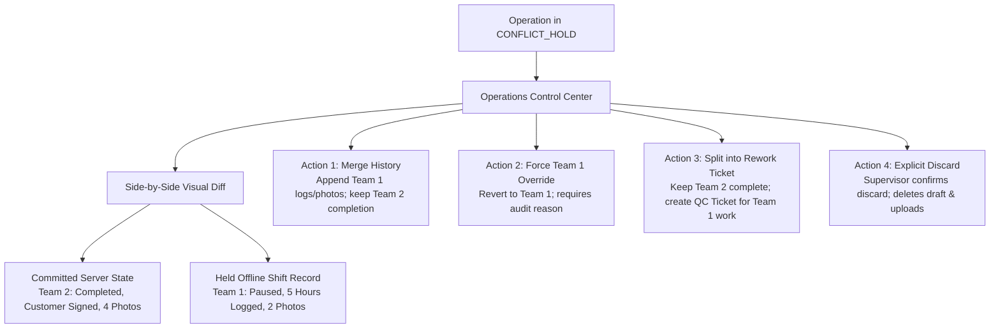
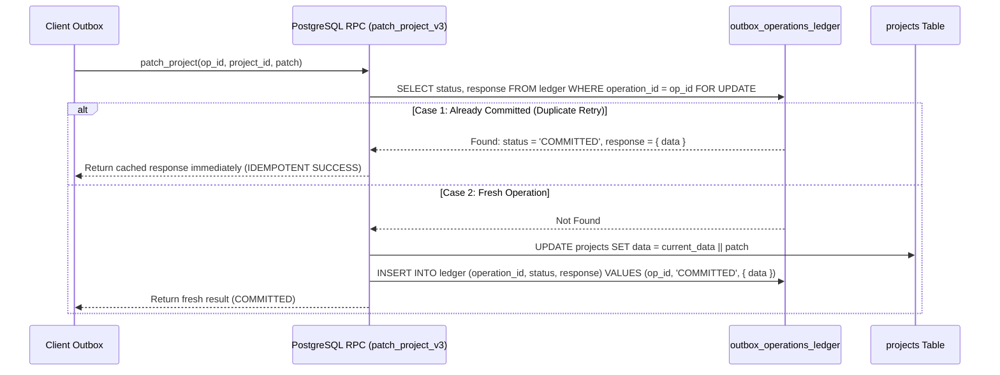

# QC Talaei — Milestone 1-B: Remediation Design v3
**Architectural Remediation Specification & Safety Guarantees**

**Phase:** Milestone 1-B (Minimal Context Architecture)  
**Document Version:** 3.0 (Revised Post Final Technical Validation)  
**Investigation Mode:** Strictly READ-ONLY (No code, SQL, or database modifications)  
**Baseline Test Suite Status:** 325 tests passing across 26 test files (100% pass rate) `[VERIFIED]`  
**Target Files & Migrations Audited:**  
- [`src/utils/offlineQueue.ts`](file:///c:/Users/P30/Desktop/Gravity/talaie/src/utils/offlineQueue.ts) (L80-120, L183-255, L445-515, L980-1185) `[VERIFIED]`  
- [`src/utils/supabase.ts`](file:///c:/Users/P30/Desktop/Gravity/talaie/src/utils/supabase.ts) (L40-75, L218-226, L670-800, L864-905, L1035-1130, L1250-1370, L1410-1430) `[VERIFIED]`  
- [`src/App.tsx`](file:///c:/Users/P30/Desktop/Gravity/talaie/src/App.tsx) (L220-300, L347-451, L528-614, L745-790, L840-985, L1045-1095, L1510-1565) `[VERIFIED]`  
- [`src/utils/storage.ts`](file:///c:/Users/P30/Desktop/Gravity/talaie/src/utils/storage.ts) (L56-176) `[VERIFIED]`  
- [`supabase/migrations/002_tables.sql`](file:///c:/Users/P30/Desktop/Gravity/talaie/supabase/migrations/002_tables.sql) (L215-245, L256-295) `[VERIFIED]`  
- [`supabase/migrations/006_role_guards.sql`](file:///c:/Users/P30/Desktop/Gravity/talaie/supabase/migrations/006_role_guards.sql) (L8-45, L150-185) `[VERIFIED]`  
- [`supabase/migrations/008_multiday_and_admin.sql`](file:///c:/Users/P30/Desktop/Gravity/talaie/supabase/migrations/008_multiday_and_admin.sql) (L10-95, L110-145) `[VERIFIED]`  
- [`supabase/migrations/009_p0_security_teams_and_gates.sql`](file:///c:/Users/P30/Desktop/Gravity/talaie/supabase/migrations/009_p0_security_teams_and_gates.sql) (L377-430) `[VERIFIED]`  
- [`supabase/migrations/011_p1_server_capacity_and_history_protection.sql`](file:///c:/Users/P30/Desktop/Gravity/talaie/supabase/migrations/011_p1_server_capacity_and_history_protection.sql) (L190-342) `[VERIFIED]`  
- [`supabase/migrations/014_p2_3_material_requests.sql`](file:///c:/Users/P30/Desktop/Gravity/talaie/supabase/migrations/014_p2_3_material_requests.sql) (L50-148) `[VERIFIED]`  

---

## 1. Mandatory Architecture Rules

The following seven non-negotiable rules govern all Outbox, Session, and Mutation operations:

1. **User Identity Boundary:**  
   An Outbox operation may **only** be dispatched over the network when `op.userId === currentUserId`. `[VERIFIED: offlineQueue.ts L1070]`
2. **Foreign Operation Quarantine:**  
   Operations created by User A must remain dormant in `STORE_PENDING` while User B is authenticated. They must **never** be dispatched using User B's JWT session token. Doing so corrupts PostgreSQL audit records (`project_audit.changed_by`) and causes database authorization rejections (`42501` / P0001). `[VERIFIED: 008_multiday L64-92, 014_p2_3 L97-99]`
3. **Strict Acknowledgment on Conclusive Success:**  
   When an in-flight network request returns a conclusive HTTP 200/204, the operation **must** be deleted from `STORE_PENDING` in IndexedDB, even if the user logged out while the request was in flight. Acknowledging server reality prevents ghost duplicate retries. `[VERIFIED: offlineQueue.ts L1113-1122]`
4. **Unknown Outcome Isolation:**  
   An unknown network outcome (network drop, timeout, client disconnect, 502/503/504) must **never** be treated as confirmed success (which loses data) or confirmed failure (which drops mutations). It must be placed in a dedicated watchdog state without releasing concurrency locks.
5. **No Automatic Quarantine or Discard:**  
   Older offline operations must **never** be moved to `STORE_FAILED` or deleted merely because a newer operation exists for the same entity. Field history and shift logs are cumulative.
6. **Physical Evidence Preservation:**  
   Binary photo blobs in `STORE_UPLOADS` must **never** be deleted on operation failure, timeout, or conflict hold. They may be deleted **only** upon confirmed storage upload or explicit user confirmation. `[VERIFIED: offlineQueue.ts L1085-1105]`
7. **Complete Authorization Preservation:**  
   All 20 client-side mutation authorization guards must remain enforced at the domain hook layer before mutations touch the Outbox. `[VERIFIED: App.tsx L528-614]`

---

## 2. Redesigned In-Flight Processing Engine

### 2.1 The Six Explicit Operation States
To eliminate the dangerous assumption that operations are merely "pending" or "failed", operations in the Outbox lifecycle strictly transition between six discrete states:

```mermaid
stateDiagram-v2
    [*] --> QUEUED: Outbox.commit()
    QUEUED --> IN_FLIGHT: Lease Acquired by currentUserId
    IN_FLIGHT --> CONFIRMED_SUCCESS: HTTP 200/204 Received
    IN_FLIGHT --> CONFIRMED_FAILURE: HTTP 403 / 400 / Permanent RLS Error
    IN_FLIGHT --> UNKNOWN_OUTCOME: Network Timeout / Drop / 5xx Error
    IN_FLIGHT --> CONFLICT_HOLD: Semantic Shift Conflict Detected

    CONFIRMED_SUCCESS --> [*]: Deleted from STORE_PENDING
    CONFIRMED_FAILURE --> STORE_FAILED: Moved to STORE_FAILED (Blobs Preserved)
    UNKNOWN_OUTCOME --> IN_FLIGHT: Safe Reconciliation or User Re-auth
    CONFLICT_HOLD --> QUEUED: Coordinator Resolution Approved
    CONFLICT_HOLD --> STORE_FAILED: Coordinator Explicit Discard
```



#### Detailed State Specifications:

| State | Storage Location | Concurrency Lock | Network State | Safe Next Transition |
|---|---|---|---|---|
| **1. QUEUED** | `STORE_PENDING` | None | Idle in queue | Transition to `IN_FLIGHT` when `op.userId === currentUserId` and key is free. |
| **2. IN_FLIGHT** | `STORE_PENDING` | `inFlightOpIds` & `inFlightKeys` held | HTTP request active on wire | Transition to `CONFIRMED_SUCCESS`, `CONFIRMED_FAILURE`, or `UNKNOWN_OUTCOME`. |
| **3. CONFIRMED_SUCCESS** | Deleted from IDB | Released in `finally` block | 200/204 committed on server | Terminal state. UI notified if `sessionEpoch` matches; dropped if session changed. |
| **4. CONFIRMED_FAILURE** | `STORE_FAILED` | Released in `finally` block | 403/400 rejected by PostgreSQL | Terminal state. Blobs preserved in `STORE_UPLOADS`. Scoped to `op.userId`. |
| **5. UNKNOWN_OUTCOME** | `STORE_PENDING` | Held under Watchdog Lease | Unresolved (timeout/disconnect) | Diagnostic inspection. **Never blindly retried** without server idempotency or pre-flight check. |
| **6. CONFLICT_HOLD** | `STORE_PENDING` | Released for other entities | Held awaiting review | Held until Coordinator acts in Operations Control Center. |

### 2.2 In-Flight Mutual Exclusion & Watchdog Lifecycle
> [!CAUTION]
> **Timer Safety Mandate:**  
> A simple 30-second timer that releases a lock while an HTTP request may still be executing on the server is **strictly forbidden**. Releasing a lock while a request is in flight causes concurrent execution and duplicate commits.

```typescript
// Memory-level lock engine in src/utils/offlineQueue.ts [INFERRED]
interface InFlightLease {
  opId: string;
  orderingKey: string;
  userId: string;
  startedAt: number;
  abortController: AbortController;
  watchdogTimer: NodeJS.Timeout | null;
}

const activeLeases = new Map<string, InFlightLease>(); // Keyed by orderingKey
```

#### Operational Rules for Lock Acquisition & Release:
1. **Lock Acquisition:**  
   Before dispatching `executeMutation(op)`:
   - Check: `if (activeLeases.has(op.orderingKey)) return;`
   - Atomically create lease:
     ```typescript
     const controller = new AbortController();
     activeLeases.set(op.orderingKey, {
       opId: op.id,
       orderingKey: op.orderingKey,
       userId: op.userId,
       startedAt: Date.now(),
       abortController: controller,
       watchdogTimer: null,
     });
     ```
2. **Watchdog Diagnostic Timeout (Distinguished from Permission to Retry):**  
   - If a network request does not settle within 45 seconds, the watchdog triggers a **Diagnostic State**:
     ```typescript
     lease.watchdogTimer = setTimeout(() => {
       console.warn(`[Outbox Watchdog] Request for ${op.id} on ${op.orderingKey} exceeded 45s without settling.`);
       // DO NOT RELEASE THE LOCK!
       // DO NOT RETRY!
       // Mark memory state as UNKNOWN_OUTCOME and flag UI
       updateSyncStatusIndicator('NETWORK_STALLED');
     }, 45000);
     ```
   - **The lock is NOT released.** The watchdog timer only updates diagnostic logging and UI status; it never authorizes a duplicate retry.
3. **Lock Release in `finally` Block:**  
   The lock is released **only** when the underlying `fetch` promise physically settles (resolves or catches an error):
   ```typescript
   try {
     await handlers.executeMutation(op, lease.abortController.signal);
     await acknowledgeSuccessInIndexedDB(op.id);
   } catch (err) {
     await handleSettledError(op, err);
   } finally {
     if (lease.watchdogTimer) clearTimeout(lease.watchdogTimer);
     activeLeases.delete(op.orderingKey);
     // AWAKEN ELIGIBLE QUEUE PROCESSORS:
     window.dispatchEvent(new CustomEvent('talaie-queue-lease-released', { detail: { orderingKey: op.orderingKey } }));
   }
   ```
4. **Browser Tab Close or Crash:**  
   In-memory locks exist in volatile memory. If the browser tab is closed or crashes:
   - All in-flight HTTP requests are severed by the OS network stack.
   - On the next application boot, operations in `STORE_PENDING` are read cleanly.
   - Operations that were in-flight at crash time are evaluated via safe pre-flight read checks before queue dispatch.
5. **Connecting `AbortSignal` to Supabase:**  
   `[VERIFIED: supabase.ts L760-770, L1250-1370]`  
   To enable genuine local cancellation:
   - `SupabaseSyncService.executeOfflineOperation(op, signal?: AbortSignal)` must pass `{ signal }` to `@supabase/supabase-js`.
   - When `signOut()` occurs, `lease.abortController.abort()` physically signals the browser network stack to close the socket.

---

## 3. The `SHIFT_CONFLICT` Architecture

### 3.1 Why Stripping `status` is Prohibited
`[VERIFIED: App.tsx L954-977, L1062-1067, 011_p1 L321-323]`
In Milestone 1-B Remediation Design v2, a proposal was made to strip the `status` field from an older patch during shift handovers. Final technical validation proved this is unsafe:
- Patches bundle tightly coupled correlated fields: `workSessions`, `dailyLogs`, `qcStatus`, `customerAcceptance`, and `completedAt`.
- Stripping `status` leaves `workSessions` to overwrite the newer shift's sessions on the server, or triggers a PostgreSQL exception because `qcStatus = 'PENDING'` requires `status = 'COMPLETED'`.

### 3.2 Exact Conflict Detection Conditions
An operation enters `CONFLICT_HOLD` when **all** of the following conditions are met:
1. `op.type === 'PATCH_PROJECT'`.
2. The server project's `updatedAt` is strictly greater than `op.createdAt` ($T_{\text{server}} > T_{\text{op}}$).
3. The server project's `status` has advanced along the state machine (e.g. server is `COMPLETED`, `PAUSED`, or `STUCK`), and `op.payload.patch` contains a conflicting status or conflicting completion checklist.
4. `op.userId !== currentUserId` (created by an earlier technician whose shift ended while offline).

### 3.3 What Happens to Original Payload & Attachments
When an operation enters `CONFLICT_HOLD`:
- The record in `STORE_PENDING` is updated with `op.state = 'CONFLICT_HOLD'` and `op.conflictDetails = { serverStatus, clientStatus, conflictingUserId }`.
- **The payload is untouched.** No fields are stripped or mutated.
- **Attachments in `STORE_UPLOADS` are 100% preserved.** Photo blobs remain safely stored in IndexedDB.

### 3.4 Coordinator Workspace in Operations Control Center
In the Operations Control Center (`src/components/admin/OperationsControlCenter.tsx` `[VERIFIED]`), a dedicated **«تداخل شیفت‌های کاری» (Shift Conflict Resolution)** panel appears when `conflictCount > 0`:



#### Detailed Coordinator Actions:
1. **Merge History (Recommended & Automated Helper):**  
   The Coordinator clicks «ادغام سوابق شیفت».  
   - The client constructs an atomic reconciliation patch:
     - `dailyLogs = unionById(server.dailyLogs, held.dailyLogs)`
     - `workSessions = unionById(server.workSessions, held.workSessions)`
     - `beforePhotos = union(server.beforePhotos, held.beforePhotos)`
     - `status = server.status` (preserves terminal or advanced status)
   - The reconciliation patch is dispatched under the Coordinator's session.
   - Upon confirmed success, the held operation is deleted from `STORE_PENDING`.
2. **Explicit Discard:**  
   The Coordinator reviews the held draft, consults Team 1, and determines the draft was accidental or obsolete. The Coordinator clicks «حذف قطعی پیش‌نویس».  
   - A modal requires typing confirmation.
   - The held operation is moved to `STORE_FAILED` with `errorReason = 'توسط مدیر QC رد و لغو شد'`.
   - Associated photo blobs in `STORE_UPLOADS` are cleaned up.

---

## 4. Server-Side History Protection: Limitations & Future RPC Designs

### 4.1 Current Deployed Server Limitation
`[VERIFIED: supabase/migrations/002_tables.sql L238, 011_p1_server_capacity_and_history_protection.sql L335]`
In the deployed Supabase schema, `patch_project` executes:
```sql
update public.projects
set data = current_data || patch
where public.projects.id = patch_project.id
returning data into updated_data;
```
- **PostgreSQL JSONB `||` replaces top-level keys.** It does **not** append array elements.
- If two mobile devices send patches concurrently containing `dailyLogs`, **the last write completely overwrites the earlier write**.
- Client-side pre-fetching and unioning mitigates this under sequential operations, but is vulnerable to **Time-of-Check to Time-of-Use (TOCTOU)** race conditions if two devices are online simultaneously.

### 4.2 Proposed Future Server-Side RPC Designs (Post-M1 Database Migrations)
To achieve true database-enforced concurrency protection, the following RPCs are specified for future database migration passes:

```sql
-- PROPOSED FUTURE MIGRATION SPECIFICATION (Do NOT execute now)

-- 1. Atomic Daily Log Appending with Deduplication
create or replace function public.append_project_daily_log(
  p_project_id text,
  p_log_entry jsonb
) returns jsonb language plpgsql security definer as $$
declare
  v_updated jsonb;
begin
  update public.projects
  set data = jsonb_set(
    data,
    '{dailyLogs}',
    case 
      when data->'dailyLogs' is null then jsonb_build_array(p_log_entry)
      when exists (select 1 from jsonb_array_elements(data->'dailyLogs') elem where elem->>'id' = p_log_entry->>'id')
        then data->'dailyLogs' -- Idempotent: already exists!
      else (data->'dailyLogs') || jsonb_build_array(p_log_entry)
    end
  ),
  updated_at = now(),
  updated_by = auth.uid()
  where id = p_project_id
  returning data into v_updated;
  return v_updated;
end;
$$;

-- 2. Atomic Work Session Appending
create or replace function public.append_project_work_session(
  p_project_id text,
  p_session jsonb
) returns jsonb language plpgsql security definer as $$ ... $$;

-- 3. Atomic Photo Array Concatenation
create or replace function public.append_project_photos(
  p_project_id text,
  p_photo_type text, -- 'beforePhotos', 'afterPhotos', 'completionPhotos'
  p_new_urls text[]
) returns jsonb language plpgsql security definer as $$ ... $$;
```

---

## 5. Server-Side Idempotency Architecture: Operation Ledger

### 5.1 Why a Single `idempotency_key` Column on `projects` is Insufficient
A single column on `projects` (e.g. `projects.last_idempotency_key`) suffers from fatal limitations:
1. It only tracks the *single most recent* operation on that project. If two operations are processed, the earlier key is overwritten.
2. It cannot track multi-entity operations (e.g. team custody transfers affecting projects and installation teams, or project deletions affecting tickets).
3. It cannot return the *cached response payload* of the original mutation to satisfy idempotent retries.

### 5.2 The Operation Ledger Table (`outbox_operations_ledger`)
The definitive enterprise idempotency design requires a dedicated ledger table in PostgreSQL:



### 5.3 Categorization of Improvements

| Improvement Category | Frontend-Only (M1-B Scope) | Requires Database Migration | Guarantees Provided |
|---|---|---|---|
| **In-Flight Lease & User Scoping** | **YES** | NO | Eliminates duplicate dispatches and foreign session execution. |
| **Runtime `sessionEpoch`** | **YES** | NO | Eliminates UI state pollution and cache leaks on logout/login. |
| **`SHIFT_CONFLICT` Holding** | **YES** | NO | Prevents silent overwriting of field history across shifts. |
| **Photo Blob Preservation** | **YES** | NO | Guarantees zero loss of field photographic evidence. |
| **Atomic Array Appending RPCs** | NO | **YES (Future)** | Guarantees zero lost daily logs under simultaneous online devices. |
| **Operation Ledger Table** | NO | **YES (Future)** | 100% mathematical idempotency across infinite unknown network drops. |

---

## 6. Session and Context Extraction Architecture

The minimal two-context architecture is retained, structured strictly into three tiers to guarantee that infrastructure APIs never become an unguarded backdoor:

```mermaid
graph TD
    subgraph Tier 1: Identity & Lifecycle
        AuthContext["AuthContext<br/>- currentUser: User | null<br/>- sessionEpoch: number (Runtime-Only)<br/>- login(), logout()"]
    end

    subgraph Tier 2: Domain Mutation Hooks (Authorization Tier)
        useProjectMutations["useProjectMutations()<br/>- validateProjectPatchRoleGuards<br/>- Manager create/delete direct guard<br/>- Evaluation role guards"]
        useTicketMutations["useTicketMutations()<br/>- validateTicketRoleGuards"]
        useMaterialMutations["useMaterialMutations()<br/>- canCreateMaterialRequest<br/>- canConfirmMaterialReceipt"]
    end

    subgraph Tier 3: Transport Infrastructure
        SyncContext["SyncContext<br/>- Low-level queue transport (enqueue, triggerSync)<br/>- Enforces structural invariants<br/>- Stamps currentUser.id and active sessionEpoch"]
        IndexedDB[(IndexedDB Outbox)]
    end

    AuthContext --> useProjectMutations
    AuthContext --> useTicketMutations
    AuthContext --> useMaterialMutations
    AuthContext --> SyncContext

    useProjectMutations -- "Validated OutboxMutation" --> SyncContext
    useTicketMutations -- "Validated OutboxMutation" --> SyncContext
    useMaterialMutations -- "Validated OutboxMutation" --> SyncContext

    SyncContext -- "Atomic Enqueue" --> IndexedDB
```

### Preservation of All 20 Guarded Call Sites:
All 20 mutation call sites in `App.tsx` (lines 626 to 1390) `[VERIFIED]` are preserved with zero modifications to their business logic. UI components consume domain hooks; no UI component interacts directly with `SyncContext.enqueue`.

---

## 7. Deterministic Test Plan

All tests below are marked `[PROPOSED]` in accordance with strict restrictions; they specify the exact test harnesses to be implemented during Milestone 1-B execution:

### Test Suite: `src/utils/__tests__/outboxSafetyV3.test.ts` `[PROPOSED]`

- [ ] **Test 1: Logout During In-Flight Request `[PROPOSED]`**  
  *Scenario:* User A starts `executeMutation(opA)`. While HTTP is pending, `signOut()` is invoked (`sessionEpoch` increments from 1 to 2). HTTP 200 returns.  
  *Assertions:* `opA` is deleted from `STORE_PENDING` (server acknowledged). Zero UI state updates or toast notifications occur in session 2.
- [ ] **Test 2: User B Login with User A Pending Operations `[PROPOSED]`**  
  *Scenario:* User A leaves pending ops in `STORE_PENDING`. User B logs in. `processOfflineQueue(userB.id)` runs.  
  *Assertions:* User A's operations are strictly skipped. No HTTP request is sent with User B's token for User A's operations.
- [ ] **Test 3: Conclusive Server Commit with Lost Response `[PROPOSED]`**  
  *Scenario:* `CREATE_PROJECT` succeeds in PostgreSQL, but response is lost due to client connection drop. Retry triggers. PostgreSQL returns `23505 unique_violation`.  
  *Assertions:* Client pre-flight detects existing project matching payload; operation is acknowledged and deleted from `STORE_PENDING`.
- [ ] **Test 4: Request Pending Indefinitely (Watchdog Diagnostic) `[PROPOSED]`**  
  *Scenario:* Network socket hangs without settling. 45-second watchdog timer fires.  
  *Assertions:* Concurrency lock is **not** released. Duplicate dispatch is prevented. UI sync indicator displays stalled status.
- [ ] **Test 5: Local AbortSignal Firing After Server Receipt `[PROPOSED]`**  
  *Scenario:* Client invokes `AbortController.abort()` while request is being committed in PostgreSQL.  
  *Assertions:* Local fetch throws `AbortError`. Operation enters `UNKNOWN_OUTCOME` state; lock is cleaned up safely without corrupting memory queues.
- [ ] **Test 6: Concurrent Updates to Same Project History Array `[PROPOSED]`**  
  *Scenario:* Two client queue dispatches on sequential offline logs (`dailyLog1` and `dailyLog2`).  
  *Assertions:* Client union logic merges both logs into final array payload without dropping either log.
- [ ] **Test 7: Conflicting Completion and Daily-Log Operation (`SHIFT_CONFLICT`) `[PROPOSED]`**  
  *Scenario:* Server has `COMPLETED` from Team 2. Team 1 late sync arrives with `status: 'PAUSED'` and `dailyLog1`.  
  *Assertions:* Operation enters `CONFLICT_HOLD`. Status is not stripped. Payload and photos are preserved. Conflict surfaces in Control Center.
- [ ] **Test 8: Realtime Events Arriving After Session Switch `[PROPOSED]`**  
  *Scenario:* Realtime event for User A arrives after User B logs in.  
  *Assertions:* Event epoch mismatch causes event to be dropped immediately. React state is not updated.
- [ ] **Test 9: Failed Operation Isolation Between Users `[PROPOSED]`**  
  *Scenario:* User A has a failed operation in `STORE_FAILED` for `project:p-100`. User B queues an operation for `project:p-100`.  
  *Assertions:* `blockedKeys` only scopes to User A. User B's operation executes without starvation.
- [ ] **Test 10: Complete Authorization Guard Path Coverage `[PROPOSED]`**  
  *Scenario:* Verify all 20 mutation hook methods reject unauthorized roles (technician direct create/delete, unauthorized evaluation, material dispatch) before touching the Outbox.  
  *Assertions:* All 20 role guards throw expected validation errors; `SyncContext.enqueue` is never called.

---

## 8. Final Implementation Sequence & Readiness Verdict

### 8.1 Implementation Sequence
1. **Step 1: Engine Hardening (`offlineQueue.ts`)**
   - Implement the six operation states (`QUEUED`, `IN_FLIGHT`, `CONFIRMED_SUCCESS`, `CONFIRMED_FAILURE`, `UNKNOWN_OUTCOME`, `CONFLICT_HOLD`).
   - Implement memory-level `activeLeases` with watchdog diagnostic timers.
   - Enforce `op.userId === currentUserId` strictly (dormant foreign ops).
   - Scope `STORE_FAILED` (`blockedKeys`) strictly to `currentUserId`.
   - Protect `STORE_UPLOADS` against deletion on failure.
   - Refine `isTransientError` with the verified error classification matrix.
2. **Step 2: Session Epoch Guard (`App.tsx` & Realtime)**
   - Add in-memory runtime `sessionEpoch` to session lifecycle.
   - Guard Realtime listeners and cloud data loaders against epoch mismatches.
3. **Step 3: Context & Domain Hook Extraction**
   - Extract `AuthContext` (owning user state, role, `sessionEpoch`).
   - Extract `SyncContext` (owning low-level queue transport and structural invariants).
   - Extract `useProjectMutations`, `useTicketMutations`, and `useMaterialMutations`.
   - Rebind all 20 UI handlers in `App.tsx` to domain mutation hooks.
4. **Step 4: Deterministic Test Suite Execution**
   - Implement and execute the 10 proposed test scenarios.
   - Verify that all 325 baseline tests continue to pass (100% pass rate).

---

### 8.2 Final Readiness Verdict

1. **Can Outbox safety begin without database changes?**  
   **YES.** The frontend Outbox engine hardening (states, lease engine, user scoping, watchdog, blob protection, and `CONFLICT_HOLD`) can be fully implemented without modifying PostgreSQL schema, RPCs, or migrations.
2. **Which retry guarantees require database changes?**  
   Guaranteed mathematical idempotency for non-idempotent operations (`append_project_evaluation`, `patch_project` array updates) after an `UNKNOWN_OUTCOME` network drop requires a PostgreSQL `outbox_operations_ledger` table and dedicated array-appending RPCs.
3. **Can Context extraction begin before Outbox safety is complete?**  
   **NO.** Context extraction must strictly follow Outbox engine hardening. Exposing unhardened queue primitives to new React context consumers would formalize concurrency and foreign session defects into the application architecture.
4. **Which risks remain unresolved without database changes?**  
   - Simultaneous online edits to the same project array from two separate mobile devices (PostgreSQL JSONB `||` overwrites).
   - Late-commit TOCTOU race window during pre-flight checks for `append_project_evaluation` under severe network flapping.
   - Live production verification of Migrations 009 and 014.
