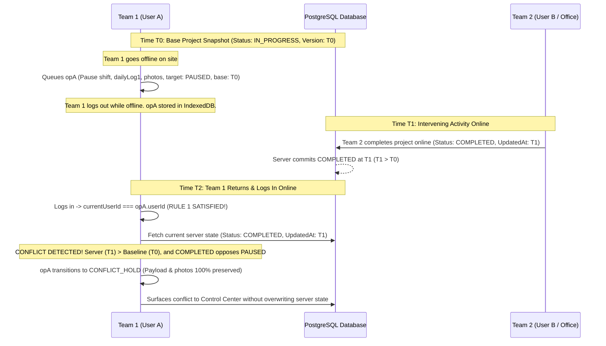
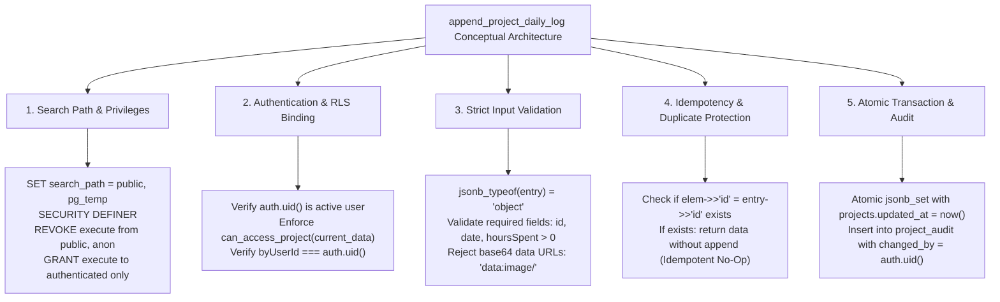

# QC Talaei — Milestone 1-B: Remediation Design v3.1
**Targeted Consistency Correction & Rigorous Architecture Specification**

**Phase:** Milestone 1-B (Minimal Context Architecture)  
**Document Version:** 3.1 (Consistency & Concurrency Correction)  
**Investigation Mode:** Strictly READ-ONLY (No code, SQL, or database modifications)  
**Baseline Test Suite Status:** 325 tests passing across 26 test files (100% pass rate) `[VERIFIED]`  
**Target Files & Migrations Audited:**  
- [`src/utils/offlineQueue.ts`](file:///c:/Users/P30/Desktop/Gravity/talaie/src/utils/offlineQueue.ts) (L80-120, L183-255, L445-515, L980-1185) `[VERIFIED]`  
- [`src/utils/supabase.ts`](file:///c:/Users/P30/Desktop/Gravity/talaie/src/utils/supabase.ts) (L40-75, L218-226, L670-800, L864-905, L1035-1130, L1250-1370, L1410-1430) `[VERIFIED]`  
- [`src/App.tsx`](file:///c:/Users/P30/Desktop/Gravity/talaie/src/App.tsx) (L220-300, L347-451, L528-614, L745-790, L840-985, L1045-1095, L1510-1565) `[VERIFIED]`  
- [`src/utils/storage.ts`](file:///c:/Users/P30/Desktop/Gravity/talaie/src/utils/storage.ts) (L56-176) `[VERIFIED]`  
- [`supabase/migrations/002_tables.sql`](file:///c:/Users/P30/Desktop/Gravity/talaie/supabase/migrations/002_tables.sql) (L215-245, L256-295) `[VERIFIED]`  
- [`supabase/migrations/006_role_guards.sql`](file:///c:/Users/P30/Desktop/Gravity/talaie/supabase/migrations/006_role_guards.sql) (L8-45, L150-185) `[VERIFIED]`  
- [`supabase/migrations/008_multiday_and_admin.sql`](file:///c:/Users/P30/Desktop/Gravity/talaie/supabase/migrations/008_multiday_and_admin.sql) (L10-95, L110-145) `[VERIFIED]`  
- [`supabase/migrations/009_p0_security_teams_and_gates.sql`](file:///c:/Users/P30/Desktop/Gravity/talaie/supabase/migrations/009_p0_security_teams_and_gates.sql) (L377-430) `[VERIFIED]`  
- [`supabase/migrations/011_p1_server_capacity_and_history_protection.sql`](file:///c:/Users/P30/Desktop/Gravity/talaie/supabase/migrations/011_p1_server_capacity_and_history_protection.sql) (L190-342) `[VERIFIED]`  
- [`supabase/migrations/014_p2_3_material_requests.sql`](file:///c:/Users/P30/Desktop/Gravity/talaie/supabase/migrations/014_p2_3_material_requests.sql) (L50-148) `[VERIFIED]`  

---

## 1. Resolution of Contradictions & Architecture Invariants

### 1.1 The Mandatory User Identity Rule
`[VERIFIED: src/utils/supabase.ts L40-75, supabase/migrations/008_multiday_and_admin.sql L64-92]`
- In PostgreSQL, every authenticated mutation evaluates `auth.uid()` from the active JWT token in the HTTP `Authorization` header.
- The PostgreSQL `projects_audit_trigger` automatically binds `project_audit.changed_by = auth.uid()`.
- **Invariant:** An operation created by User A **MUST ONLY** be dispatched over the network when `currentUserId === op.userId`. Dispatching User A's operation using User B's session token causes permanent audit trail corruption and triggers hard PostgreSQL RLS rejections (`42501` / P0001).
- Operations belonging to another user must remain dormant in `STORE_PENDING` until their original creator logs back into the application.

---

## 2. Issue 1: Redesign of `SHIFT_CONFLICT` Detection

### 2.1 Resolution of the v3 Contradiction
In Remediation Design v3, a logical contradiction existed:
- Rule 1 required: `op.userId === currentUserId` (only dispatch own operations).
- Section 3.2 required: `op.userId !== currentUserId` (trigger conflict when created by another user).

**The Architectural Correction:**
User identity mismatch is **NOT** the primary conflict condition. Conflict detection occurs when the **original returning user (`op.userId === currentUserId`)** attempts to synchronize an offline operation whose causal baseline has been invalidated by intervening server activity.



### 2.2 Redesigned Conflict Detection Conditions
An operation enters `CONFLICT_HOLD` when **all** of the following conditions are met:
1. **Target Entity:** `op.type === 'PATCH_PROJECT'`.
2. **Identity Match:** `op.userId === currentUserId` (the authentic creator is syncing).
3. **Baseline Divergence:**  
   The server project's `updatedAt` is strictly greater than the snapshot timestamp when `op` was created:
   $$T_{\text{server}} > T_{\text{base}}$$
4. **State Machine Incompatibility:**  
   The server project's `status` has advanced along the state machine such that applying `op.payload.patch.status` constitutes an invalid or backward transition according to PostgreSQL business rules:
   - Server status is `COMPLETED`, while `op` attempts `PAUSED` or `IN_PROGRESS` (Postgres `is_valid_status_transition` would throw).
   - Server status is `STUCK`, while `op` attempts `COMPLETED` without addressing the stuck incident.
   - Server project contains a conflicting signed `customerAcceptance` or conflicting `handoverChecklist`.

### 2.3 How a Returning Original User Detects the Conflict
When User A logs back in and connectivity is restored:
1. `loadCloudData()` fetches the latest `cloudProjects` from PostgreSQL `[VERIFIED: App.tsx L255]`.
2. Before queue execution, the queue controller compares `op.baseUpdatedAt` (the project's `updatedAt` at the moment `commit()` was called) against `cloudProject.updatedAt`.
3. If $T_{\text{server}} > T_{\text{base}}$ and the status transition is contradictory:
   - The queue engine sets `op.state = 'CONFLICT_HOLD'`.
   - **The payload is untouched.** No fields are stripped.
   - **Binary photos in `STORE_UPLOADS` are 100% preserved.**
   - The user is notified: *"وضعیت پروژه روی سرور توسط شیفت دیگری به «اتمام کار» تغییر یافته است. اطلاعات ثبت‌شده شما حفظ شده و جهت بررسی به مدیر ارشد ارسال گردید."*
   - In the Operations Control Center, the Coordinator sees the side-by-side diff to resolve the conflict.

---

## 3. Issue 2: Browser Crash & Unknown Outcome Modeling

### 3.1 The Post-Crash Scenario
We model the critical distributed systems boundary:
1. Client dispatches `executeMutation(op)`.
2. Network packet reaches Supabase; PostgreSQL commits the transaction.
3. The browser crashes or closes **before receiving or storing the HTTP response**.
4. The application restarts.
5. `op` is still present in `STORE_PENDING` in IndexedDB.

> [!WARNING]
> **Factual Correction:**  
> Browser closure does **NOT** guarantee that a request was not committed on the server.  
> Treating a post-crash operation as uncommitted and blindly retrying causes duplicate entries, whereas treating it as committed without verification causes data loss.  
> **Client-side preflight reads DO NOT provide mathematical idempotency** due to Time-of-Check to Time-of-Use (TOCTOU) race windows.

### 3.2 Operation-by-Operation Post-Restart Recovery Matrix

| Operation Type | Deployed Server Behavior `[VERIFIED]` | Post-Restart Automated Verification | Outcome Classification | Safe Action |
|---|---|---|---|---|
| **`CREATE_PROJECT`** | `insert into projects (id, data)` `[supabase.ts L787]`. Fails with `23505` if exists. | Query: `select data from projects where id = op.payload.id`. | If exists & core data matches: **Conclusive Success**.<br/>If exists with conflicting data: **Conclusive Failure**.<br/>If missing: **Safe Idempotent Retry**. | If success: delete from `STORE_PENDING`.<br/>If missing: re-dispatch insert.<br/>If conflict: move to `STORE_FAILED`. |
| **`PATCH_PROJECT` (Scalar fields)** | `update projects set data = current || patch` `[011_p1 L335]`. | Query project `data`. Compare scalar fields (`notes`, `scheduledDate`). | If server reflects patch: **Conclusive Success**.<br/>If server `updatedAt > op.createdAt` and fields differ: **Conflict Hold**. | If success: delete from pending.<br/>If conflict: enter `CONFLICT_HOLD`. |
| **`PATCH_PROJECT` (History Arrays)** | Top-level JSONB `||` overwrites array `[002_tables L238]`. | Query project `dailyLogs` / `workSessions`. Check if `log.id` exists. | If `log.id` exists: **Conclusive Success**.<br/>If missing: **Unknown Outcome (Residual Risk)**. | If missing: Client merges array by ID and dispatches, but logs warning of TOCTOU residual risk. |
| **`CREATE_TICKET`** | `upsert into tickets (id, data) on conflict (id)` `[supabase.ts L1079]`. | Idempotent upsert by primary key. | **Safe Idempotent Retry**. | Safe to re-dispatch immediately. |
| **`PATCH_TICKET`** | `update tickets set data = ... where id = ...` `[supabase.ts L1118]`. | Idempotent update of existing ticket. | **Safe Idempotent Retry**. | Safe to re-dispatch immediately. |
| **`DELETE_TICKET` / `DELETE_PROJECT`** | Deletes row by primary key `id` `[supabase.ts L874, L1125]`. | If row already deleted, delete query returns 0 rows without error. | **Safe Idempotent Retry**. | Safe to re-dispatch immediately. |
| **`CREATE_MATERIAL_REQUEST`** | In Migration 014: handles `unique_violation` gracefully `[014 L126]`. | Check `select id from material_requests where id = op.payload.id`. | If exists: **Conclusive Success**.<br/>If missing & 014 deployed: **Safe Idempotent Retry**. | If 014 deployed: safe retry.<br/>If 014 not deployed: **Manual Reconciliation**. |
| **`APPEND_PROJECT_EVALUATION`** | Unconditional array append: `|| jsonb_build_array(item)` `[002 L281, 006 L180]`. | Query `evaluations`. Check if `evaluation.id` is in array. | If `id` present: **Conclusive Success**.<br/>If `id` missing: **Unknown Outcome (High Risk)**. | If missing: Do NOT blindly retry. Escalate to **Manual Reconciliation** to avoid duplicate array entries. |

---

## 4. Issue 3: Non-Deadlocking `UNKNOWN_OUTCOME` Recovery

### 4.1 Persisted Representation in IndexedDB
To prevent in-memory lock leakage while surviving browser crashes, `UNKNOWN_OUTCOME` is stored directly inside the operation record in `STORE_PENDING`:
```typescript
interface OutboxOperation {
  id: string;
  orderingKey: string;
  userId: string;
  type: OutboxMutationType;
  payload: any;
  createdAt: number;
  retryCount: number;
  nextRetryAt: number;
  // State machine fields [INFERRED]
  executionState: 'QUEUED' | 'IN_FLIGHT' | 'UNKNOWN_OUTCOME' | 'CONFLICT_HOLD';
  lastAttemptedAt?: number;
  unknownReason?: 'TIMEOUT' | 'NETWORK_DROP' | 'HTTP_5XX' | 'POST_CRASH_RESTART';
}
```

### 4.2 Behavior After Browser Restart
- When the application boots, memory locks are empty (`activeLeases` is empty).
- The queue controller reads `STORE_PENDING`. Any operation flagged as `IN_FLIGHT` from a previous session that crashed is automatically transitioned to `executionState = 'UNKNOWN_OUTCOME'`.
- **Causal FIFO Ordering Preservation:**  
  Subsequent operations on the same `orderingKey` (e.g. `op2` on `project:p-100`) are **held in `QUEUED` state behind `op1`**. They are not executed out of order and not deleted.
- **Unlocking Other Entities:**  
  Independent entity keys (e.g. `project:p-101`, `ticket:t-5`) are completely free to process in parallel.

### 4.3 UI Presentation & Resolution Workflow
1. **Visual Indicator:**  
   In the Application Header and Project Card, an amber alert badge appears:  
   «ارسال نامشخص — در انتظار تایید سرور» (Unknown Transmission — Awaiting Verification).
2. **The Unresolved Operations Drawer:**  
   Clicking the badge opens a dedicated resolution view displaying:
   - Entity ID and Operation Type.
   - Exact timestamp when the network dropped.
   - Current server state vs local pending mutation payload.
3. **Automated Probe vs Manual Action:**
   - **Phase A (Automated Probe):** On reconnection, the client issues a read-only probe (`fetchProjects()`). If the entity proves the mutation succeeded (e.g. project exists or patch applied), the operation transitions to `CONFIRMED_SUCCESS` and deletes from `STORE_PENDING`.
   - **Phase B (Manual Coordinator Resolution):** If automated probe cannot prove outcome (non-idempotent operations):
     - Action 1: «تایید ثبت در سرور» (Acknowledge as Committed): Marks success, deletes from pending, unblocks subsequent operations on that key.
     - Action 2: «ارسال مجدد» (Force Retry): Permitted only after manual confirmation that the mutation is not duplicated.
     - Action 3: «لغو پیش‌نویس» (Discard Draft): Removes from pending, preserves photo blobs in `STORE_UPLOADS`.

> [!IMPORTANT]
> **Watchdog Invariant:**  
> A watchdog diagnostic timeout **must NEVER authorize a blind retry**. It serves solely to update diagnostic states and alert the user; locks are released only upon promise settlement or manual resolution.

---

## 5. Issue 4: Conceptual Security Architecture for Future RPCs

The proposed RPC `append_project_daily_log` is a **conceptual specification only** for future database migration passes. It must fulfill the following security and architectural criteria:



### Detailed Security Requirements (Design Only — No Migrations Executed):
1. **Search Path Hijacking Protection:**  
   The function must declare `SET search_path = public, pg_temp;` to prevent malicious schema injection in `SECURITY DEFINER` mode.
2. **Authorization & Access Guards:**  
   - Verify `auth.uid()` is not null and `public.is_active_user()` is true.
   - Verify caller is assigned to the project or is a manager/coordinator (`public.is_coordinator_or_manager() or public.can_access_project(...)`).
   - Strict identity binding: If caller is a technician, `entry->>'byUserId'` must strictly equal `auth.uid()::text`.
3. **Payload Sanitization & Constraints:**  
   - Require valid JSONB object schema with non-empty `id` (UUID or deterministic log ID), valid Jalali/ISO `date`, and positive `hoursSpent`.
   - Reject any string containing `"data:image/"` to enforce prior photo upload to Supabase Storage.
4. **Server-Side Idempotency Guard:**  
   - Before appending, inspect `data->'dailyLogs'`. If any existing element matches `elem->>'id' = entry->>'id'`, return the current project data immediately without appending a duplicate.
5. **Atomic Audit Logging:**  
   - Atomically append to `dailyLogs`, update `projects.updated_at = now()`, update `projects.updated_by = auth.uid()`, and insert an audit record into `public.project_audit` within the same PostgreSQL transaction.

---

## 6. Issue 5: Concurrent Multi-Client Race Simulation Test

### 6.1 Test Specification: `src/utils/__tests__/concurrentClientsRace.test.ts` `[PROPOSED]`

This test simulates two independent mobile clients reading the same initial server state and submitting different daily logs concurrently, mathematically proving why client-side merging is insufficient and demonstrating the necessity of future server-side atomic RPCs:

```typescript
// PROPOSED TEST SPECIFICATION (Specification Only — Not Executed)
describe('Concurrent Multi-Client Shift Logging Race Simulation', () => {

  it('[PROPOSED] proves current patch_project loses updates under concurrent client writes', async () => {
    // 1. Initial server state
    let serverProject = {
      id: 'p-100',
      data: {
        dailyLogs: [{ id: 'log-0', date: '1403-08-01', hours: 4, note: 'Initial setup' }],
        updatedAt: '2026-11-14T10:00:00Z',
      },
    };

    // 2. Client 1 (Team 1) and Client 2 (Team 2) read identical initial state
    const client1View = JSON.parse(JSON.stringify(serverProject));
    const client2View = JSON.parse(JSON.stringify(serverProject));

    // 3. Client 1 creates log-1 offline; Client 2 creates log-2 offline
    const log1 = { id: 'log-1', date: '1403-08-02', hours: 5, note: 'Team 1 work' };
    const log2 = { id: 'log-2', date: '1403-08-02', hours: 6, note: 'Team 2 work' };

    // 4. Both clients perform client-side union based on their local view:
    const client1Patch = {
      dailyLogs: [...client1View.data.dailyLogs, log1], // [log-0, log-1]
      updatedAt: '2026-11-14T11:00:00Z',
    };
    const client2Patch = {
      dailyLogs: [...client2View.data.dailyLogs, log2], // [log-0, log-2]
      updatedAt: '2026-11-14T11:01:00Z',
    };

    // 5. Simulating current deployed patch_project RPC: data = current_data || patch
    // Client 1 write arrives first:
    serverProject.data = { ...serverProject.data, ...client1Patch };
    expect(serverProject.data.dailyLogs).toHaveLength(2); // contains log-0, log-1

    // Client 2 write arrives second (concurrent race):
    serverProject.data = { ...serverProject.data, ...client2Patch };

    // 6. MATHEMATICAL PROOF OF DATA LOSS:
    // log-1 is completely missing! Client 2's patch overwrote Client 1's patch!
    expect(serverProject.data.dailyLogs.map(l => l.id)).toEqual(['log-0', 'log-2']);
    expect(serverProject.data.dailyLogs.some(l => l.id === 'log-1')).toBe(false);
  });

  it('[PROPOSED] proves future atomic append_project_daily_log preserves both concurrent entries', async () => {
    let serverDailyLogs = [{ id: 'log-0', date: '1403-08-01', hours: 4, note: 'Initial setup' }];

    // Simulated atomic server RPC function
    const atomicAppendRPC = (newLog: any) => {
      if (!serverDailyLogs.some(l => l.id === newLog.id)) {
        serverDailyLogs = [...serverDailyLogs, newLog];
      }
      return serverDailyLogs;
    };

    const log1 = { id: 'log-1', date: '1403-08-02', hours: 5, note: 'Team 1 work' };
    const log2 = { id: 'log-2', date: '1403-08-02', hours: 6, note: 'Team 2 work' };

    // Both clients dispatch atomic RPC concurrently:
    await Promise.all([
      Promise.resolve(atomicAppendRPC(log1)),
      Promise.resolve(atomicAppendRPC(log2)),
    ]);

    // ZERO DATA LOSS: Both logs are preserved regardless of arrival order!
    expect(serverDailyLogs).toHaveLength(3);
    expect(serverDailyLogs.map(l => l.id)).toContain('log-1');
    expect(serverDailyLogs.map(l => l.id)).toContain('log-2');
  });

});
```

---

## 7. Categorization of Engineering Scope

### Group A: Safe to Implement in Frontend Without Database Changes `[VERIFIED]`
- **User Identity Scoping:** Enforce `op.userId === currentUserId`. Foreign operations stay dormant in `STORE_PENDING`.
- **Six Operation States:** Implement `QUEUED`, `IN_FLIGHT`, `CONFIRMED_SUCCESS`, `CONFIRMED_FAILURE`, `UNKNOWN_OUTCOME`, `CONFLICT_HOLD`.
- **In-Memory Concurrency Lease:** Implement `activeLeases` per `orderingKey` with watchdog diagnostic timers (no premature timer retries).
- **Wakeup Event:** Dispatch `talaie-queue-lease-released` when an in-flight operation promise settles.
- **`SHIFT_CONFLICT` Detection:** Baseline divergence ($T_{\text{server}} > T_{\text{base}}$) detection and routing to Operations Control Center.
- **Physical Photo Blob Preservation:** Prevent deletion of `STORE_UPLOADS` on failed, unknown, or held operations.
- **Runtime `sessionEpoch` in `AuthContext`:** Discard stale Realtime events and UI callbacks after session switches.
- **Three-Tier Mutation Architecture:** Implement `useProjectMutations`, `useTicketMutations`, `useMaterialMutations`, preserving all 20 guarded call sites.

### Group B: Requires Future Database Changes (Post-M1 Migrations) `[REQUIRES DB MIGRATION]`
- **Atomic History RPCs:** `append_project_daily_log`, `append_project_work_session`, `append_project_photos`.
- **Server-Side Idempotency Ledger:** `outbox_operations_ledger` table with row-level locks (`FOR UPDATE`).
- **Server-Side Array Check for Evaluations:** Update `append_project_evaluation` SQL to check `elem->>'id' = item->>'id'`.

---

## 8. Safe Implementation Sequence & Final Readiness Verdict

### 8.1 Implementation Sequence
1. **Step 1: Engine Hardening (`offlineQueue.ts`)**  
   Implement the six operation states, user identity boundary, in-memory `activeLeases` with watchdog diagnostic timers, `CONFLICT_HOLD` baseline divergence detection, and blob preservation in `STORE_UPLOADS`.
2. **Step 2: Runtime Session Epoch (`App.tsx` & Realtime)**  
   Implement in-memory `sessionEpoch` in session lifecycle. Guard Realtime subscriptions and initial cloud loaders against epoch mismatches.
3. **Step 3: Context & Domain Mutation Extraction**  
   Extract `AuthContext`, `SyncContext`, and the three domain mutation hooks (`useProjectMutations`, `useTicketMutations`, `useMaterialMutations`), preserving all 20 guarded call sites.
4. **Step 4: Regression & Proposed Test Implementation**  
   Implement the proposed safety test suite alongside the 325 passing baseline tests.

---

### 8.2 Final Readiness Verdict

1. **Can Outbox safety begin without database changes?**  
   **YES.** The complete Group A frontend scope (states, lease engine, user scoping, watchdog diagnostics, blob protection, baseline conflict detection) can be implemented safely without modifying PostgreSQL tables, RPCs, or migrations.
2. **Which retry guarantees require database changes?**  
   Guaranteed mathematical idempotency under unknown network outcomes for non-idempotent operations (`append_project_evaluation` and `patch_project` array updates) requires future database migrations (`outbox_operations_ledger` and atomic array RPCs).
3. **Can Context extraction begin before Outbox safety is complete?**  
   **NO.** Context extraction must strictly follow Outbox engine hardening.
4. **Which risks remain unresolved without database changes?**  
   - Simultaneous online concurrent edits to the same project array from two separate devices (due to PostgreSQL JSONB `||` overwriting).
   - Late-commit TOCTOU race windows on pre-flight evaluation checks under severe network flapping.
   - Verification of live production deployment status for Migrations 009 and 014.
