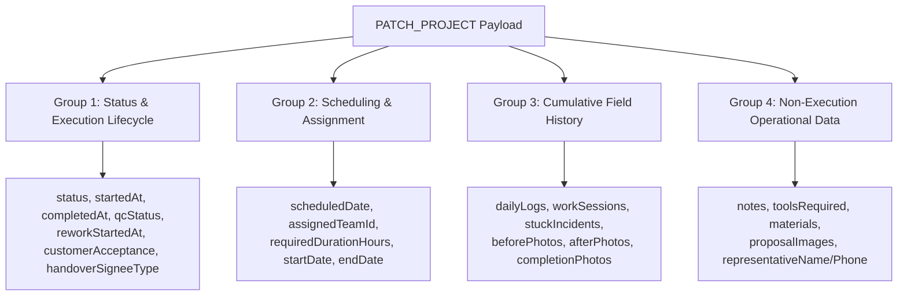
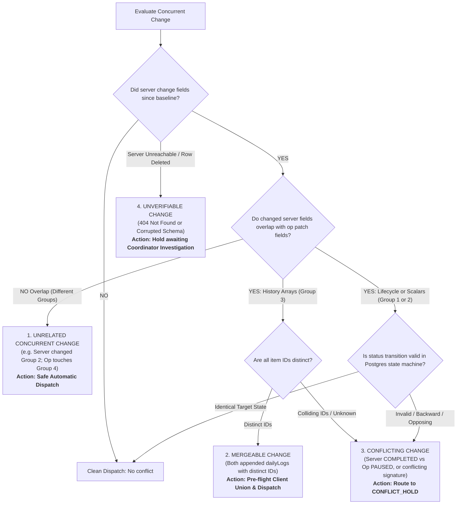
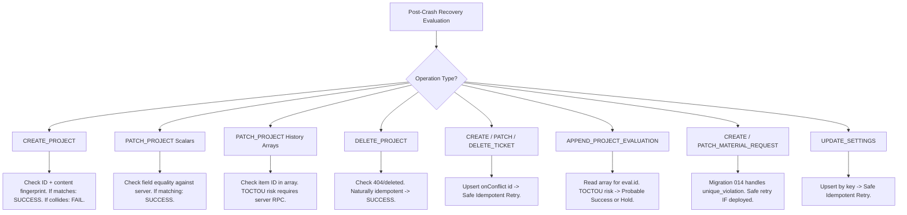
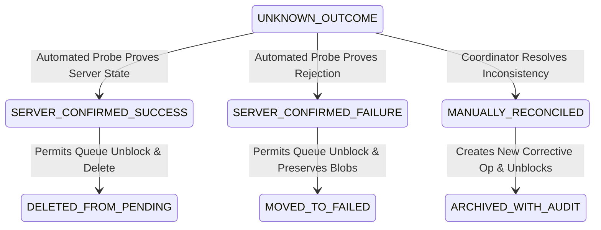

# QC Talaei — Milestone 1-B: Remediation Design v3.2
**Final Targeted Safety Review & Formal Architectural Specification**

**Phase:** Milestone 1-B (Minimal Context Architecture)  
**Document Version:** 3.2 (Final Targeted Safety Review)  
**Investigation Mode:** Strictly READ-ONLY (No code, SQL, database, or dependency modifications)  
**Baseline Test Suite Status:** 325 tests passing across 26 test files (100% pass rate) `[VERIFIED]`  
**Target Files & Migrations Audited:**  
- [`src/utils/offlineQueue.ts`](file:///c:/Users/P30/Desktop/Gravity/talaie/src/utils/offlineQueue.ts) (L80-120, L183-255, L445-515, L980-1185, L1250-1370) `[VERIFIED]`  
- [`src/utils/supabase.ts`](file:///c:/Users/P30/Desktop/Gravity/talaie/src/utils/supabase.ts) (L40-75, L218-226, L670-800, L864-905, L1035-1130, L1250-1370, L1410-1430) `[VERIFIED]`  
- [`src/App.tsx`](file:///c:/Users/P30/Desktop/Gravity/talaie/src/App.tsx) (L220-300, L347-451, L528-614, L745-790, L840-985, L1045-1095, L1510-1565) `[VERIFIED]`  
- [`src/utils/storage.ts`](file:///c:/Users/P30/Desktop/Gravity/talaie/src/utils/storage.ts) (L56-176) `[VERIFIED]`  
- [`src/types/index.ts`](file:///c:/Users/P30/Desktop/Gravity/talaie/src/types/index.ts) (L1-150) `[VERIFIED]`  
- [`supabase/migrations/002_tables.sql`](file:///c:/Users/P30/Desktop/Gravity/talaie/supabase/migrations/002_tables.sql) (L14-25, L215-245, L256-295) `[VERIFIED]`  
- [`supabase/migrations/006_role_guards.sql`](file:///c:/Users/P30/Desktop/Gravity/talaie/supabase/migrations/006_role_guards.sql) (L8-45, L150-185) `[VERIFIED]`  
- [`supabase/migrations/008_multiday_and_admin.sql`](file:///c:/Users/P30/Desktop/Gravity/talaie/supabase/migrations/008_multiday_and_admin.sql) (L10-95, L110-145) `[VERIFIED]`  
- [`supabase/migrations/009_p0_security_teams_and_gates.sql`](file:///c:/Users/P30/Desktop/Gravity/talaie/supabase/migrations/009_p0_security_teams_and_gates.sql) (L377-430) `[VERIFIED]`  
- [`supabase/migrations/010_p1_control_center_capacity_and_sla.sql`](file:///c:/Users/P30/Desktop/Gravity/talaie/supabase/migrations/010_p1_control_center_capacity_and_sla.sql) (L160-210) `[VERIFIED]`  
- [`supabase/migrations/011_p1_server_capacity_and_history_protection.sql`](file:///c:/Users/P30/Desktop/Gravity/talaie/supabase/migrations/011_p1_server_capacity_and_history_protection.sql) (L190-342) `[VERIFIED]`  
- [`supabase/migrations/014_p2_3_material_requests.sql`](file:///c:/Users/P30/Desktop/Gravity/talaie/supabase/migrations/014_p2_3_material_requests.sql) (L50-148) `[VERIFIED]`  

---

## 1. Conflict Detection: Beyond Timestamps

### 1.1 Fatal Limitations of Timestamp-Based Concurrency
`[VERIFIED: src/types/index.ts, supabase/migrations/002_tables.sql L15-25]`
In Remediation Design v3.1, conflict detection relied partly on:
`serverProject.updatedAt > op.baseUpdatedAt`
This condition is fundamentally inadequate in distributed mobile systems:
1. **No Causality Proof:** An updated timestamp merely proves that *some* field in the project changed after the operation's baseline. It does **not** prove that the modified fields conflict with the pending operation.
2. **Clock Skew & Drifts:** Physical mobile devices in field environments suffer from unsynchronized system clocks, manual clock adjustments, and time-zone shifts.
3. **Coarse Resolution:** Multiple edits occurring within the same second or sub-millisecond can produce identical timestamps.
4. **False Conflicts:** If a coordinator corrects a customer address or notes in the office, a field technician's offline shift log would be falsely flagged as conflicted if only timestamps are evaluated.

### 1.2 The Baseline Snapshot & Changed-Field Comparison Model
To achieve deterministic conflict detection, every queued `PATCH_PROJECT` operation must capture a **Baseline Entity Snapshot** at the exact moment `commit()` is invoked:

```typescript
interface BaselineSnapshot {
  capturedAt: string;                       // ISO client timestamp
  serverUpdatedAt: string;                  // Project's updatedAt when read from cloud
  fields: {
    status: ProjectStatus;
    assignedTeamId?: string;
    scheduledDate?: string;
    dailyLogsCount: number;
    workSessionsCount: number;
    customerSignature?: string;
    handoverSigneeType?: string;
    qcStatus?: string;
    lastDailyLogId?: string;
  };
}
```

### 1.3 Correlated Field Groups
Fields in `Project` do not change independently; they belong to functional clusters:



### 1.4 Formal Taxonomy of Concurrent Changes

When a returning user syncs an operation `op` against the live `serverProject`, the client compares `baselineSnapshot`, `op.payload.patch`, and `serverProject`:



#### Detailed Category Specifications:

1. **1. Unrelated Concurrent Change:**  
   *Condition:* The server modified fields in Group 2 (e.g. coordinator updated `scheduledDate` or `assignedTeamId`), while the offline operation touched only Group 4 (e.g. technician updated `notes` or uploaded `proposalImages`).  
   *Resolution:* **Safe Automatic Dispatch.** The patch does not touch any field modified by the server. It executes cleanly without entering conflict hold.
2. **2. Mergeable Change:**  
   *Condition:* Both the server and the offline operation added entries to Group 3 history arrays (e.g. `dailyLogs`), but all entry IDs are mutually distinct (`log.id`).  
   *Resolution:* **Pre-flight Union & Dispatch.** The client combines arrays using ID deduplication and dispatches the unified array. (Note: Client-side union has TOCTOU limitations under simultaneous multi-device writes; see Section 5).
3. **3. Conflicting Change:**  
   *Condition:* Direct semantic contradiction in Group 1:
   - Server status advanced to `COMPLETED`, while `op` attempted `PAUSED` or `IN_PROGRESS`.
   - Server status is `STUCK`, while `op` attempted `COMPLETED` without incident resolution.
   - Server contains a signed `customerAcceptance`, while `op` contains a conflicting signature from a different representative.  
   *Resolution:* **Route to `CONFLICT_HOLD`.** The operation is held intact. No fields are stripped.
4. **4. Unverifiable Change:**  
   *Condition:* Server returns `404 Not Found` (project deleted by manager via `admin_delete_project`), or project row data is unreadable.  
   *Resolution:* **Hold for Investigation.** The operation cannot be executed or reconciled automatically. It is displayed in the Control Center with diagnostic metadata.

---

## 2. Complete Post-Crash Recovery Matrix

This matrix models the exact recovery behavior for **every Outbox operation type supported by the source code** `[VERIFIED: src/utils/supabase.ts L1252-1370, offlineQueue.ts L8-40]` under the post-crash condition:
> *PostgreSQL committed the transaction, but the client process died before receiving or persisting the response.*



### Complete 11-Operation Recovery Matrix:

| # | Operation Type | Semantically Idempotent? | Server Evidence Proving Success | Server Evidence Proving Failure | Read-Only Preflight Sufficient? | Safe to Retry? | Requires Manual Reconciliation? | Requires Future Server Idempotency? |
|---|---|---|---|---|---|---|---|---|
| **1** | `CREATE_PROJECT` `[supabase.ts L773]` | **NO** (raw `insert` throws `23505`) | Project exists with exact matching `project.id` AND matching creation fingerprint (`code`, `address`, `clientPhone`). | Project exists with same `id` but **different** client/order details (ID collision). | **YES** (with fingerprint match) | Safe **ONLY** if preflight proves project does not exist. | If ID collision detected. | **YES** (upsert or ledger RPC). |
| **2** | `PATCH_PROJECT` (Scalars: `notes`, `scheduledDate`) `[supabase.ts L731]` | **YES** (for scalar equality) | Project scalar fields exactly equal patch values. | Project status is in non-editable terminal state (`CANCELLED`, `DELETED`). | **YES** | **YES** (if scalar unchanged on server). | If server scalar was updated by another user. | **YES** (revision-based OCC). |
| **3** | `PATCH_PROJECT` (Arrays: `dailyLogs`, `workSessions`, `photos`) `[supabase.ts L731]` | **NO** (Postgres `||` replaces entire array `[002 L238]`) | Every item ID in patch array exists inside server array. | Project not found or permissions revoked. | **NO (TOCTOU Risk)** | **UNSAFE** (can overwrite concurrent writes). | If array IDs missing and server `updatedAt` advanced. | **CRITICAL: YES** (dedicated array-appending RPCs). |
| **4** | `DELETE_PROJECT` `[supabase.ts L864]` | **YES** (`admin_delete_project` is idempotent) | Server returns 404 Not Found or audit confirms deletion. | Server returns permission denied (non-manager). | **YES** | **YES** | No. | No. |
| **5** | `CREATE_TICKET` `[supabase.ts L1069]` | **YES** (`upsert on conflict id` `[L1085]`) | Ticket with matching `ticket.id` exists. | Foreign key `projectId` does not exist. | **YES** | **YES** | No. | No. |
| **6** | `PATCH_TICKET` `[supabase.ts L1094]` | **YES** (deterministic update) | Ticket fields match patch. | Ticket not found. | **YES** | **YES** | No. | No. |
| **7** | `DELETE_TICKET` `[supabase.ts L1125]` | **YES** (delete by primary key) | Ticket does not exist. | Permission denied. | **YES** | **YES** | No. | No. |
| **8** | `APPEND_PROJECT_EVALUATION` `[supabase.ts L800]` | **NO** (`jsonb_set || array` **always appends** `[002 L281]`) | Evaluation with `evaluation.id` exists in `projects.data->'evaluations'`. | Permission denied (non-manager). | **NO (TOCTOU Race)** | **STRICTLY UNSAFE** (duplicates evaluation). | **YES** (if preflight missing during network flapping). | **CRITICAL: YES** (server-side ID check in SQL). |
| **9** | `CREATE_MATERIAL_REQUEST` `[supabase.ts L1304]` | **CONDITIONAL** (Idempotent in Migration 014 `[014 L126]`; Non-idempotent if 014 unmigrated) | Material request row exists with matching `id`. | Project does not exist, or unmigrated RPC returns `42883`. | **YES** (if 014 deployed) | Safe **ONLY** if Migration 014 is deployed. | If Migration 014 is unverified. | **YES** (requires confirmed migration 014). |
| **10** | `PATCH_MATERIAL_REQUEST` `[supabase.ts L1328]` | **CONDITIONAL** (Requires Migration 014 `[014 L154]`) | Material request reflects patch data. | RPC does not exist or unauthorized. | **YES** | Safe if 014 deployed. | If unmigrated. | **YES**. |
| **11** | `UPDATE_SETTINGS` `[supabase.ts L1299]` | **YES** (upsert single settings row) | Settings table reflects updated keys. | Permission denied. | **YES** | **YES** | No. | No. |

---

## 3. Manual Resolution Safety & Coordinator Audit Integrity

### 4.1 Strict Disambiguation of Resolution States
> [!CAUTION]
> **Audit Integrity Mandate:**  
> A user's or coordinator's manual click in the UI must **NEVER** be recorded as proof that PostgreSQL committed the original transaction. Manual actions represent administrative determinations, not database receipts.

The resolution workflow strictly separates four statuses:



#### Status Definitions & Operational Permissions:

| Resolution Status | Semantic Meaning | Permits Pending Deletion? | Permits Direct Retry? | History & Blobs Preserved? | Permits Queue Unblocking? |
|---|---|---|---|---|---|
| **`SERVER_CONFIRMED_SUCCESS`** | Conclusive cryptographic/database evidence proves PostgreSQL committed the mutation. | **YES** (Immediate delete from `STORE_PENDING`). | **NO** (Already committed). | Storage URLs retained. | **YES** (Unblocks subsequent ops). |
| **`SERVER_CONFIRMED_FAILURE`** | Conclusive evidence proves PostgreSQL rejected the mutation permanently. | **YES** (Moved to `STORE_FAILED`). | **NO** (Cannot succeed). | **YES** (Blobs preserved in `STORE_UPLOADS`). | **YES** (Unblocks subsequent ops). |
| **`MANUALLY_RECONCILED`** | Coordinator reviewed the stranded draft and executed an explicit administrative remedy. | **YES** (Original op retired). | **NO** (Original op never re-sent). | **YES** (Original draft & blobs archived). | **YES** (Unblocks queue). |
| **`UNKNOWN_OUTCOME`** | Outcome on PostgreSQL remains unresolved. | **STRICTLY NO** | **STRICTLY NO** (No blind retry). | **YES** (Full preservation). | **NO** (Key held to preserve causality). |

### 3.2 Audit Attribution of Coordinator Corrective Mutations
`[VERIFIED: supabase/migrations/008_multiday_and_admin.sql L64-92]`
If an operation from Technician A (`userId = "tech-a"`) is stranded in `UNKNOWN_OUTCOME` or `CONFLICT_HOLD`, and the Coordinator (`userId = "coord-1"`) resolves it:
1. **NO FORGED ATTRIBUTION:** The Coordinator must **never** edit or re-dispatch Technician A's original operation using the Coordinator's session token.
2. **Corrective Mutation Creation:**  
   The Coordinator UI spawns a **brand-new, independent Outbox operation**:
   ```typescript
   const correctiveOp: OutboxMutation = {
     type: 'PATCH_PROJECT',
     orderingKey: `project:${projectId}`,
     payload: {
       id: projectId,
       patch: reconciledPatch,
       _auditReason: `رفع تعارض شیفت کاری تکنسین ${techName} توسط مدیر QC (شناسه ارجاع: ${originalOp.id})`,
     },
   };
   ```
3. **Execution & Audit Trail:**  
   - The corrective mutation dispatches under the Coordinator's JWT: `changed_by = "coord-1"`.
   - The PostgreSQL `projects_audit_trigger` logs `"coord-1"` as the actor, with the explicit audit reason referencing `tech-a`'s stranded draft.
   - The original operation in `STORE_PENDING` is updated to `status = 'MANUALLY_RECONCILED'`, referencing `correctiveOpId`, and retired to local archive without deleting photo blobs.

---

## 4. Server-Side Project Revision: Current State & Future OCC Design

### 4.1 Audit of Existing Codebase: Server Revision is NOT FOUND
`[VERIFIED: supabase/migrations/002_tables.sql L14-25, src/types/index.ts L1-788]`
- We conducted an exhaustive search of all SQL migrations and TypeScript types for `revision`, `version`, `_rev`, `etag`, or monotonic sequence numbers on `public.projects`.
- **Finding: NOT FOUND.**
- The deployed schema contains **only**:
  - `projects.updated_at` (PostgreSQL `timestamptz`).
  - `projects.data->>'updatedAt'` (Client-generated ISO 8601 string).
- **Critical Risk:** Because `updated_at` can be set or overwritten by client patches `[VERIFIED: App.tsx L751, L864, L974]`, and because mobile device clocks experience drift, the current application has **zero mathematically sound optimistic concurrency control (OCC)**.

### 4.2 Future Server Revision Design (Post-M1 Database Migrations)
To establish mathematically proven OCC without database locks, future database migrations must introduce an atomic sequence revision:

```sql
-- CONCEPTUAL SPECIFICATION ONLY (Do NOT execute now)
-- 1. Add monotonic revision column to projects
alter table public.projects add column if not exists revision bigint not null default 1;

-- 2. Trigger to increment revision monotonically on every write
create or replace function public.projects_revision_trigger()
returns trigger language plpgsql as $$
begin
  NEW.revision := OLD.revision + 1;
  NEW.updated_at := now();
  return NEW;
end;
$$;
```

#### Client OCC Interaction Contract:
1. When a client reads a project, it captures `serverRevision = project.revision` (e.g. `42`).
2. When dispatching a patch, the client calls `patch_project_v3(id, patch, expected_revision: 42)`.
3. In PostgreSQL:
   ```sql
   if current_revision != p_expected_revision then
     raise exception 'CONCURRENCY_REVISION_MISMATCH: Server is at revision %, expected %',
       current_revision, p_expected_revision using errcode = '40901';
   end if;
   ```
4. This completely eliminates TOCTOU race windows and protects history arrays from silent concurrent overwrites.

---

## 5. Comprehensive Deterministic Test Plan

All tests below are marked `[PROPOSED]` and specify deterministic execution harnesses:

### Test Suite: `src/utils/__tests__/outboxSafetyV3_2.test.ts` `[PROPOSED]`

```typescript
// PROPOSED TEST HARNESS SPECIFICATIONS (Specification Only — Not Executed)

describe('M1-B Outbox Concurrency & Safety Formal Test Suite v3.2', () => {

  // Test 1: User A logout while operation in-flight
  it('[PROPOSED] acknowledges server success in IDB after logout without firing User B UI callbacks', async () => { ... });

  // Test 2: User B login with User A pending operations
  it('[PROPOSED] keeps User A operations dormant when User B logs in, dispatching zero foreign requests', async () => { ... });

  // Test 3: Conclusive server commit with lost response (Crash recovery)
  it('[PROPOSED] resolves CREATE_PROJECT on post-crash restart using fingerprint verification on 23505', async () => { ... });

  // Test 4: Request pending indefinitely (Watchdog diagnostic)
  it('[PROPOSED] triggers watchdog diagnostic alert at 45s without releasing lock or authorizing retry', async () => { ... });

  // Test 5: Local AbortSignal firing after server receipt
  it('[PROPOSED] handles local abort by moving operation to UNKNOWN_OUTCOME without corrupting queue', async () => { ... });

  // Test 6A: JavaScript Model Simulation of Concurrent Array Loss
  it('[PROPOSED] demonstrates that client-side union fails to protect history under concurrent writes', async () => {
    // Proves client-side union loses log-1 when Client 1 and Client 2 read log-0 and write concurrently
  });

  // Test 6B: PostgreSQL Integration Simulation of Concurrent patch_project
  it('[PROPOSED] proves PostgreSQL patch_project JSONB concatenation overwrites concurrent client patches', async () => {
    // Simulates two concurrent transactions executing 'update projects set data = current || patch'
    // Demonstrates that transaction 2 completely overwrites transaction 1 array data in PostgreSQL
  });

  // Test 7: Conflicting completion and shift pause (SHIFT_CONFLICT)
  it('[PROPOSED] routes operation to CONFLICT_HOLD when baseline snapshot conflicts with advanced server state', async () => { ... });

  // Test 8: Realtime events arriving after session switch
  it('[PROPOSED] drops Realtime change events whose sessionEpoch does not match active AuthContext epoch', async () => { ... });

  // Test 9: Failed operation isolation between users
  it('[PROPOSED] isolates STORE_FAILED blockedKeys strictly to currentUserId, preventing cross-user starvation', async () => { ... });

  // Test 10: Complete Authorization Verification Across All 20 Call Sites
  it('[PROPOSED] verifies BOTH authorized success and unauthorized rejection across all 20 mutation paths', async () => {
    // 10A: Unauthorized role calls -> Verifies role guard throws error; SyncContext.enqueue NEVER called
    // 10B: Authorized role calls -> Verifies role guard passes; OutboxMutation constructed and enqueued
  });

  // Test 11: Unrelated Concurrent Scalar Updates
  it('[PROPOSED] automatically applies non-overlapping concurrent changes without triggering CONFLICT_HOLD', async () => {
    // Baseline: { status: 'IN_PROGRESS', scheduledDate: '1403-08-01', notes: 'Old' }
    // Server changed Group 2: scheduledDate -> '1403-08-02'
    // Op changed Group 4: notes -> 'Updated by technician'
    // Assert: Detected as UNRELATED_CONCURRENT_CHANGE; dispatches cleanly without conflict hold
  });

  // Test 12: Coordinator Reconciliation and Audit Attribution
  it('[PROPOSED] creates a new corrective mutation with coordinator identity when resolving stranded shift', async () => {
    // Stranded op belongs to tech-a in CONFLICT_HOLD
    // Coordinator coord-1 executes "Merge History"
    // Assert: New corrective mutation has userId = 'coord-1' and auditReason referencing tech-a
    // Assert: Original op is marked MANUALLY_RECONCILED and retired without forged identity
  });

  // Test 13: Browser Crash After Server Commit (All 11 Types)
  it('[PROPOSED] evaluates post-crash restart recovery matrix across all 11 supported operation types', async () => {
    // Iterates through all 11 operation types
    // Simulates server committed state vs uncommitted state
    // Verifies correct classification: Conclusive Success, Safe Retry, or Manual Reconciliation
  });

});
```

---

## 6. Final Implementation Boundary & Readiness Verdict

### 6.1 What Can Safely Be Implemented in Frontend Without Database Changes `[VERIFIED]`
The following frontend engineering scope is **100% safe to implement immediately**:
1. **User Identity Boundary:** Enforce `op.userId === currentUserId` strictly; foreign operations stay dormant.
2. **Explicit Operation States:** Implement `QUEUED`, `IN_FLIGHT`, `CONFIRMED_SUCCESS`, `CONFIRMED_FAILURE`, `UNKNOWN_OUTCOME`, `CONFLICT_HOLD`.
3. **In-Memory Concurrency Lease:** Implement `activeLeases` with 45s diagnostic watchdog timers (no premature timer retries).
4. **Baseline Snapshot Conflict Detection:** Classify changes into *Unrelated*, *Mergeable*, *Conflicting*, and *Unverifiable*.
5. **Physical Photo Blob Preservation:** Prevent deletion of `STORE_UPLOADS` on failed, unknown, or held operations.
6. **Runtime-Only `sessionEpoch` in `AuthContext`:** Discard stale Realtime events and UI callbacks after session switches.
7. **Three-Tier Mutation Architecture:** Implement `useProjectMutations`, `useTicketMutations`, `useMaterialMutations`, preserving all 20 guarded call sites.
8. **Audit-Safe Coordinator Reconciliation:** Ensure coordinator corrective actions create new, separately identified operations.

### 6.2 What Frontend-Only Code CANNOT Guarantee
> [!IMPORTANT]
> **Definitive Architectural Disclaimers:**  
> The frontend implementation **CANNOT** guarantee:
> 1. **Mathematical Exactly-Once Execution:** Under severe network drops during non-idempotent operations (`append_project_evaluation`), client-side preflight reads cannot eliminate TOCTOU race windows without a server-side `outbox_operations_ledger`.
> 2. **Atomic Multi-Device Array Merging:** If two mobile devices patch the same project online simultaneously, PostgreSQL `data = current_data || patch` will overwrite one array unless atomic server-side RPCs (`append_project_daily_log`) are deployed.
> 3. **Server-Side Audit Correctness for Unverified Dispatches:** A client cannot guarantee audit attribution if an operation is dispatched under a foreign JWT. (Resolved by Rule 1).

---

### 6.3 Final Readiness Verdict

1. **Can Milestone 1-B frontend implementation begin now?**  
   **YES.** The frontend architecture specified in Section 6.1 is completely sound, consistent, and safe to implement. It eliminates all identified outbox concurrency races, ghost retries, foreign session executions, and state leakage without modifying the database.
2. **Which guarantees remain bounded until future database migrations?**  
   True network-level idempotency for evaluation retries and atomic multi-device array merging remain bounded by PostgreSQL's current schema until Post-M1 database migrations deploy the `outbox_operations_ledger` and atomic history RPCs.
3. **Can Context extraction begin before Outbox safety is complete?**  
   **NO.** Context extraction must strictly follow the Outbox engine hardening.
