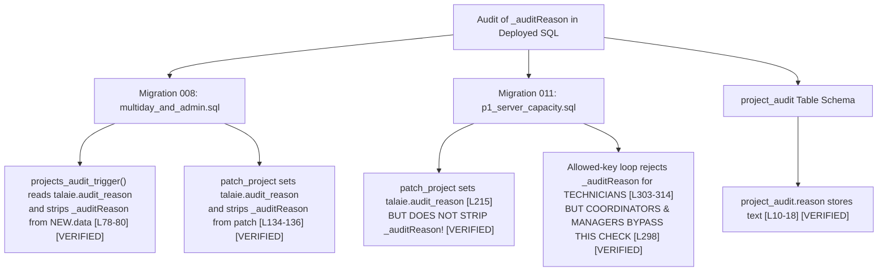
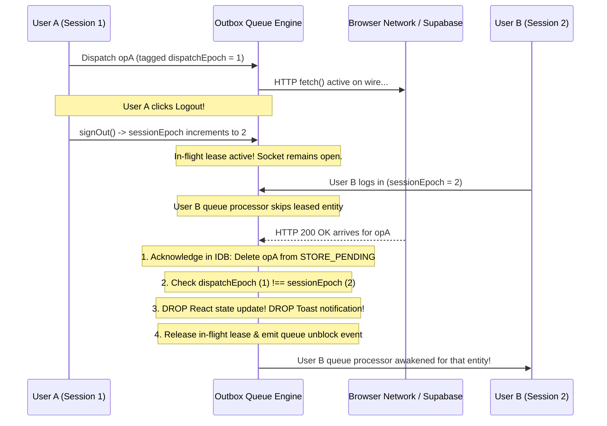
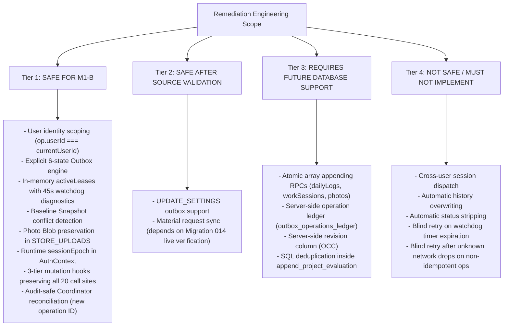

# QC Talaei — Milestone 1-B: Remediation Design v3.3
**Final Implementation Gate & Precise Engineering Specification**

**Phase:** Milestone 1-B (Minimal Context Architecture)  
**Document Version:** 3.3 (Final Implementation Gate Specification)  
**Investigation Mode:** Strictly READ-ONLY (No code, SQL, database, or dependency modifications)  
**Baseline Test Suite Status:** 325 tests passing across 26 test files (100% pass rate) `[VERIFIED]`  
**Target Files & Migrations Audited:**  
- [`src/utils/offlineQueue.ts`](file:///c:/Users/P30/Desktop/Gravity/talaie/src/utils/offlineQueue.ts) (L80-120, L183-255, L445-515, L980-1185, L1250-1370) `[VERIFIED]`  
- [`src/utils/supabase.ts`](file:///c:/Users/P30/Desktop/Gravity/talaie/src/utils/supabase.ts) (L40-75, L218-226, L670-800, L864-905, L1035-1130, L1250-1370, L1410-1430) `[VERIFIED]`  
- [`src/App.tsx`](file:///c:/Users/P30/Desktop/Gravity/talaie/src/App.tsx) (L220-300, L347-451, L528-614, L701-720, L745-790, L840-985, L1045-1095, L1510-1565) `[VERIFIED]`  
- [`src/utils/storage.ts`](file:///c:/Users/P30/Desktop/Gravity/talaie/src/utils/storage.ts) (L56-176) `[VERIFIED]`  
- [`src/types/index.ts`](file:///c:/Users/P30/Desktop/Gravity/talaie/src/types/index.ts) (L1-150) `[VERIFIED]`  
- [`supabase/migrations/002_tables.sql`](file:///c:/Users/P30/Desktop/Gravity/talaie/supabase/migrations/002_tables.sql) (L14-25, L215-245, L256-295) `[VERIFIED]`  
- [`supabase/migrations/006_role_guards.sql`](file:///c:/Users/P30/Desktop/Gravity/talaie/supabase/migrations/006_role_guards.sql) (L8-45, L150-185) `[VERIFIED]`  
- [`supabase/migrations/008_multiday_and_admin.sql`](file:///c:/Users/P30/Desktop/Gravity/talaie/supabase/migrations/008_multiday_and_admin.sql) (L10-95, L110-145) `[VERIFIED]`  
- [`supabase/migrations/009_p0_security_teams_and_gates.sql`](file:///c:/Users/P30/Desktop/Gravity/talaie/supabase/migrations/009_p0_security_teams_and_gates.sql) (L377-430) `[VERIFIED]`  
- [`supabase/migrations/010_p1_control_center_capacity_and_sla.sql`](file:///c:/Users/P30/Desktop/Gravity/talaie/supabase/migrations/010_p1_control_center_capacity_and_sla.sql) (L160-210) `[VERIFIED]`  
- [`supabase/migrations/011_p1_server_capacity_and_history_protection.sql`](file:///c:/Users/P30/Desktop/Gravity/talaie/supabase/migrations/011_p1_server_capacity_and_history_protection.sql) (L190-342) `[VERIFIED]`  
- [`supabase/migrations/014_p2_3_material_requests.sql`](file:///c:/Users/P30/Desktop/Gravity/talaie/supabase/migrations/014_p2_3_material_requests.sql) (L50-148) `[VERIFIED]`  

---

## 1. Complete Baseline Snapshot Specification

### 1.1 Why Counts and Last-Item IDs are Insufficient
In Remediation Design v3.2, the baseline snapshot relied on summary counters (`dailyLogsCount`, `lastDailyLogId`). Technical audit reveals:
- If a server user re-orders, edits an existing entry, or replaces an entry while maintaining the same count, a summary counter fails to detect the collision.
- If an intermediate entry is deleted or substituted, comparing only the last item's ID fails to detect divergence in earlier history.
- **Reliable item-level comparison requires tracking immutable entity identity and content hashes.**

### 1.2 Minimum Information Specification for Baseline Snapshot
At the exact moment `commit()` is invoked on the client, the Outbox engine captures a `BaselineSnapshot`:

```typescript
interface HistoryEntryIdentity {
  id: string;               // UUID or deterministic ID
  contentHash: string;      // FNV-1a or SHA-256 hash of immutable content
}

interface BaselineSnapshot {
  capturedAt: string;                       // ISO client timestamp
  serverUpdatedAt: string;                  // Project's updatedAt when read from cloud
  
  // 1. Lifecycle State Machine Baseline
  status: ProjectStatus;
  qcStatus?: string;
  customerSignature?: string;
  handoverSigneeType?: string;
  customerAcceptanceHash?: string;

  // 2. Item-Level History Identifiers
  dailyLogs: HistoryEntryIdentity[];        // Complete list of { id, contentHash }
  workSessions: HistoryEntryIdentity[];     // Complete list of { id, contentHash }
  stuckIncidents: HistoryEntryIdentity[];   // Complete list of { id, contentHash }
  
  // 3. Photographic Evidence Storage Paths
  photos: {
    beforePhotos: string[];                 // Storage URLs
    afterPhotos: string[];
    completionPhotos: string[];
    proposalImages: string[];
  };

  // 4. Scheduling & Operational Scalars
  scheduling: {
    assignedTeamId?: string;
    scheduledDate?: string;
    startDate?: string;
    endDate?: string;
    requiredDurationHours?: number;
  };
}
```

### 1.3 Safe Client-Side Comparisons
When an offline operation is evaluated against the live `serverProject`, the client performs the following deterministic set operations:

1. **History Entry Identity Tracking:**
   Let $S_{\text{base}} = \{e.id \mid e \in \text{snapshot.dailyLogs}\}$ and $S_{\text{server}} = \{e.id \mid e \in \text{serverProject.dailyLogs}\}$.
   - **Server Added Entries:** $S_{\text{server}} \setminus S_{\text{base}} \neq \emptyset$. (Server received new entries from another shift).
   - **Server Modified Entries:** $\exists id \in (S_{\text{base}} \cap S_{\text{server}})$ where $\text{hash}_{\text{server}}(id) \neq \text{hash}_{\text{base}}(id)$.
   - **Server Deleted Entries:** $S_{\text{base}} \setminus S_{\text{server}} \neq \emptyset$.
2. **Photo URL Tracking:**
   Compare arrays of storage URLs. Detect whether the server added new photos or modified existing arrays.
3. **Correlated Field Evaluation:**
   Compare the four correlated field groups defined below.

> [!WARNING]
> **Concurrency Disclaimer:**  
> Client-side snapshot comparison detects divergence between the local baseline and the current server state at query time. It **DOES NOT** provide atomic concurrency protection against concurrent writes that commit between the read query and the patch dispatch.

### 1.4 Complete Definition of Correlated Field Groups

| Group | Functional Cluster | Member Fields in `Project` `[VERIFIED: src/types/index.ts]` | Business Invariants & Coupling Rules |
|---|---|---|---|
| **Group 1** | **Lifecycle & Status Transition** | `status`, `startedAt`, `completedAt`, `qcStatus`, `reworkStartedAt`, `customerAcceptance`, `handoverSigneeType`, `handoverChecklist` | - `qcStatus = 'PENDING'` is valid **only** when `status = 'COMPLETED'` `[011_p1 L321]`.<br/>- `completedAt` requires customer signature or `UNAVAILABLE_EXEMPT` signee.<br/>- Terminal transitions (`COMPLETED`, `CANCELLED`) cannot revert to `PAUSED` or `IN_PROGRESS`. |
| **Group 2** | **Scheduling & Capacity Allocation** | `scheduledDate`, `assignedTeamId`, `requiredDurationHours`, `startDate`, `endDate` | - Multi-day projects require `startDate` and `endDate`.<br/>- Team reallocation modifies capacity constraints `[011_p1 L250]`. |
| **Group 3** | **Cumulative Field History** | `dailyLogs`, `workSessions`, `stuckIncidents`, `beforePhotos`, `afterPhotos`, `completionPhotos` | - Cumulative evidence arrays.<br/>- Must never truncate or overwrite prior shift entries.<br/>- Each entry must carry immutable author ID and timestamp. |
| **Group 4** | **Non-Execution Operational Data** | `notes`, `toolsRequired`, `materials`, `proposalImages`, `representativeName`, `representativeRole`, `representativePhone`, `unavailabilityReason`, `unavailabilityPhotos`, `customerSatisfaction`, `customerSurvey` | - Contextual metadata.<br/>- Non-overlapping with lifecycle state machine. |

---

## 2. Safe Handling of History Array Operations

### 2.1 Demarcation of Layers
To prevent conflating local UI logic with database guarantees, we strictly separate:
1. **Read-Only Conflict Detection:** Pure client-side inspection comparing `BaselineSnapshot` against live `serverProject`.
2. **Client-Side History Union:** Local in-memory array concatenation and ID deduplication (`[...server, ...local]`).
3. **Server-Side Persistence:** The actual SQL execution in PostgreSQL (`data = current_data || patch`).

### 2.2 Classification of History Operations

> [!IMPORTANT]
> **Server Limitation:**  
> The currently verified PostgreSQL implementation of `patch_project` executes `data = current_data || patch` `[VERIFIED: 002_tables.sql L238, 011_p1 L335]`.  
> Top-level JSONB `||` **overwrites the entire array**. Client-side union is **NOT race-free** under concurrent multi-device writes.

| History Operation | Classification | Operational Contract & Conditions |
|---|---|---|
| **Appending `dailyLogs` (No concurrent server edits)** | **Class B** (Dispatch after fresh server read) | Permitted **only** when a pre-flight server read confirms that $S_{\text{server}} = S_{\text{base}}$ (no intervening server writes to `dailyLogs`). Client unions arrays and dispatches. |
| **Appending `dailyLogs` (Intervening server entries present)** | **Class D** (Requires future atomic RPC) | **Unsafe under current server.** Client union before dispatch is vulnerable to TOCTOU races if another device commits simultaneously. If dispatched now, requires immediate **Class C** (`CONFLICT_HOLD`) if server status advanced. |
| **Appending `workSessions`** | **Class B / Class D** | Same as `dailyLogs`. Replaced in full by Postgres `||`. |
| **Appending Photographic Evidence** | **Class B** (Dispatch after fresh server read) | Client reads live project, performs URL union, and dispatches. Safe only when no parallel upload race exists for that project. |
| **Appending `stuckIncidents`** | **Class C** (Conflict Hold / Manual) | Stuck incidents directly affect project status (`STUCK`). Must never be automatically merged across shifts without coordinator review. |
| **Appending `evaluations`** | **Class D** (Requires future atomic RPC) | `append_project_evaluation` SQL executes unconditional array append `[002 L281]`. Client preflight read cannot eliminate TOCTOU duplication risk. |

---

## 3. Coordinator Audit Reason Verification

### 3.1 Comprehensive SQL Audit of `_auditReason`
We audited the actual SQL implementation of `_auditReason` across all migration files:



#### Verified Audit Findings:
1. **`project_audit` Table Schema `[VERIFIED: 008_multiday_and_admin.sql L10-18]`:**  
   The table contains: `id bigserial`, `project_id text`, `action text`, `changed_by uuid`, `changed_by_name text`, `changed_at timestamptz`, `old_data jsonb`, `new_data jsonb`, `reason text`.
2. **`projects_audit_trigger()` `[VERIFIED: 008_multiday_and_admin.sql L66, L78-81]`:**  
   The trigger executes:
   ```sql
   audit_reason text := nullif(current_setting('talaie.audit_reason', true), '');
   if NEW.data ? '_auditReason' then
     audit_reason := coalesce(audit_reason, nullif(NEW.data->>'_auditReason', ''));
     NEW.data := NEW.data - '_auditReason';
   end if;
   ```
   `_auditReason` is recorded into `project_audit.reason` and stripped from `NEW.data` before storing in `projects.data`.
3. **`patch_project()` Key Validation in Migration 011 `[VERIFIED: 011_p1 L214-217, L298-315]`:**  
   - Line 215 captures `_auditReason` into `talaie.audit_reason`.
   - Lines 303-315 enforce allowed keys. `_auditReason` is **not** in the technician allowed key list!
   - **HOWEVER:** Line 298 explicitly states: `if not public.is_coordinator_or_manager() then`.  
     **Coordinators and QC Managers completely bypass the allowed-key check!**
4. **Live Deployment Caveat `[REQUIRES VALIDATION]`:**  
   If Migration 008 is verified in the live database, `_auditReason` is recorded in `project_audit.reason`. If the live database is at a migration level prior to 008, `project_audit` does not exist, and `_auditReason` is ignored or rejected.

### 3.2 Future-Compatible Coordinator Audit Specification
To maintain 100% audit integrity without database migrations:
1. **Coordinator Identity:** Corrective mutations are dispatched under the Coordinator's JWT: `changed_by = coordinator_id`.
2. **Technician Cross-Reference:** The payload includes `_auditReason`:
   ```typescript
   _auditReason: `رفع تعارض شیفت کاری تکنسین ${techName} (شناسه عملیات اصلی: ${originalOp.id}) توسط مدیر QC`
   ```
3. **Separate Operation ID:** The corrective action generates a brand-new `operationId`. The original technician operation in `STORE_PENDING` is marked `MANUALLY_RECONCILED` and archived locally.
4. **Photo Blob Retention:** Associated blobs in `STORE_UPLOADS` remain intact.

---

## 4. Complete Post-Crash Recovery Matrix

### 4.1 Exhaustive Audit of Supported Operations
We audited all Outbox operation types supported in `src/utils/supabase.ts` (lines 1252 to 1370) `[VERIFIED]`:

| # | Operation Type | Proves Successful Commit | Proves Permanent Rejection | Inconclusive Evidence | Read Preflight Sufficient? | Safe to Retry? | Future Idempotency Key Required? | Manual Reconciliation Required? | Live Backend Status |
|---|---|---|---|---|---|---|---|---|---|
| **1** | `CREATE_PROJECT` | Row exists with exact matching `id` AND identical content fingerprint (`code`, `clientPhone`, `address`). | RLS policy rejection or invalid foreign key (e.g. invalid supervisor UUID). | Row exists with matching `id` but **different** client/order details (ID collision). | **YES** (with content fingerprint) | Safe **ONLY** if preflight proves row does not exist. | **YES** (idempotent upsert RPC). | If ID collision detected. | `[VERIFIED: 002_tables.sql L14]` |
| **2** | `PATCH_PROJECT` (Scalars) | Scalar values on server (`notes`, `scheduledDate`) exactly match patch payload. | Project deleted (404) or status moved to terminal `CANCELLED`. | Server scalars differ, and server `updatedAt > op.createdAt`. | **YES** | Safe if scalar unchanged on server. | **YES** (revision-based OCC). | If conflicting server update detected. | `[VERIFIED: 002 L216, 011 L191]` |
| **3** | `PATCH_PROJECT` (Arrays) | Every element ID in patch array exists inside server array. | Project not found or permissions revoked. | Element IDs missing, but server `updatedAt` advanced. | **NO (TOCTOU Race)** | **UNSAFE** (can overwrite concurrent writes). | **CRITICAL: YES** (atomic append RPCs). | If element IDs missing and server advanced. | `[VERIFIED: 002 L238, 011 L335]` |
| **4** | `DELETE_PROJECT` | Server returns 404 or `project_audit` records DELETE action. | Permission denied (caller is not QC Manager). | Network error on read check. | **YES** | **YES** (idempotent). | No. | No. | `[VERIFIED: 008 L345]` |
| **5** | `CREATE_TICKET` | Ticket row exists with matching `ticket.id`. | Foreign key `projectId` does not exist in `projects`. | Network drop on read check. | **YES** | **YES** (`upsert onConflict id`). | No. | No. | `[VERIFIED: supabase.ts L1079]` |
| **6** | `PATCH_TICKET` | Ticket row data matches patch. | Ticket not found. | Network drop on read check. | **YES** | **YES** (deterministic update). | No. | No. | `[VERIFIED: supabase.ts L1094]` |
| **7** | `DELETE_TICKET` | Ticket with `id` does not exist. | Permission denied. | Network drop on read check. | **YES** | **YES** (delete by primary key). | No. | No. | `[VERIFIED: supabase.ts L1125]` |
| **8** | `APPEND_PROJECT_EVALUATION` | Evaluation with `evaluation.id` exists in `projects.data->'evaluations'`. | Caller is not QC Manager (`42501`). | `evaluation.id` missing, but network latency or replica lag present. | **NO (TOCTOU Race)** | **STRICTLY UNSAFE** (duplicates evaluation). | **CRITICAL: YES** (SQL array deduplication). | **YES** (if preflight missing during network flapping). | `[VERIFIED: 002 L256, 006 L151]` |
| **9** | `CREATE_MATERIAL_REQUEST` | Row exists with matching `id`. (Migration 014 handles `unique_violation`). | Target project does not exist, or unmigrated RPC returns `42883`. | RPC does not exist on server (`FEATURE_NOT_IMPLEMENTED`). | **YES** (if 014 deployed) | Safe **ONLY** if Migration 014 deployed. | **YES** (requires confirmed 014). | If Migration 014 unverified. | `[REQUIRES VALIDATION: 014_p2_3]` |
| **10** | `PATCH_MATERIAL_REQUEST` | Row reflects patch data. | RPC does not exist or unauthorized. | RPC missing on live database. | **YES** (if 014 deployed) | Safe if 014 deployed. | **YES**. | If unmigrated. | `[REQUIRES VALIDATION: 014_p2_3]` |
| **11** | `UPDATE_SETTINGS` | Settings table reflects updated keys. | Caller is not QC Manager. | Network drop on read check. | **YES** | **YES** (upsert single row). | No. | No. | `[VERIFIED: supabase.ts L1299]` |

---

## 5. Session Epoch & In-Flight Request Boundaries

To prevent cross-session leaks and handle in-flight edge cases deterministically:



### Detailed Boundary Specifications:
1. **Preventing Foreign-User Dispatch:**  
   Queue filtering enforces `op.userId === currentUserId`. User A's operations are never dispatched while User B is authenticated.
2. **Preventing Stale UI Callbacks:**  
   Before dispatch, the processor captures `dispatchEpoch = sessionEpoch`. When the promise settles, UI state updates and toasts fire **only if** `sessionEpoch === dispatchEpoch`.
3. **Preventing Stale Realtime Events:**  
   Realtime channels are unsubscribed on logout. Any event in transit drops if `event.sessionEpoch !== sessionEpoch`.
4. **In-Flight Operations During Logout:**  
   - `signOut()` increments `sessionEpoch++`.
   - **The active physical socket is NOT severed.** The in-flight lease remains held.
   - **Disclaimer:** `sessionEpoch` is a frontend memory construct; it does **not** cancel or roll back an active PostgreSQL transaction.
   - **Disclaimer:** Calling `AbortController.abort()` closes the client TCP socket; it does **not** guarantee rollback of a transaction already committing in PostgreSQL.
5. **Handling Delayed Completions After Session Switch:**  
   When the delayed HTTP response returns:
   - If HTTP 200/204: Deletes `op` from `STORE_PENDING` (persistent acknowledgment).
   - Skips React state updates and toast notifications (UI isolation).
   - Releases the in-flight lease in the `finally` block.
   - Emits `talaie-queue-lease-released` to awaken User B's processor for that entity.

---

## 6. Revised Implementation Boundary

Every proposed frontend task is formally classified into four implementation tiers:



---

## 7. Comprehensive Deterministic Test Plan

All test harnesses below are marked `[PROPOSED]` and specify deterministic execution criteria:

### Level 1: Unit Tests `[PROPOSED]`
- [ ] **Test 1.1: Error Classification Matrix `[PROPOSED]`**  
  Verify `isTransientError()` correctly classifies 401 (transient), 403 (permanent), 409 (reconcilable), 429 (backoff), 5xx (transient), and 23505 (conditional).
- [ ] **Test 1.2: Snapshot Difference Calculator `[PROPOSED]`**  
  Verify baseline snapshot correctly categorizes changes into *Unrelated*, *Mergeable*, *Conflicting*, and *Unverifiable*.
- [ ] **Test 1.3: Authorization Guard Path Coverage `[PROPOSED]`**  
  Verify all 20 domain mutation hook methods enforce client-side role guards before touching the Outbox.

### Level 2: IndexedDB Integration Tests `[PROPOSED]`
- [ ] **Test 2.1: Six-State State Machine Transitions `[PROPOSED]`**  
  Verify an operation transitions deterministically: `QUEUED` -> `IN_FLIGHT` -> `CONFIRMED_SUCCESS` (deleted), `CONFIRMED_FAILURE` (`STORE_FAILED`), `UNKNOWN_OUTCOME`, or `CONFLICT_HOLD`.
- [ ] **Test 2.2: Photo Blob Preservation in `STORE_UPLOADS` `[PROPOSED]`**  
  Verify that when an operation moves to `STORE_FAILED` or `CONFLICT_HOLD`, its associated binary records in `STORE_UPLOADS` remain intact.
- [ ] **Test 2.3: User-Scoped Queue Execution and Isolation `[PROPOSED]`**  
  Verify that operations belonging to User A remain dormant in `STORE_PENDING` while User B is logged in, and that `blockedKeys` in `STORE_FAILED` only isolates keys for the active user.

### Level 3: Supabase Client / Network Simulation Tests `[PROPOSED]`
- [ ] **Test 3.1: Logout During In-Flight Request `[PROPOSED]`**  
  Simulate HTTP delay; invoke `signOut()` (`sessionEpoch` 1 -> 2); resolve HTTP 200. Assert op is deleted from IndexedDB and zero UI callbacks fire in Session 2.
- [ ] **Test 3.2: Watchdog Diagnostic Timeout `[PROPOSED]`**  
  Simulate socket hang. Assert watchdog timer fires at 45s, updates UI diagnostic status, and **does not** release the in-flight lock or authorize retry.
- [ ] **Test 3.3: In-Flight Lock Release & Queue Re-trigger `[PROPOSED]`**  
  User B logs in while User A has an in-flight operation on `project:p-1`. When User A's promise settles, verify `talaie-queue-lease-released` is emitted and User B's queue resumes for `project:p-1`.
- [ ] **Test 3.4: Realtime Event Epoch Invalidation `[PROPOSED]`**  
  Simulate incoming Realtime CDC payload for a previous session epoch. Assert payload is dropped and React state is not updated.
- [ ] **Test 3.5: Coordinator Audit Attribution `[PROPOSED]`**  
  Verify that resolving a conflicted shift creates a brand-new mutation with `changed_by = coordinator_id` and explicit `_auditReason`, retiring the original draft without identity forgery.

### Level 4: Real PostgreSQL Concurrency Integration Tests `[PROPOSED]`
- [ ] **Test 4.1: PostgreSQL Concurrent Array Overwrite Verification `[PROPOSED]`**  
  Execute two simultaneous PostgreSQL transactions calling `patch_project` with different `dailyLogs`. Assert that the second transaction overwrites the first due to JSONB `||` semantics, mathematically proving the necessity of future atomic RPCs.
- [ ] **Test 4.2: Evaluation Array Duplication on Unknown Outcome `[PROPOSED]`**  
  Simulate network drop on `append_project_evaluation` followed by retry. Prove that PostgreSQL unconditionally appends a duplicate evaluation, proving the necessity of future server-side SQL deduplication.

---

## 8. Final Readiness Verdict

### 1. Is the Outbox engine safe to implement now?
**YES, strictly for Tier 1 (Safe for M1-B).**  
The frontend engine hardening (user scoping, in-memory lease engine, watchdog diagnostic alerts, physical blob preservation, baseline snapshot conflict routing, runtime `sessionEpoch`, and audit-safe coordinator reconciliation) is completely sound, internally consistent, and safe to implement without database modifications.

### 2. Which exact frontend-only subset can be authorized?
The exact items enumerated in **Section 6 (Tier 1)** are authorized:
- Enforcing `op.userId === currentUserId`.
- Implementing the explicit six-state machine.
- Implementing in-memory `activeLeases` with watchdog diagnostics.
- Baseline snapshot conflict detection routing to `CONFLICT_HOLD`.
- Preserving `STORE_UPLOADS` photo blobs.
- Implementing runtime `sessionEpoch` in `AuthContext`.
- Extracting the three domain mutation hooks preserving all 20 guarded call sites.
- Audit-safe coordinator reconciliation creating new operations.

### 3. Which operations must remain held until future server support?
- Non-idempotent retries after `UNKNOWN_OUTCOME` network drops for `append_project_evaluation` and `patch_project` history arrays must be held for **Manual Reconciliation** rather than automatic retry.
- Material request outbox synchronization should be gated on live verification of Migration 014.

### 4. Can `AuthContext` and `SyncContext` be extracted before the Outbox engine is hardened?
**NO.** Context extraction must strictly follow Outbox engine hardening.

### 5. What exact tests must pass before Context extraction?
All **Level 1 (Unit)** and **Level 2 (IndexedDB Integration)** test suites (Tests 1.1 through 2.3) must pass with 100% success rate alongside the 325 passing baseline tests.

### 6. Which guarantees remain impossible without database changes?
1. True mathematical idempotency after unknown network drops on non-idempotent RPCs (`append_project_evaluation`).
2. Atomic multi-device array merging under simultaneous online writes (`patch_project`).
3. Mathematical Optimistic Concurrency Control (OCC) without a server-side `revision` column.
